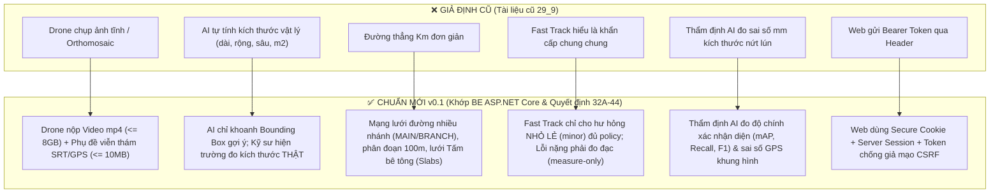

# BẢNG PHÂN TÍCH KHÁC BIỆT & KẾ HOẠCH ĐIỀU CHỈNH FRONTEND WEB (PM & SUPERVISOR) THEO TÀI LIỆU CHUẨN V0.1

> **Tài liệu kỹ thuật nội bộ (SSOT điều chỉnh giao diện Web)**  
> **Áp dụng cho:** Frontend Web Dashboard (Nhà thầu Hoàng Hải) — 2 vai trò: **Project Manager (PM)** & **Supervisor (SUP)**.  
> **Lưu ý đặc biệt:** Đã **loại trừ hoàn toàn phạm vi của Reporter** (chức năng phản ánh người dân thuộc ứng dụng Mobile, Web văn phòng không phụ trách).  
> **Căn cứ đối chiếu:** Bộ tài liệu `RoadGuard-Project-Docs-v0.1` kết nối trực tiếp với Backend ASP.NET Core Official và các Quyết định chủ dự án 32A – 44.

---

## 📌 I. TỔNG QUAN 6 ĐIỂM CHUYỂN DỊCH BẢN CHẤT (CORE PARADIGM SHIFTS)

Khi đối chiếu giữa thiết kế Web hiện tại (theo tài liệu cũ 29_9) và bộ tài liệu hệ thống chuẩn v0.1, có **6 thay đổi bản chất về mặt kỹ thuật & nghiệp vụ** cần được điều chỉnh trên Web:



---

## 📋 II. CHI TIẾT CÁC ĐIỂM CẦN ĐIỀU CHỈNH THEO TỪNG MÀN HÌNH WEB

---

### 1. Màn hình Tạo Khảo Sát & Quản Lý Bay Drone (`/pm/surveys/create` & `/pm/surveys`)

* **Hiện trạng trên Web:**
  * Form yêu cầu bay chỉ chọn độ cao bay, cọc Km, ngày bay; giả định Drone nộp về các tệp ảnh trực giao hoặc gói ảnh tĩnh đơn lẻ.
* **Quy chuẩn mới v0.1 (`01_FRD_SRS_Project.md - RG-SURVEY`, Quyết định 38):**
  * Tác vụ khảo sát Drone phân công theo **phân đoạn tuyến (`segment`)**.
  * Dữ liệu bay nộp về bắt buộc gồm: **Tệp Video chất lượng cao ($mp4$, dung lượng tối đa $8\text{ GiB}$)** và **Tệp phụ đề viễn thám ($SRT / telemetry$, tối đa $10\text{ MiB}$)** chứa GPS timecode từng giây.
  * Hỗ trợ cơ chế tải lên có thể tạm dừng/tiếp tục (**Resumable Upload**), hiển thị mã băm kiểm tra toàn vẹn (`checksum / progress / resume / cancel`).
* **Các việc cần chỉnh sửa trên giao diện Web:**
  * [ ] **Bổ sung khu vực Upload Video & SRT:** Thêm dropzone hỗ trợ 2 loại tệp: Video ($mp4/mov$) và File telemetry ($SRT$).
  * [ ] **Thanh tiến độ Resumable Upload:** Hiển thị phần trăm tải lên, tốc độ truyền, nút Tạm dừng / Tiếp tục / Hủy tải.
  * [ ] **Gắn kết phân đoạn:** Cho phép chọn phân đoạn cụ thể ($100m$) trong danh sách các phân đoạn của tuyến đường.

---

### 2. Màn hình Tiếp Nhận & Thẩm Định Lỗi AI (`/pm/ai-inbox`, `/pm/defects/:id/verify-a`, `/pm/defects/:id/verify-b`)

* **Hiện trạng trên Web:**
  * AI quét ảnh và tự động hiển thị diện tích ($m^2$), chiều rộng, chiều sâu ($cm$).
  * Kéo chỉnh Bounding Box trên ảnh tĩnh để thay đổi diện tích hư hỏng.
* **Quy chuẩn mới v0.1 (`00_Overview/01_Project_Charter.md`, `08_AI/01_AI_Service_Scope.md`, Quyết định 33A):**
  * **AI không có khả năng đo kích thước vật lý ngoài hiện trường:** AI chỉ phân tích video và gắn Bounding Box chuẩn hóa $[0, 1]$ trên khung hình video tại thời điểm $t$ (`frame timestamp`) kèm độ tin cậy (`confidence`).
  * **"Crew đo thật":** Kích thước vật lý (dài, rộng, sâu) bắt buộc do Đội thi công/khảo sát ngoài hiện trường cầm thước đo thực tế nộp về.
  * **Cơ chế phân loại ứng viên (Candidate Triage):** PM có 3 quyết định xử lý:
    * `KEEP_NEW`: Giữ lại tạo thành khiếm khuyết mới.
    * `LINK_EXISTING`: Gộp vào một khiếm khuyết đã được ghi nhận trước đó trên cùng phân đoạn (tránh trùng lặp).
    * `REJECT`: Bác bỏ do AI nhận diện nhầm (False positive).
* **Các việc cần chỉnh sửa trên giao diện Web:**
  * [ ] **Điều chỉnh nhãn hiển thị tại AI Inbox:** Bỏ các nhãn "Diện tích do AI đo: $0.85m^2$" $\rightarrow$ Đổi thành **"Tọa độ nghi ngờ trên Video (Khung hình 00:14:22, Confidence: 94%)"**.
  * [ ] **Tách biệt 2 nguồn dữ liệu trong chi tiết lỗi:**
    * *Khối AI gợi ý:* Ảnh trích xuất từ video + Khung Bounding box định vị + Mã loại lỗi dự đoán.
    * *Khối Số đo thực tế hiện trường:* Chiều dài, chiều rộng, chiều sâu, diện tích do kỹ sư hiện trường nộp về (có nhãn "Số đo kiểm chứng thực địa").
  * [ ] **Bổ sung cụm nút xử lý Candidate:** Thêm nút **"Gộp vào sự cố cũ (Link Existing)"** bên cạnh nút "Tạo lỗi mới" và "Bác bỏ".

---

### 3. Màn hình Quản Lý Tuyến & Bản Đồ Tim Tuyến (`/sup/alignment`, `/pm/projects`)

* **Hiện trạng trên Web:**
  * Bản đồ hiển thị một đường thẳng tim tuyến đơn giản nối giữa điểm đầu và điểm cuối cọc Km.
* **Quy chuẩn mới v0.1 (`03_Architecture/04_Geospatial_Architecture.md`, `04_Data/01_Information_Model.md`, Quyết định 39A):**
  * Hỗ trợ cấu trúc tuyến đường bê tông gồm:
    * Tuyến chính và các tuyến nhánh: **`MAIN` / `BRANCH`** (phục vụ đường giao thông nông thôn nhiều nhánh rẽ).
    * **Phân đoạn gợi ý chuẩn $100m$** (`Segment`), PM có quyền hiệu chỉnh ranh giới phân đoạn.
    * **Lưới Tấm bê tông xi măng (`Slab Layout / Grid`):** Chia mặt đường thành các tấm bê tông theo bề rộng (`width profile`) để gắn hư hỏng theo từng tấm cụ thể.
  * Tách biệt rõ ràng **Chiều dài hồ sơ (`Document length`)** và **Chiều dài hình học thực đo (`Computed geometric length`)**.
* **Các việc cần chỉnh sửa trên giao diện Web:**
  * [ ] **Bộ chọn nhánh tuyến trên bản đồ:** Thêm dropdown cho phép chọn xem tuyến chính (`Tuyến chính - 5.2km`) hoặc các tuyến nhánh (`Nhánh rẽ Km2+300 - 800m`).
  * [ ] **Lớp hiển thị phân đoạn $100m$:** Thể hiện các vạch chia đoạn $100m$ trên bản đồ MapLibre để người dùng dễ theo dõi.
  * [ ] **Thông tin hình học:** Thể hiện cả 2 trường: "Chiều dài pháp lý theo hồ sơ" và "Chiều dài hình học thực tế" cạnh nhau.

---

### 4. Màn hình Gom Đợt Sửa Chữa & Thẩm Duyệt Khối Lượng (`/pm/proposals`, `/sup/proposals/:id`)

* **Hiện trạng trên Web:**
  * PM gom các lỗi đã duyệt, tính bảng khối lượng kỹ thuật cào bóc ($m^2$), trám nứt ($m$), phụ gia mác nhựa TCVN 8819:2011, tuân thủ nghiêm ngặt Zero Money.
* **Quy chuẩn mới v0.1 (`01_Requirements/02_Business_Rules.md`, `02_Processes/04_Field_Repair_Acceptance.md`, Quyết định 32A):**
  * **Khẳng định tính đúng đắn:** Nghiệp vụ Zero Money (không có giá tiền), Supervisor độc quyền duyệt, và Đóng băng hồ sơ sau khi duyệt `APPROVED` hoàn toàn khớp 100% với Backend.
  * **Điểm bổ sung:** Hệ thống định kỳ hàng tuần chỉ **nhắc nhở PM rà soát các hư hỏng đã đo đạc** để gom đợt sửa chữa; hệ thống **không tự động giao việc sửa chữa** mà bắt buộc phải qua sự chủ động lập kế hoạch của PM (Quyết định 32A).
* **Các việc cần chỉnh sửa trên giao diện Web:**
  * [ ] **Giữ nguyên 100% logic Zero Money:** Tuyệt đối không thêm cột tiền tệ hay bảng BOQ.
  * [ ] **Bổ sung nhãn xuất xứ số đo:** Trong bảng chi tiết hư hỏng thuộc đợt sửa, bổ sung cột *"Nguồn gốc số đo: Kỹ sư trắc địa hiện trường xác nhận"* để khẳng định tính pháp lý của hồ sơ.

---

### 5. Màn hình Điều Phối Fast Track (`/sup/fast-track`)

* **Hiện trạng trên Web:**
  * Màn hình Fast Track đang hiển thị theo dạng bảng điều phối các sự cố ổ gà cấp bách cần rào chắn 4h và vá 24h.
* **Quy chuẩn mới v0.1 (`01_Requirements/02_Business_Rules.md`, `02_Processes/04_Field_Repair_Acceptance.md`):**
  * **Làm rõ 2 luồng riêng biệt:**
    1. **Luồng Fast Track (Sửa nhanh không cần trình duyệt):** CHỈ dành cho các **hư hỏng nhỏ lẻ (minor), độc lập, đáp ứng đầy đủ điều kiện chính sách (`policy`)** $\rightarrow$ PM tự bấm duyệt cho đội thi công xử lý ngay, sau đó hệ thống tự động gửi thông báo báo cáo sang Supervisor.
    2. **Luồng Hư hỏng nặng (Severe):** Nghiêm cấm chạy Fast Track. Hư hỏng nặng **chỉ được đo đạc (`measure-only`)**, sau đó bắt buộc PM phải gom vào Đợt sửa chữa trình Supervisor phê duyệt trước khi thi công.
    3. **Biện pháp an toàn tạm thời (Quyết định 35A):** Rào chắn, cảnh báo an toàn trong 4h/24h chỉ là biện pháp tạm, **không thay thế cho việc nghiệm thu hoàn công**.
* **Các việc cần chỉnh sửa trên giao diện Web:**
  * [ ] **Bộ lọc phân loại rõ ràng:** Thêm bộ lọc tách biệt: `Đủ điều kiện Fast Track (Hư hỏng nhẹ)` và `Chuyển luồng thẩm duyệt (Hư hỏng nặng - Measure Only)`.
  * [ ] **Badge cảnh báo vi phạm chính sách:** Nếu một hư hỏng có diện tích hoặc độ sâu vượt ngưỡng chính sách, hiển thị badge: *"Vượt ngưỡng Fast Track — Yêu cầu lập đợt sửa chữa thông thường"*.

---

### 6. Màn hình Kiểm Định Mô Hình AI Thực Địa (`/sup/research-validation`)

* **Hiện trạng trên Web:**
  * Thẻ KPI hiển thị sai số hình học ($Bias, MAE, RMSE$ tính theo đơn vị $mm$) giữa kích thước do AI ước lượng và Ground Truth đo ngoài hiện trường.
* **Quy chuẩn mới v0.1 (`08_AI/01_AI_Service_Scope.md`, `08_AI/03_Model_Validation_and_Provenance.md`):**
  * Vì AI không đo kích thước thực tế ngoài hiện trường, nên việc tính sai số $Bias, MAE, RMSE$ theo $mm$ kích thước nứt lún là không còn phù hợp với bản chất mô hình FastAPI YOLO.
  * Chỉ số đánh giá mô hình chuẩn xác phải là:
    * **Chỉ số nhận diện & phân loại khiếm khuyết:** $\text{mAP@50}$, $\text{Precision}$, $\text{Recall}$, $\text{F1-Score}$.
    * **Sai số định vị vị trí không gian:** Độ lệch tọa độ GPS giữa tâm khung hình video và tọa độ trắc địa thực tế (tính bằng mét $m$).
    * **Tỷ lệ phát hiện đúng / Bác bỏ nhầm:** Tỷ lệ PM bấm `KEEP_NEW` vs `REJECT`.
* **Các việc cần chỉnh sửa trên giao diện Web:**
  * [ ] **Chuyển đổi thẻ chỉ số kỹ thuật:**
    * Thay thẻ sai số kích thước $mm$ bằng: **Tỷ lệ nhận diện chính xác (Precision/Recall %)**, **Độ tin cậy trung bình (Mean Confidence %)**, và **Độ lệch định vị GPS khung hình ($m$)**.
  * [ ] **Điều chỉnh bảng mẫu đối soát:** Cột Ground Truth và Model Output chuyển sang so sánh: *Loại hư hỏng dự đoán* vs *Loại hư hỏng thực tế do kỹ sư xác nhận*, và *Tọa độ GPS video* vs *Tọa độ trắc địa thực địa*.

---

### 7. Màn hình Cấu Hình Hệ Thống & Quản Trị TCVN (`/sup/system-control`)

* **Hiện trạng trên Web:**
  * Có 4 tab: Mô hình AI (giám sát phiên bản, xuất nhãn QT07), Danh mục khiếm khuyết TCVN (Thêm/Sửa/Soft-Disable), Chính sách Fast-Track, Kiểm soát pháp lý Legal Hold (BR-45).
* **Quy chuẩn mới v0.1 (`04_Data/01_Information_Model.md`, Quyết định 34A, 41A, 42A):**
  * **Hoàn toàn trùng khớp 100%:**
    * Quyết định 34A khẳng định nhãn huấn luyện AI chỉ được xuất ra sau khi PM đã duyệt (`QT07`).
    * Quyết định 41A khẳng định cơ chế Legal Hold chặn xóa dữ liệu theo yêu cầu thanh tra.
    * Nguyên tắc Soft-Disable bảo toàn lịch sử hoàn công được giữ nguyên vẹn.
* **Các việc cần chỉnh sửa trên giao diện Web:**
  * [ ] Giữ nguyên các chức năng vừa hoàn thiện, không cần thay đổi lớn.

---

### 8. Giao Thức Kết Nối & Xác Thực Người Dùng (Network & Auth Layer)

* **Hiện trạng trên Web:**
  * Dùng Mock data cục bộ, lưu Access Token in-memory, gửi Header `Authorization: Bearer <token>`.
* **Quy chuẩn mới v0.1 (`05_API_Integration/02_Auth_Permissions.md`):**
  * Web Frontend kết nối với Backend ASP.NET Core thật thông qua:
    * **Secure HttpOnly Cookie** (lưu phiên làm việc trên server `session`).
    * **Header chống giả mạo `X-CSRF-TOKEN` / `RequestVerificationToken`**.
    * Không truyền Bearer token thô trên trình duyệt để đảm bảo an toàn bảo mật cấp công trình.
* **Các việc cần chỉnh sửa trên giao diện Web:**
  * [ ] Khi chuyển từ Mock sang kết nối API thật, cấu hình Axios instance:
    ```typescript
    axios.defaults.withCredentials = true; // Cho phép gửi nhận Cookie phiên làm việc
    ```

---

## 🛡️ III. NHỮNG ĐIỀU BẤT BIẾN TIẾP TỤC BẢO LƯU 100% (KHÔNG ĐƯỢC PHÉP THAY ĐỔI)

Dù cập nhật theo chuẩn v0.1, các nguyên tắc sau đây **tuyệt đối giữ nguyên vẹn** trên toàn bộ hệ thống:

1. **Zero Money:** Tuyệt đối không thêm giá tiền, chi phí, đơn giá VNĐ hay bảng BOQ tài chính vào bất kỳ màn hình nào.
2. **Quyền Duyệt độc quyền của Supervisor:** Supervisor là người duy nhất có quyền Phê duyệt/Từ chối đợt sửa, Nghiệm thu Before/After và Ký số đóng đợt. PM không bao giờ có nút duyệt hồ sơ.
3. **Đóng băng hồ sơ (`APPROVED` = Read-only):** Khi đợt sửa đã được duyệt, toàn bộ dữ liệu bị khóa cứng chống sửa/xóa.
4. **Không Hard-Delete:** Danh mục TCVN và dữ liệu hoàn công chỉ được Soft-Disable (Tạm ngưng) để bảo toàn lịch sử nghiệm thu.
5. **Ký số toàn vẹn SHA-256:** Xuất gói hồ sơ hoàn công đóng đợt tích hợp mã băm mật mã SHA-256 chống chối bỏ trách nhiệm.

---

## 🗓️ IV. BẢNG CHECKLIST CÁC ĐẦU VIỆC ĐIỀU CHỈNH ƯU TIÊN

| STT | Màn hình | Công việc cụ thể | Mức độ ưu tiên | Tác động UI |
|:---:|---|---|:---:|---|
| **01** | `/pm/ai-inbox` & Chi tiết lỗi | Bỏ hiển thị "Diện tích do AI đo"; đổi thành "Khung nhận diện AI trên Video", gắn số đo kích thước thực tế do kỹ sư hiện trường nộp về. | **Cao** 🔴 | Chỉnh sửa thẻ hiển thị và nhãn thông số. |
| **02** | `/pm/surveys/create` | Bổ sung giao diện tải lên tệp Video ($mp4$) + Tệp phụ đề viễn thám ($SRT$), kèm thanh tiến độ Resumable Upload. | **Cao** 🔴 | Cập nhật form tải lên tài liệu khảo sát. |
| **03** | `/sup/fast-track` | Chuẩn hóa bảng điều phối: Hư hỏng nhẹ mới cho Fast Track; hư hỏng nặng hiển thị trạng thái `Chỉ đo đạc (Measure-Only)` và chuyển luồng thẩm duyệt. | **Vừa** 🟡 | Bổ sung tag lọc và badge trạng thái chính sách. |
| **04** | `/sup/research-validation` | Chuyển đổi các thẻ sai số kích thước $mm$ sang đánh giá: Độ chính xác nhận diện (mAP, Precision, Recall %) và Sai số định vị GPS ($m$). | **Vừa** 🟡 | Thay đổi các thẻ số liệu thống kê mô hình. |
| **05** | `/sup/alignment` | Bổ sung bộ chọn xem tuyến nhánh (`MAIN / BRANCH`) và hiển thị các phân đoạn $100m$ trên bản đồ MapLibre. | **Thấp** 🟢 | Cập nhật lớp hiển thị trên bản đồ. |

---
*Kế hoạch được lập bởi Đỗ Quốc Hoàng (Frontend Solo Developer) — Ngày 13/10/2026.*
