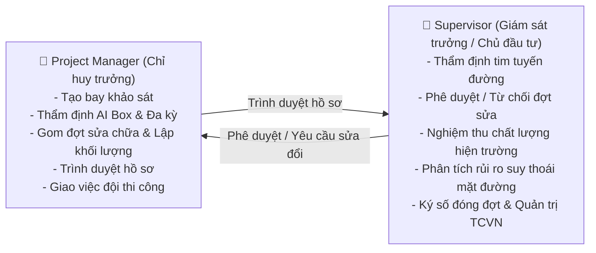
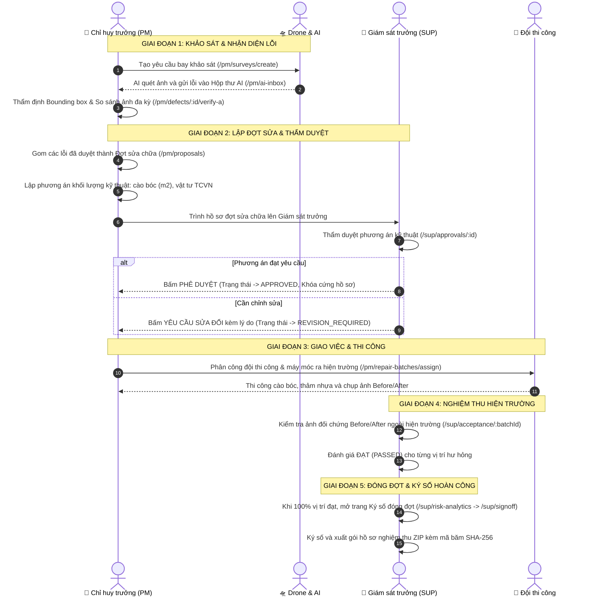

# CẨM NANG TỔNG QUAN HỆ THỐNG ROADGUARD & HƯỚNG DẪN KIỂM THỬ, THIẾT KẾ GIAO DIỆN
> **Tài liệu nguồn (SSOT) dành cho QA/Tester, UI/UX Designer và Frontend Developer**  
> Dự án: **RoadGuard Web Dashboard** — Hệ thống quản lý bảo hành & sửa chữa hạ tầng đường bộ bằng Drone & AI  
> Đơn vị chủ quản: **Nhà thầu xây dựng hạ tầng Hoàng Hải**

---

## 📖 MỤC LỤC
1. [Bản Chất & Mục Tiêu Của Hệ Thống](#1-bản-chất--mục-tiêu-của-hệ-thống)
2. [Hai Vai Trò Người Dùng Cốt Lõi (Roles)](#2-hai-vai-trò-người-dùng-cốt-lõi-roles)
3. [10 Điều Bất Biến Nghiệp Vụ (Bắt Buộc Nhớ Khi Thiết Kế & Sửa UI)](#3-10-điều-bất-biến-nghiệp-vụ-bắt-buộc-nhớ-khi-thiết-kế--sửa-ui)
4. [Hệ Thống Nhận Diện Thương Hiệu Hoàng Hải & Design Tokens](#4-hệ-thống-nhận-diện-thương-hiệu-hoàng-hải--design-tokens)
5. [Bản Đồ Toàn Bộ Màn Hình Hệ Thống (Sitemap & Screen Inventory)](#5-bản-đồ-toàn-bộ-màn-hình-hệ-thống-sitemap--screen-inventory)
6. [Luồng Nghiệp Vụ Xuyên Suốt (End-to-End Walkthrough)](#6-luồng-nghiệp-vụ-xuyên-suốt-end-to-end-walkthrough)
7. [Các Luồng Nghiệp Vụ Đặc Biệt & Ngoại Lệ](#7-các-luồng-nghiệp-vụ-đặc-biệt--ngoại-lệ)
8. [Hướng Dẫn Thao Tác Chạy Web & Checklist Kiểm Thử Nhanh](#8-hướng-dẫn-thao-tác-chạy-web--checklist-kiểm-thử-nhanh)

---

## 1. BẢN CHẤT & MỤC TIÊU CỦA HỆ THỐNG

**RoadGuard** là nền tảng số hóa quản lý công tác bảo hành, bảo trì và sửa chữa mặt đường bộ dành cho nhà thầu **Hoàng Hải**.  
Hệ thống giải quyết bài toán kiểm tra mặt đường thủ công (vốn nguy hiểm, chậm trễ và thiếu chính xác) bằng quy trình tự động hóa:
- **Thu thập dữ liệu:** Drone bay chụp tự động độ phân giải cao theo bình đồ tuyến và cọc lý trình Km.
- **Phân tích thông minh:** Mô hình AI (Road-YOLO) tự động phát hiện, khoanh vùng (Bounding Box) và phân loại khiếm khuyết (ổ gà, nứt dọc, nứt ngang, nứt mai rùa, hằn lún bánh xe, bong tróc).
- **So sánh đa kỳ (Temporal):** Đối chiếu hình ảnh cùng một vị trí qua các đợt bay khác nhau để đo tốc độ phát triển hư hỏng.
- **Lập phương án kỹ thuật:** Gom các khiếm khuyết vào các Đợt sửa chữa, tính toán khối lượng thi công thực tế theo tiêu chuẩn xây dựng giao thông Việt Nam (TCVN 8819:2011).
- **Phê duyệt & Nghiệm thu:** Quy trình thẩm duyệt hồ sơ, giao việc đội hiện trường, đối soát ảnh trước/sau sửa chữa (Before/After) và ký số đóng đợt.

---

## 2. HAI VAI TRÒ NGƯỜI DÙNG CỐT LÕI (ROLES)

Hệ thống Web Dashboard phục vụ **2 vai trò chính tại văn phòng điều hành**:



| Tiêu chí | Project Manager (Chỉ huy trưởng) | Supervisor (Giám sát trưởng / Chủ đầu tư) |
|---|---|---|
| **Mã vai trò** | `PROJECT_MANAGER` | `SUPERVISOR` |
| **Thư mục code** | `src/pages/(pm)/` | `src/pages/(sup)/` |
| **Trọng tâm công việc** | Thực thi kỹ thuật, quản lý tiến độ, điều phối drone & đội sửa chữa ngoài hiện trường. | Giám sát độc lập, kiểm soát chất lượng, thẩm duyệt hồ sơ, ký số nghiệm thu hoàn công. |
| **Quyền hạn đặc trưng** | • Tạo yêu cầu bay khảo sát<br>• Chấp nhận/Bác bỏ kết quả AI phát hiện<br>• Lập phương án khối lượng kỹ thuật<br>• Trình duyệt đợt sửa<br>• Phân công đội thi công | • Thẩm định & Xác nhận tim tuyến<br>• **Độc quyền Phê duyệt / Từ chối đợt sửa**<br>• Nghiệm thu hiện trường Before/After<br>• Ký số đóng đợt (Sign-off)<br>• Quản trị danh mục khiếm khuyết TCVN & Legal Hold |

---

## 3. 10 ĐIỀU BẤT BIẾN NGHIỆP VỤ (BẮT BUỘC NHỚ KHI THIẾT KẾ & SỬA UI)

> ⚠️ **CẢNH BÁO CỰC KỲ QUAN TRỌNG:**  
> Mọi thay đổi giao diện, bổ sung form hay chỉnh sửa cột bảng bắt buộc phải tuân thủ 10 điều bất biến dưới đây. Vi phạm các quy tắc này sẽ làm sai lệch bản chất phần mềm kỹ thuật công trình:

1. **QUY TẮC ZERO MONEY (TUYỆT ĐỐI KHÔNG CÓ GIÁ TIỀN):**  
   Hệ thống chỉ quản lý **chỉ số khối lượng kỹ thuật thi công** (diện tích cào bóc $m^2$, chiều dài trám nứt $m$, chiều sâu $cm$, khối lượng bê tông nhựa theo TCVN 8819:2011).  
   👉 **CẤM:** Không được thêm trường giá tiền, đơn giá, dự toán VNĐ hay bảng BOQ tài chính vào bất kỳ màn hình nào.
2. **QUYỀN PHÊ DUYỆT ĐỘC QUYỀN CỦA SUPERVISOR:**  
   Chỉ người dùng có vai trò `SUPERVISOR` mới thấy và bấm được các nút: **"Phê duyệt đợt sửa"**, **"Từ chối / Yêu cầu sửa đổi"**, **"Ký số đóng đợt"** và **"Xác nhận tim tuyến"**. PM chỉ có nút **"Trình duyệt"** và không bao giờ tự duyệt được hồ sơ của mình.
3. **ĐÓNG BĂNG HỒ SƠ KHI ĐÃ DUYỆT (`APPROVED` = READ-ONLY):**  
   Khi đợt sửa chữa được Supervisor duyệt (`APPROVED`), toàn bộ danh sách khiếm khuyết và phương án kỹ thuật trong đợt đó bị khóa cứng. Không ai được phép thêm, sửa hay xóa hạng mục.
4. **SO SÁNH ẢNH ĐA KỲ (TEMPORAL EPOCH):**  
   Tại màn hình thẩm định hư hỏng, ảnh chụp đợt mới nhất phải luôn được đặt cạnh ảnh chụp đợt cũ (Side-by-side hoặc Overlay) để kỹ sư trực quan đánh giá tốc độ nứt lún theo thời gian.
5. **CHUẨN DỮ LIỆU ĐỊA LÝ GEOJSON & EPSG:32648:**  
   Toạ độ khiếm khuyết và tim tuyến phải tương thích chuẩn GeoJSON WGS84 và hệ toạ độ phẳng UTM Zone 48N (phổ biến trong đo đạc đường bộ Việt Nam).
6. **BẢO TỒN LỊCH SỬ & CƠ CHẾ SOFT-DISABLE:**  
   Danh mục khiếm khuyết TCVN và dữ liệu công trình **cấm tuyệt đối nút Xóa vĩnh viễn (Hard-Delete)**. Chỉ được sử dụng công tắc **"Tạm ngưng / Áp dụng" (Soft-Disable)** để không làm rách lịch sử các hồ sơ hoàn công cũ đã nghiệm thu.
7. **ĐIỀU KIỆN KÝ ĐÓNG ĐỢT (SIGNOFF GATE):**  
   Nút ký số hoàn công đóng đợt chỉ sáng lên khi **100% hạng mục sửa chữa trong đợt đã qua bước nghiệm thu đạt yêu cầu (`PASSED`)**.
8. **MÁY TRẠNG THÁI ĐỢT SỬA (`RepairBatchStatus`):**  
   Tuân thủ nghiêm ngặt chu trình:  
   `DRAFT` $\rightarrow$ `PENDING_APPROVAL` $\rightarrow$ (`APPROVED` hoặc `REVISION_REQUIRED`) $\rightarrow$ `ASSIGNED` $\rightarrow$ `IN_PROGRESS` $\rightarrow$ `PENDING_INSPECTION` $\rightarrow$ `COMPLETED`.
9. **PHONG TỎA DỮ LIỆU PHÁP LÝ (`LEGAL HOLD` - BR-45):**  
   Khi công trình có yêu cầu thanh tra hoặc tranh chấp pháp lý, Supervisor có quyền kích hoạt Legal Hold để đóng băng toàn bộ hệ thống, ngăn mọi hành vi chỉnh sửa hoặc xuất hủy dữ liệu.
10. **TÍNH TOÀN VẸN VỚI MÃ BĂM SHA-256:**  
   Gói hồ sơ nghiệm thu xuất ra phải được niêm phong bằng chuỗi băm mật mã SHA-256 để chống gian lận và chối bỏ trách nhiệm.

---

## 4. HỆ THỐNG NHẬN DIỆN THƯƠNG HIỆU HOÀNG HẢI & DESIGN TOKENS

Khi chỉnh sửa CSS, Tailwind hoặc bố cục, phải tuân thủ chuẩn thiết kế trong [src/design-tokens.ts](file:///d:/hoctap/k%C3%AC%209/%C4%91%E1%BB%93%20%C3%A1n/FE_Drone_Web/src/design-tokens.ts):

| Tên Token | Mã màu Hex | Class Tailwind | Ý nghĩa & Hướng dẫn sử dụng |
|---|---|---|---|
| **Brand Gold (Vàng đồng)** | `#C9A227` | `bg-brand-gold`, `text-brand-gold`, `border-brand-gold` | **Màu thương hiệu Hoàng Hải:** Chỉ dùng cho 1 nút hành động chính (Primary CTA) trên màn hình, Tab đang được chọn, hoặc số liệu KPI quan trọng nhất. **Tuyệt đối không dùng làm màu nền bảng hay nền trang.** |
| **Navy Brand** | `#2D3748` | `bg-brand-navy`, `text-brand-navy` | Màu nhận diện bổ trợ, tiêu đề cấp cao, thẻ thông tin kỹ thuật chuyên sâu. |
| **Dark Base** | `#1A1D20` | `bg-brand-dark`, `text-brand-dark` | Thanh Header tối, nền Modal hoặc chân trang mang phong cách chuyên nghiệp. |
| **Surface Alt** | `#F8FAFC` | `bg-brand-surfaceAlt` | Nền khung phụ, vùng chứa bảng dữ liệu, nền form nhập liệu. |
| **Border Slate** | `#E2E8F0` | `border-brand-border` | Đường viền ngăn cách giữa các cột, viền bảng và viền thẻ card. |

- **Typography:** Sử dụng phông chữ không chân hiện đại (Inter, Roboto). Cỡ chữ rõ ràng, độ tương phản cao để kỹ sư công trường dễ nhìn.
- **Phong cách giao diện:** Tinh gọn, tối giản (Minimalism), các góc bo nhẹ (`rounded-xl` đến `rounded-2xl`).

---

## 5. BẢN ĐỒ TOÀN BỘ MÀN HÌNH HỆ THỐNG (SITEMAP & SCREEN INVENTORY)

Toàn bộ hệ thống gồm **18 màn hình chức năng** được phân chia rõ ràng:

### A. Nhóm Màn Hình Chung & Xác Thực
| URL | Component File | Vai trò | Chức năng chính | Lưu ý khi kiểm tra & sửa giao diện |
|---|---|---|---|---|
| `/login` | `src/pages/(auth)/Login.tsx` | Chung | Đăng nhập tài khoản, có nút chọn nhanh vai trò (PM / SUP) để test tiện lợi. | Nhập email/password hợp lệ. Đổi mật khẩu lần đầu nếu tài khoản gắn cờ `must_change_password`. |
| `/force-change-password` | `src/pages/(auth)/Login.tsx` | Chung | Bắt buộc đổi mật khẩu mới đối với tài khoản cấp lần đầu. | Không cho phép thoát khỏi trang này nếu chưa đổi mật khẩu xong. |

---

### B. Nhóm Màn Hình Dành Cho Project Manager (Chỉ Huy Trưởng - PM)
| URL | Component File | Chức năng chính | Các nút thao tác quan trọng | Gợi ý cho Tester / Designer |
|---|---|---|---|---|
| `/pm/dashboard` | `src/pages/(pm)/PMDashboard.tsx` | Tổng quan tiến độ bay, thống kê lỗi AI mới phát hiện, phím tắt tạo bay, gom đợt sửa. | • Tạo đợt bay mới<br>• Xem hộp thư AI<br>• Gom đợt sửa | Kiểm tra các thẻ KPI số lượng lỗi chưa xử lý và tiến độ thi công. |
| `/pm/projects` | `src/pages/(pm)/ProjectList.tsx` | Danh sách các đoạn đường/dự án bảo hành của nhà thầu Hoàng Hải. | • Tìm kiếm theo tên<br>• Lọc trạng thái<br>• Xem chi tiết tuyến | Kiểm tra thanh tìm kiếm hoạt động mượt mà. |
| `/pm/surveys` | `src/pages/(pm)/SurveyRequests.tsx` | Danh sách các yêu cầu bay khảo sát bằng Drone theo lịch định kỳ hoặc đột xuất. | • Lọc theo dự án<br>• Xem trạng thái bay (Đang xử lý, Hoàn tất) | Trạng thái hiển thị theo tag màu rõ ràng. |
| `/pm/surveys/create` | `src/pages/(pm)/CreateSurvey.tsx` | Form lập kế hoạch bay: chọn tuyến, độ cao bay, cọc Km bắt đầu/kết thúc, ngày bay. | • Chọn nhanh tuyến mẫu<br>• Tạo đợt bay khảo sát | Kiểm tra validate các trường ngày tháng và lý trình. |
| `/pm/ai-inbox` | `src/pages/(pm)/AIReviewInbox.tsx` | Hộp thư tiếp nhận các hư hỏng do AI tự động quét ra từ ảnh chụp Drone. | • Chấp nhận lỗi<br>• Bác bỏ (False positive)<br>• Chuyển tiếp thẩm định | Lọc theo loại hư hỏng (ổ gà, nứt) và mức độ nghiêm trọng. |
| `/pm/defects/:id/verify-a` | `src/pages/(pm)/DefectDetailVerify.tsx` | Thẩm định chi tiết 1 lỗi: xem ảnh gốc Drone, khung Bounding Box AI, chỉnh sửa tọa độ/kích thước. | • Lưu khung bounding box<br>• Phê duyệt khiếm khuyết | Tương tác zoom ảnh và xem thông số chiều dài, chiều rộng, diện tích. |
| `/pm/defects/:id/verify-b` | `src/pages/(pm)/DefectDetailVerify.tsx` | So sánh ảnh đa kỳ (Temporal): so sánh ảnh hư hỏng hiện tại với ảnh đợt trước để đánh giá nứt lan rộng. | • Chuyển chế độ so sánh song song / lớp phủ | Kiểm tra hiển thị 2 ảnh chụp ở 2 mốc thời gian khác nhau. |
| `/pm/proposals` | `src/pages/(pm)/RepairProposals.tsx` | Gom các khiếm khuyết đã duyệt thành một Đợt sửa chữa, lập bảng khối lượng kỹ thuật cào bóc, mác nhựa. | • Tạo đợt sửa chữa mới<br>• Lập phương án thi công | **Nhớ luật Zero Money:** Bảng chỉ có cột diện tích ($m^2$), chiều sâu ($cm$), vật tư TCVN. |
| `/pm/proposals/:id` | `src/pages/(sup)/ProposalApprovalDetail.tsx` | Xem hồ sơ đợt sửa và Trình lên Giám sát trưởng phê duyệt. | • **Trình duyệt hồ sơ** (PM chỉ có nút này, không có nút Duyệt) | Kiểm tra trạng thái chuyển từ `DRAFT` $\rightarrow$ `PENDING_APPROVAL`. |
| `/pm/repair-batches/assign` | `src/pages/(pm)/AssignCrew.tsx` | Sau khi hồ sơ được duyệt, PM phân công Đội thi công (Repair Crew) và máy móc ra hiện trường. | • Chọn đội thi công<br>• Đặt hạn hoàn thành<br>• Phát lệnh thi công | Trạng thái chuyển sang `ASSIGNED`. |
| `/pm/field-tasks` | `src/pages/(pm)/FieldTasks.tsx` | Theo dõi nhiệm vụ đo đạc bổ sung và xử lý xung đột đồng bộ dữ liệu ngoại tuyến (Offline sync). | • Trình cứu hộ thiết bị (Q17)<br>• Yêu cầu đo lại / nộp bổ sung ảnh | Xem chi tiết ở phần 7 (Cứu hộ Q17). |

---

### C. Nhóm Màn Hình Dành Cho Supervisor (Giám Sát Trưởng / Chủ Đầu Tư - SUP)
| URL | Component File | Chức năng chính | Các nút thao tác quan trọng | Gợi ý cho Tester / Designer |
|---|---|---|---|---|
| `/sup/dashboard` | `src/pages/(sup)/SupDashboard.tsx` | Bảng điều hành giám sát: chỉ số rủi ro suy thoái mặt đường, cảnh báo bảo hành, số đợt chờ duyệt. | • Lối tắt thẩm duyệt hồ sơ<br>• Lối tắt nghiệm thu | Kiểm tra các thẻ số liệu cảnh báo khẩn cấp. |
| `/sup/projects` | `src/pages/(pm)/ProjectList.tsx` | Xem danh mục các dự án đang trong thời gian bảo hành và thông tin nhà thầu. | • Tìm kiếm & xem thông tin | Kiểm tra quyền truy cập ở góc nhìn giám sát. |
| `/sup/alignment` | `src/pages/(sup)/AlignmentReview.tsx` | Thẩm định và phê duyệt bình đồ tim tuyến đường bay GeoJSON, cọc lý trình Km. | • **Xác nhận tim tuyến** (`CONFIRMED`) | Bản đồ hiển thị tọa độ các điểm mốc chính xác. |
| `/sup/proposals` & `/sup/approvals/:id` | `src/pages/(sup)/ProposalApprovalDetail.tsx` | Thẩm duyệt hồ sơ đợt sửa: kiểm tra phương án cào bóc, độ sâu và khối lượng kỹ thuật do PM trình. | • **Phê duyệt đợt sửa** (`APPROVED`)<br>• **Yêu cầu sửa đổi** | **Kiểm tra độc quyền:** Nút duyệt chỉ hiển thị với vai trò SUP. Không có giá tiền. |
| `/sup/approvals/:id/reject` | `src/pages/(sup)/BatchRejection.tsx` | Gửi phiếu yêu cầu sửa đổi hồ sơ nếu khối lượng chưa khớp hoặc phương án chưa hợp lý. | • Gửi yêu cầu sửa đổi | Trạng thái đợt chuyển sang `REVISION_REQUIRED`. |
| `/sup/acceptance` & `/sup/acceptance/:batchId` | `src/pages/(sup)/EvidenceCloseoutDetail.tsx` | Nghiệm thu chất lượng thi công tại hiện trường: đối chiếu ảnh trước khi sửa và sau khi sửa (Before/After). | • Đánh giá Đạt / Không đạt từng vị trí<br>• Xác nhận nghiệm thu đợt | Kiểm tra điều kiện nghiệm thu trước khi cho phép đóng đợt. |
| `/sup/field-tasks` | `src/pages/(pm)/FieldTasks.tsx` | Nghiệm thu hiện trường & Thẩm định cứu hộ thiết bị gặp sự cố ngoài công trường (Q17). | • **Xác nhận dữ liệu cứu hộ**<br>• Từ chối cứu hộ | Nút màu tím xác nhận tính pháp lý của dữ liệu trích xuất từ máy vỡ. |
| `/sup/fast-track` | `src/pages/(sup)/FastTrackReview.tsx` | Giám sát luồng cấp bách: theo dõi xử lý ổ gà khẩn cấp nguy cơ tai nạn cao (SLA 4h rào chắn, 24h vá). | • Xem tiến độ xử lý cấp bách | Tách biệt với luồng sửa chữa thông thường. |
| `/sup/risk-analytics` & `/sup/signoff` | `src/pages/(sup)/RiskAnalytics.tsx` | Phân tích rủi ro hư hỏng mặt đường dài hạn, mô phỏng xu hướng suy thoái và Ký số đóng đợt. | • **Ký số đóng đợt** (Sign-off)<br>• Tải gói ZIP bằng chứng SHA-256 | Nút ký số chỉ bấm được khi 100% hạng mục đạt `PASSED`. |
| `/sup/research-validation` | `src/pages/(sup)/ResearchValidation.tsx` | Thẩm định độ chính xác khoa học của Drone & AI: sai số đo đạc $Bias, MAE, RMSE$ tính theo $mm$. | • Chạy Job kiểm định mới<br>• Xuất file CSV `RPT-09` | Kiểm tra hiển thị đơn vị $mm$, không để công thức toán thô. |
| `/sup/system-control` | `src/pages/(sup)/SystemControl.tsx` | **Quản trị trung tâm:**<br>1. Giám sát phiên bản AI & Xuất nhãn huấn luyện (`QT07`).<br>2. **Quản trị danh mục khiếm khuyết TCVN (Thêm mới, Sửa, Soft-disable).**<br>3. Ngưỡng chính sách Fast-Track.<br>4. Phong tỏa pháp lý (`Legal Hold` - BR-45). | • Thêm khiếm khuyết TCVN<br>• Sửa danh mục<br>• Công tắc Áp dụng/Ngưng<br>• Xuất nhãn AI<br>• Kích hoạt Legal Hold | Xem chi tiết ở mục 7. |
| `/sup/audit-trail` | `src/pages/(sup)/AuditTrail.tsx` | Nhật ký kiểm toán bảo mật: ghi nhận mọi thao tác của người dùng kèm mã băm SHA-256 chống chối bỏ. | • Tìm kiếm sự kiện<br>• Lọc theo người dùng | Dữ liệu kiểm toán chỉ đọc (Read-only). |
| `/sup/personnel` | `src/pages/(sup)/Personnel.tsx` | Danh bạ nhân sự kỹ sư giám sát và các tổ thi công hiện trường. | • Xem thông tin & phân quyền | Thể hiện cơ cấu nhân sự dự án. |

---

## 6. LUỒNG NGHIỆP VỤ XUYÊN SUỐT (END-TO-END WALKTHROUGH)

Một vòng đời hoàn chỉnh từ khi phát hiện hư hỏng đến khi ký hoàn công diễn ra qua 5 giai đoạn:



---

## 7. CÁC LUỒNG NGHIỆP VỤ ĐẶC BIỆT & NGOẠI LỆ

### 7.1. Cứu Hộ Thiết Bị Ngoại Tuyến Gặp Sự Cố (Q17 / Quyết Định 42A)
- **Tình huống:** Máy tính bảng của kỹ sư hiện trường bị rơi vỡ nát màn hình ngoài công trường, không thể kết nối mạng để đồng bộ dữ liệu. Kỹ thuật viên phải cắm cáp USB trích xuất trực tiếp file cơ sở dữ liệu nội bộ máy.
- **Thẩm quyền:**  
  - PM kiểm tra ảnh biên bản vỡ máy và bấm: **"Trình Giám sát xác nhận cứu hộ (Q17)"**.  
  - Supervisor là người duy nhất có thẩm quyền bấm: **"Xác nhận dữ liệu cứu hộ"** (nút màu tím) để hợp thức hóa dữ liệu này vào hệ thống trung tâm.

### 7.2. Quản Trị Danh Mục Khiếm Khuyết TCVN (`QT03, QT04`)
- Nằm tại: `/sup/system-control` $\rightarrow$ Tab **"Danh mục khiếm khuyết TCVN"**.
- **Chức năng:**
  - **Thêm mới khiếm khuyết:** Bấm nút `+ Thêm khiếm khuyết TCVN` để mở Modal, điền mã lỗi, tên tiếng Việt, tiêu chuẩn viện dẫn (TCVN 8819:2011, TCVN 8864:2011), cấp độ khẩn cấp và lưu lại.
  - **Cập nhật khiếm khuyết:** Bấm nút `Sửa` trên từng dòng để cập nhật thông số kỹ thuật.
  - **Nguyên tắc Soft-Disable:** Công tắc bật/tắt `Áp dụng / Ngưng`. Tuyệt đối **không có nút xóa vĩnh viễn** để bảo tồn lịch sử hồ sơ hoàn công đã ký.

### 7.3. Phong Tỏa Dữ Liệu Pháp Lý (`Legal Hold` - BR-45)
- Nằm tại: `/sup/system-control` $\rightarrow$ Tab **"Kiểm soát dữ liệu & Pháp lý"**.
- **Mục đích:** Khi có yêu cầu điều tra hoặc tranh chấp kỹ thuật với Chủ đầu tư/Thanh tra giao thông, Supervisor bấm **"Kích hoạt Legal Hold"** kèm số công văn và lý do. Khi kích hoạt, banner cảnh báo xuất hiện trên toàn hệ thống và cấm mọi hành vi sửa/xóa hồ sơ.

### 7.4. Xuất Dữ Liệu Huấn Luyện AI (`QT07`) & Báo Cáo Thẩm Định (`RPT-09`)
- **Xuất nhãn AI (QT07):** Tại `/sup/system-control` $\rightarrow$ Tab "Mô hình AI", bấm nút **"Xuất nhãn huấn luyện (QT07)"** để tải về gói tệp JSON chứa 1.420 nhãn kiểm định đã qua thẩm định của con người để nạp cho quy trình huấn luyện lại mô hình YOLO.
- **Báo cáo đối soát thực nghiệm (RPT-09):** Tại `/sup/research-validation`, bấm nút **"Xuất CSV Dữ Liệu Đối Soát"** để tải về bảng dữ liệu đối chiếu Ground Truth và số đo Drone AI phục vụ nghiên cứu khoa học.

---

## 8. HƯỚNG DẪN THAO TÁC CHẠY WEB & CHECKLIST KIỂM THỬ NHANH

### 8.1. Khởi Động Dự Án Dưới Local
```bash
# Cài đặt thư viện (nếu mới clone)
npm install

# Khởi chạy máy chủ phát triển
npm run dev
# Truy cập giao diện tại: http://localhost:3000
```

### 8.2. Chuyển Đổi Nhanh Giữa 2 Vai Trò Để Kiểm Thử
- Tại màn hình đăng nhập `/login`, có 2 nút bấm tự động điền sẵn tài khoản:
  - Bấm **"Chỉ huy trưởng (PM)"** $\rightarrow$ Đăng nhập bằng `pm@hoanghai.vn` $\rightarrow$ Chuyển đến `/pm/dashboard`.
  - Bấm **"Giám sát trưởng (SUP)"** $\rightarrow$ Đăng nhập bằng `supervisor@hoanghai.vn` $\rightarrow$ Chuyển đến `/sup/dashboard`.

### 8.3. Bảng Kiểm Tra Nhanh (QA & Designer Checklist)
Trước khi bàn giao một giao diện mới hoặc kiểm thử một màn hình, hãy kiểm tra lần lượt:

- [ ] **Đúng vai trò:** Màn hình của PM có nằm trong `/pm/` không? Màn hình của SUP có nằm trong `/sup/` không?
- [ ] **Không có giá tiền (Zero Money):** Đã kiểm tra không có chữ "VNĐ", "chi phí", "giá", "BOQ" nào trên bảng chưa?
- [ ] **Nút duyệt hồ sơ:** Màn hình của PM có bị lộ nút "Phê duyệt" không? (Phải đảm bảo chỉ có nút "Trình duyệt").
- [ ] **Màu thương hiệu Hoàng Hải:** Màu vàng đồng `#C9A227` chỉ dùng cho nút CTA chính hoặc tab active, không bị lạm dụng làm màu nền bảng?
- [ ] **Khóa hồ sơ đã duyệt:** Khi đợt sửa ở trạng thái `APPROVED`, bảng khối lượng có bị khóa (không cho thêm/xóa dòng) không?
- [ ] **Không có nút Hard-Delete danh mục:** Trong danh mục TCVN, chỉ có công tắc Soft-Disable (Tạm ngưng), không có nút xóa vĩnh viễn?
- [ ] **Hiển thị đơn vị kỹ thuật:** Các số đo có đầy đủ đơn vị ($m^2, m, cm, mm$) thay vì để số trơn không?
- [ ] **Không vỡ giao diện trên Desktop:** Kiểm tra ở độ phân giải $1366 \times 768$ và $1920 \times 1080$, các bảng không bị tràn khung vô lý.

---
*Tài liệu được biên soạn bởi Đỗ Quốc Hoàng (Frontend Solo Developer) — Bản cập nhật ngày 13/10/2026.*
