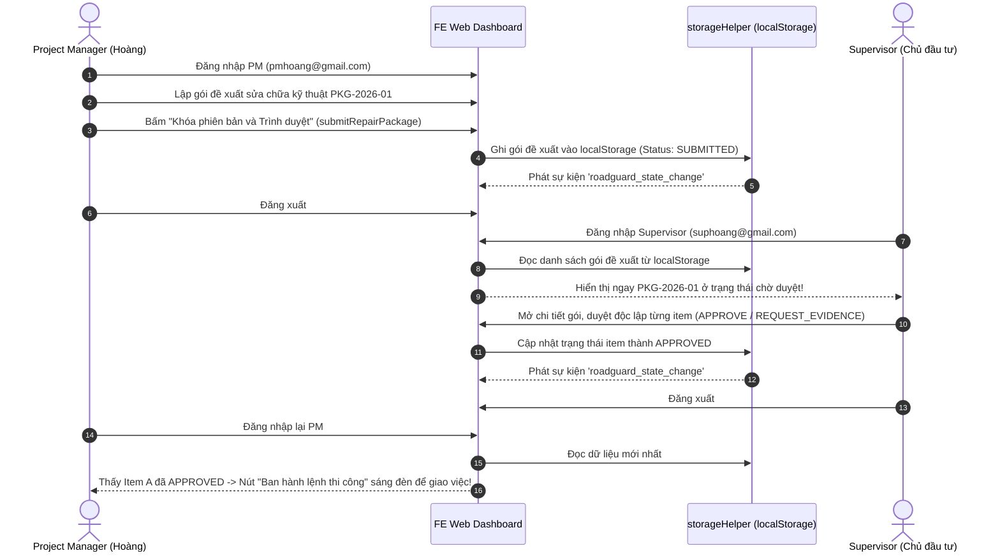

# TỔNG HỢP CHỨC NĂNG PM & SUPERVISOR VÀ KẾ HOẠCH CHI TIẾT XÂY DỰNG MOCK API

> **Tài liệu quy chuẩn dành cho Frontend Web RoadGuard (Nhà thầu Hoàng Hải)**  
> **Căn cứ gốc:** Trích xuất 100% từ bộ đặc tả chuẩn **`docs/specs/29_9/`** (`operation_catalog.md`, `01_FRD_SRS.md`, `02_Business_Rules.md`, `04_Use_Cases.md`, `01_FE_Scope_Implementation_Guide.md`, `06_Report_Analytics_Requirements.md`, `api.types.ts`) kết hợp **10 Điều bất biến (Invariants) trong `AGENTS.md`**.  
> **Nguyên tắc kỹ thuật:** Hệ thống quản lý bảo hành đường bộ thuần túy kỹ thuật hình học (diện tích $m^2$, chiều dài $m$, chiều sâu $cm$, $mm$). Tuyệt đối **KHÔNG** tính toán giá tiền, đơn giá tài chính hay bảng BOQ tiền tệ.

---

## 📑 MỤC LỤC
1. [Các file nguồn căn cứ chuẩn trong `docs/specs/29_9/`](#1-các-file-nguồn-căn-cứ-chuẩn-trong-docsspecs29_9)
2. [Tổng hợp toàn bộ chức năng & API của Role SUPERVISOR (Giám sát / Chủ đầu tư)](#2-tổng-hợp-toàn-bộ-chức-năng--api-của-role-supervisor-giám-sát--chủ-đầu-tư)
3. [Tổng hợp toàn bộ chức năng & API của Role PM (Project Manager - Chỉ huy trưởng)](#3-tổng-hợp-toàn-bộ-chức-năng--api-của-role-pm-project-manager---chỉ-huy-trưởng)
4. [Bảng đối chiếu màn hình FE Web thực tế, Route URL và thẩm quyền thao tác](#4-bảng-đối-chiếu-màn-hình-fe-web-thực-tế-route-url-và-thẩm-quyền-thao-tác)
5. [Kế hoạch kiến trúc Mock API Service (9 Module tập trung)](#5-kế-hoạch-kiến-trúc-mock-api-service-9-module-tập-trung)
6. [Cơ chế lưu trữ trạng thái chéo & Reactive Events (Cross-Role Persistence)](#6-cơ-chế-lưu-trữ-trạng-thái-chéo--reactive-events-cross-role-persistence)
7. [Danh mục màn hình được nâng cấp hỗ trợ đa đối tượng (Tuyến chính + Tuyến nhánh)](#7-danh-mục-màn-hình-được-nâng-cấp-hỗ-trợ-đa-đối-tượng-tuyến-chính--tuyến-nhánh)
8. [Hướng dẫn Test Kịch bản Chi tiết lần lượt cho từng Role (PM & Supervisor End-to-End Walkthrough)](#8-hướng-dẫn-test-kịch-bản-chi-tiết-lần-lượt-cho-từng-role-pm--supervisor-end-to-end-walkthrough)

---

## 1. CÁC FILE NGUỒN CĂN CỨ CHUẨN TRONG `docs/specs/29_9/`

Để đảm bảo Mock API và mã nguồn Frontend Web chuẩn xác 100%, không bịa field, không sai HTTP Method/Path và tuân thủ chặt chẽ hợp đồng API Backend:

1. **[`operation_catalog.md`](file:///D:/hoctap/k%C3%AC%209/%C4%91%E1%BB%93%20%C3%A1n/FE_Drone_Web/docs/specs/29_9/operation_catalog.md)**: Danh mục chuẩn toàn bộ API operations từ baseline (Operation ID, Method, Path, Role, Request/Response Schema, Required Headers `Idempotency-Key`, `If-Match`).
2. **[`01_FRD_SRS.md`](file:///D:/hoctap/k%C3%AC%209/%C4%91%E1%BB%93%20%C3%A1n/FE_Drone_Web/docs/specs/29_9/01_FRD_SRS.md)**: Đặc tả yêu cầu chức năng hệ thống (FR-01 đến FR-36), điều kiện đầu vào/đầu ra và tiêu chí kiểm chứng chấp nhận.
3. **[`02_Business_Rules.md`](file:///D:/hoctap/k%C3%AC%209/%C4%91%E1%BB%93%20%C3%A1n/FE_Drone_Web/docs/specs/29_9/02_Business_Rules.md)**: 48 Quy tắc nghiệp vụ bất biến cốt lõi (BR-01 đến BR-48: Fast Track không có gate duyệt trước, Approval Track duyệt từng item độc lập, lưu trữ dữ liệu pháp lý bảo hành +5 năm...).
4. **[`04_Use_Cases.md`](file:///D:/hoctap/k%C3%AC%209/%C4%91%E1%BB%93%20%C3%A1n/FE_Drone_Web/docs/specs/29_9/04_Use_Cases.md)**: Đặc tả chi tiết các Use Case tác nghiệp (DA, KS, AI, PA, SC, TN, HT, QT, BC).
5. **[`01_FE_Scope_Implementation_Guide.md`](file:///D:/hoctap/k%C3%AC%209/%C4%91%E1%BB%93%20%C3%A1n/FE_Drone_Web/docs/specs/29_9/01_FE_Scope_Implementation_Guide.md)**: Hướng dẫn phân định ranh giới Web Dashboard và App Mobile, 10 Invariants bất biến, chuẩn Header và cơ chế xử lý ngoại tuyến/đồng bộ.
6. **[`02_Authentication_Flow.md`](file:///D:/hoctap/k%C3%AC%209/%C4%91%E1%BB%93%20%C3%A1n/FE_Drone_Web/docs/specs/29_9/02_Authentication_Flow.md)**: Quy trình xác thực JWT Bearer, Token Rotation, Force Change Password lần đầu và phân quyền theo Role.
7. **[`03_Error_Response_UI_Convention.md`](file:///D:/hoctap/k%C3%AC%209/%C4%91%E1%BB%93%20%C3%A1n/FE_Drone_Web/docs/specs/29_9/03_Error_Response_UI_Convention.md)**: Chuẩn cấu trúc phản hồi lỗi RFC 7807 ProblemDetails (`type`, `title`, `status`, `detail`, `instance`, `invalidParams`).
8. **[`06_Report_Analytics_Requirements.md`](file:///D:/hoctap/k%C3%AC%209/%C4%91%E1%BB%93%20%C3%A1n/FE_Drone_Web/docs/specs/29_9/06_Report_Analytics_Requirements.md)**: Quy chuẩn 10 loại báo cáo (RPT-01 đến RPT-10) và các chỉ số KPI suy thoái MET-01, MET-04, MET-08, MET-11.
9. **[`api.types.ts`](file:///D:/hoctap/k%C3%AC%209/%C4%91%E1%BB%93%20%C3%A1n/FE_Drone_Web/docs/specs/29_9/api.types.ts)**: Hệ thống định nghĩa kiểu dữ liệu TypeScript DTO schemas và domain entities chuẩn.

---

## 2. TỔNG HỢP TOÀN BỘ CHỨC NĂNG & API CỦA ROLE SUPERVISOR (GIÁM SÁT / CHỦ ĐẦU TƯ)

Supervisor đại diện cho **Chủ đầu tư / Lãnh đạo cấp cao của Nhà thầu Hoàng Hải**.  
Trên Web Dashboard, Supervisor có **15 nhóm chức năng lớn**, tương ứng các Operation ID chuẩn từ `operation_catalog.md`:

| STT | Nhóm chức năng | Mã Use Case / FR | Hành vi tác nghiệp trên Web Dashboard | Operation ID & Endpoint chuẩn (29_9) | Headers bắt buộc |
|:---:|---|:---:|---|---|:---:|
| **01** | **Khởi tạo & Quản lý Dự án** | DA01, FR-04, BR-01 | Tạo dự án bảo hành mới, nhập thời hạn bảo hành (tháng), ngày hết hạn, ngày bàn giao, mảng tệp bàn giao (tùy chọn), chỉ định duy nhất 1 PM chính. | `createProject`<br>`POST /api/v1/projects`<br>`getProject`<br>`GET /api/v1/projects/{projectId}`<br>`listProjects`<br>`GET /api/v1/projects` | `Idempotency-Key` (cho POST) |
| **02** | **Cập nhật & Đóng Dự án** | DA05, DA12, FR-04, BR-45 | Chỉnh sửa thông tin dự án; đóng dự án khi hết thời hạn bảo hành chuyển trạng thái sang `CLOSED` (chế độ Read-only). | `updateProject`<br>`PATCH /api/v1/projects/{projectId}`<br>`closeProject`<br>`POST /api/v1/projects/{projectId}/close` | `Idempotency-Key`<br>`If-Match` |
| **03** | **Phân quyền & Đội thi công** | DA03, FR-02, BR-02 | Phân công PM chính, bổ nhiệm Drone Operator và Repair Crew vào dự án; tạo mới đội thi công công ty. | `setMembership`<br>`POST /api/v1/projects/{projectId}/memberships`<br>`createCrew`<br>`POST /api/v1/projects/{projectId}/crews`<br>`listCrews`<br>`GET /api/v1/projects/{projectId}/crews` | `Idempotency-Key` |
| **04** | **Xác nhận Tuyến đường** | DA13, FR-06, BR-04 | Xem trước tim đường và bề rộng mặt đường trên MapLibre do PM trình; bấm "Xác nhận phiên bản tuyến" để khóa bất biến `RoadSectionVersion`. | `confirmRoute`<br>`POST /api/v1/route-versions/{routeVersionId}/confirm`<br>`getRouteVersion`<br>`GET /api/v1/route-versions/{routeVersionId}` | `Idempotency-Key`<br>`If-Match` |
| **05** | **Thẩm duyệt Hạng mục Sửa chữa (Approval Track)** | SC06, FR-19, BR-21 | Xem gói hồ sơ do PM trình (`WF-07`); ra quyết định độc lập trên từng hạng mục: `APPROVE`, `REQUEST_EVIDENCE`, `REQUEST_RECONSIDER`, `REJECT` kèm lý do giải trình. | `decideRepairItem`<br>`POST /api/v1/repair-items/{itemId}/decisions`<br>`getRepairPackage`<br>`GET /api/v1/repair-packages/{packageId}`<br>`getRepairItem`<br>`GET /api/v1/repair-items/{itemId}` | `Idempotency-Key`<br>`If-Match` |
| **06** | **Nghiệm thu Hạng mục Nhánh duyệt** | HT10, FR-24, BR-26 | Xem chuỗi ảnh đối chứng BEFORE/AFTER và biên bản hoàn công do PM trình; bấm "Chấp thuận nghiệm thu" hoặc "Yêu cầu sửa lại (Rework)". | `acceptApprovalAttempt`<br>`POST /api/v1/repair-attempts/{attemptId}/acceptance`<br>`getRepairAttempt`<br>`GET /api/v1/repair-attempts/{attemptId}` | `Idempotency-Key`<br>`If-Match` |
| **07** | **Đóng Tổng thể Vụ việc Hỗn hợp (Mixed Case)** | HT12, FR-25, BR-26 | Sau khi 100% hạng mục trong vụ việc đã hoàn thành (Fast Track do PM đóng, Approval Track do Sup nghiệm thu), bấm đóng vụ việc sang `CLOSED`. Chặn đóng nếu còn mục dở dang. | `closeMixedCase`<br>`POST /api/v1/cases/{caseId}/close` | `Idempotency-Key`<br>`If-Match` |
| **08** | **Quản trị Tài khoản & Lời mời** | QT01, QT02, FR-01, FR-02 | Tạo thư mời nhân sự mới, đình chỉ tài khoản nghỉ việc (thu hồi token ngay), cập nhật thông tin, đặt lại mật khẩu nhân viên. | `createInvitation`<br>`POST /api/v1/invitations`<br>`adminResetPassword`<br>`POST /api/v1/users/{userId}/password-reset`<br>`updateAccount`<br>`PATCH /api/v1/users/{userId}`<br>`getAccount`<br>`GET /api/v1/users/{userId}` | `Idempotency-Key`<br>`If-Match` |
| **09** | **Quản trị Danh mục Hư hỏng** | QT03, QT04, FR-36 | Xem, thêm mới và cập nhật danh mục loại hư hỏng, đơn vị đo kỹ thuật, quy tắc phân mức nghiêm trọng/khẩn cấp. | `listDefectTypes`<br>`GET /api/v1/catalog/defect-types`<br>`updateDefectType`<br>`PUT /api/v1/catalog/defect-types/{code}` | `Idempotency-Key`<br>`If-Match` |
| **10** | **Cấu hình Nhắc việc & Cảnh báo** | QT05, FR-36 | Cài đặt chu kỳ gửi thông báo nhắc việc định kỳ cho PM, số ngày cảnh báo trước khi hết hạn bảo hành công trình. | `getReminderConfig`<br>`GET /api/v1/reminder-configuration`<br>`setReminderConfig`<br>`PUT /api/v1/reminder-configuration` | `Idempotency-Key`<br>`If-Match` |
| **11** | **Quản lý Phiên bản AI Model** | QT06, QT07, FR-36 | Khai báo phiên bản mô hình AI mới, kích hoạt vận hành (`ACTIVE`), ngừng dùng mô hình cũ; xuất tập nhãn đã duyệt cho đội ngũ AI huấn luyện. | `createModelVersion`<br>`POST /api/v1/model-versions`<br>`activateModelVersion`<br>`POST /api/v1/model-versions/{modelVersionId}/activate`<br>`retireModelVersion`<br>`POST /api/v1/model-versions/{modelVersionId}/retire`<br>`exportApprovedLabels`<br>`POST /api/v1/training-exports`<br>`getModelVersion`<br>`GET /api/v1/model-versions/{modelVersionId}` | `Idempotency-Key`<br>`If-Match` |
| **12** | **Giám sát Máy chủ & Audit Trail** | QT08, QT09, FR-35, BR-45 | Giám sát danh sách job xử lý AI; tra cứu nhật ký kiểm toán bất biến (Audit Trail) hiển thị thời gian, tác nhân, hành động, giá trị trước/sau. | `listAdminJobs`<br>`GET /api/v1/admin/processing-jobs`<br>`listAuditEvents`<br>`GET /api/v1/audit-events` | — |
| **13** | **Phong tỏa Pháp lý Legal Hold** | QT12, FR-35, BR-45 | Bật/tắt lệnh phong tỏa hồ sơ pháp lý (`Legal Hold`) khi có tranh chấp, ngăn chặn mọi thao tác xóa dữ liệu bảo hành. | `setLegalHold`<br>`PUT /api/v1/projects/{projectId}/legal-hold` | `Idempotency-Key`<br>`If-Match` |
| **14** | **Phê duyệt Xóa Dữ liệu (+5 năm)** | QT14, FR-35, BR-45 | Phê duyệt hoặc từ chối yêu cầu tiêu hủy dữ liệu đã hết hạn bảo hành đủ 5 năm do PM lập. | `decideDeletion`<br>`POST /api/v1/retention/deletion-requests/{requestId}/decision`<br>`getDeletionRequest`<br>`GET /api/v1/retention/deletion-requests/{requestId}` | `Idempotency-Key`<br>`If-Match` |
| **15** | **Dashboard Toàn danh mục & Xuất hồ sơ** | BC01..BC07, RPT-01..RPT-10 | Xem KPI toàn danh mục dự án, tỷ lệ hoàn thành sửa chữa, cảnh báo rủi ro suy thoái MET-01, MET-04, MET-08, MET-11; tạo lệnh xuất hồ sơ PDF và ZIP kèm Checksum SHA-256. | `getDashboard`<br>`GET /api/v1/projects/{projectId}/dashboard`<br>`createExport`<br>`POST /api/v1/exports`<br>`getExport`<br>`GET /api/v1/exports/{exportId}` | `Idempotency-Key` (cho POST) |

---

## 3. TỔNG HỢP TOÀN BỘ CHỨC NĂNG & API CỦA ROLE PM (PROJECT MANAGER - CHỈ HUY TRƯỞNG)

Project Manager là người **trực tiếp chỉ đạo và điều hành công tác bảo hành tại dự án được phân công**.  
Trên Web Dashboard, PM có **17 nhóm chức năng lớn**, tương ứng các Operation ID chuẩn từ `operation_catalog.md`:

| STT | Nhóm chức năng | Mã Use Case / FR | Hành vi tác nghiệp trên Web Dashboard | Operation ID & Endpoint chuẩn (29_9) | Headers bắt buộc |
|:---:|---|:---:|---|---|:---:|
| **01** | **Thiết lập Tuyến đường & Tim tuyến** | DA02, FR-05, FR-06 | Nhập chuỗi tọa độ tim đường (upload GPX/GeoJSON), cấu hình Station Origin, bề rộng mặt đường từng đoạn (RoadWidthProfile); xem trước MapLibre và trình Supervisor xác nhận. | `createRouteDraft`<br>`POST /api/v1/projects/{projectId}/route-drafts`<br>`updateRouteDraft`<br>`PUT /api/v1/route-versions/{routeVersionId}/draft` | `Idempotency-Key`<br>`If-Match` (PUT) |
| **02** | **Phân chia Phân đoạn (SegmentSet)** | DA14, DA15, FR-07 | Nhập độ dài mục tiêu (100m, 500m, 1000m) hoặc tùy chỉnh ranh giới lý trình; xem trước danh sách segment; bấm "Công bố tập đoạn đường (Publish SegmentSet)". | `previewSegmentSet`<br>`POST /api/v1/projects/{projectId}/segment-set-previews`<br>`publishSegmentSet`<br>`POST /api/v1/segment-sets/{segmentSetId}/publish`<br>`getSegmentSet`<br>`GET /api/v1/segment-sets/{segmentSetId}` | `Idempotency-Key`<br>`If-Match` (Publish) |
| **03** | **Quản lý Tuyến nhánh (Branch) & Lưới tấm (Slab)** | DA17, DA18, FR-08 | Khai báo mạng lưới đường nhánh nút giao / đường gom kết nối vào trục chính (điểm rẽ BranchStation, chiều dài, bề rộng, dải phân cách); chọn nhánh để phân chia phân đoạn (Segment) riêng; tạo dải tấm bê tông xi măng (Slab 4m/5m, dày 24-28cm) và liên kết hư hỏng. | `createBranch`<br>`POST /api/v1/projects/{projectId}/branches`<br>`createSlab`<br>`POST /api/v1/projects/{projectId}/slabs`<br>`setDefectSlabLinks`<br>`PUT /api/v1/defects/{defectId}/slab-links` | `Idempotency-Key`<br>`If-Match` (PUT) |
| **04** | **Lập Kế hoạch Khảo sát Drone** | DA06, DA07, FR-09 | Lập kế hoạch khảo sát gốc (Baseline) hoặc định kỳ; chọn bộ Segment và dải quan sát (SURFACE, LEFT_EDGE, RIGHT_EDGE); hoãn lịch do thời tiết nếu cần. | `createSurveyPlan`<br>`POST /api/v1/projects/{projectId}/survey-plans`<br>`postponeSurveyPlan`<br>`POST /api/v1/survey-plans/{planId}/postpone` | `Idempotency-Key`<br>`If-Match` (Postpone) |
| **05** | **Giao nhiệm vụ Bay & Bay bù** | KS01, KS04, KS11, FR-10..FR-12 | Giao việc cho Drone Operator, chọn điểm cất hạ cánh; kiểm tra độ phủ (`Coverage`); yêu cầu bay bổ sung vùng thiếu/mờ; xuất nhiệm vụ Dronelink; hủy/điều chuyển nhiệm vụ. | `createSurveyTask`<br>`POST /api/v1/projects/{projectId}/survey-tasks`<br>`getSurveyTask`<br>`GET /api/v1/survey-tasks/{taskId}`<br>`cancelSurveyTask`<br>`POST /api/v1/survey-tasks/{taskId}/cancel`<br>`reassignSurveyTask`<br>`POST /api/v1/survey-tasks/{taskId}/reassign`<br>`requestSurveySupplement`<br>`POST /api/v1/survey-tasks/{taskId}/supplements`<br>`setSurveyAccessPoint`<br>`PUT /api/v1/survey-tasks/{taskId}/access-point`<br>`getDatasetCoverage`<br>`GET /api/v1/datasets/{datasetId}/coverage`<br>`exportMission`<br>`POST /api/v1/projects/{projectId}/mission-exports` | `Idempotency-Key`<br>`If-Match` |
| **06** | **Xác nhận Mốc chuẩn Baseline** | DA10, FR-13, BR-40 | Khi dữ liệu bay đạt độ phủ SUFFICIENT và các phát hiện AI đã rà soát xong, PM bấm "Xác nhận Baseline" độc lập cho từng cặp (segment, band) để khóa mốc chuẩn. | `confirmBaseline`<br>`POST /api/v1/projects/{projectId}/baselines` | `Idempotency-Key` |
| **07** | **Kích hoạt AI & Rà soát Lỗi (Inbox)** | AI01..AI08, FR-14..FR-16 | Kích hoạt job phân tích video 2 giai đoạn; rà soát phát hiện sơ bộ trên MapLibre và khung ảnh video (Bounding Box); hiệu chỉnh loại lỗi; loại bỏ phát hiện sai kèm lý do; duyệt nhãn huấn luyện AI. | `createProcessingJob`<br>`POST /api/v1/processing-jobs`<br>`getProcessingJob`<br>`GET /api/v1/processing-jobs/{jobId}`<br>`retryProcessingJob`<br>`POST /api/v1/processing-jobs/{jobId}/retry`<br>`createPreliminaryDefect`<br>`POST /api/v1/projects/{projectId}/defects`<br>`listDefects`<br>`GET /api/v1/projects/{projectId}/defects`<br>`getDefect`<br>`GET /api/v1/defects/{defectId}`<br>`reviewTrainingLabel`<br>`POST /api/v1/labels/{labelId}/review`<br>`createValidationRun`<br>`POST /api/v1/projects/{projectId}/validation-runs`<br>`getValidationResult`<br>`GET /api/v1/validation-runs/{runId}` | `Idempotency-Key`<br>`If-Match` |
| **08** | **Tiếp nhận Phản ánh & Báo trùng (Triage)** | PA03..PA05, FR-17, BR-30 | Tiếp nhận phản ánh từ Reporter; đối chiếu không gian; liên kết các báo cáo trùng vào 1 IncidentCase chính (`linkReports`); kết luận kiểm chứng (`DEFECT_FOUND`, `NO_DEFECT`, `OUT_OF_SCOPE`); điều phối dự án. | `listCases`<br>`GET /api/v1/projects/{projectId}/cases`<br>`getCase`<br>`GET /api/v1/cases/{caseId}`<br>`triageCase`<br>`POST /api/v1/cases/{caseId}/triage`<br>`linkReports`<br>`POST /api/v1/cases/{caseId}/report-links`<br>`concludeCase`<br>`POST /api/v1/cases/{caseId}/conclusion` | `Idempotency-Key`<br>`If-Match` |
| **09** | **Phân cấp Hư hỏng & Ưu tiên** | SC14, FR-18, BR-05 | Phân cấp độc lập 2 trục: Severity (`LOW`..`CRITICAL`) và Urgency (`NORMAL`..`URGENT`); xác nhận lỗi chính thức (`VERIFIED`); sắp xếp thứ tự ưu tiên xử lý trong dự án. | `assessDefect`<br>`POST /api/v1/defects/{defectId}/assessments`<br>`verifyDefect`<br>`POST /api/v1/defects/{defectId}/verification`<br>`setWorkOrder`<br>`PUT /api/v1/projects/{projectId}/work-order`<br>`getWorkOrder`<br>`GET /api/v1/projects/{projectId}/work-order` | `Idempotency-Key`<br>`If-Match` |
| **10** | **Chính sách Sửa nhanh (Fast Track)** | SC13, FR-18, BR-08..BR-11 | Thiết lập quy định FastTrackPolicy dự án: danh mục loại lỗi cho phép, ngưỡng kích thước tối đa (dài, rộng, sâu, diện tích), biện pháp thi công và yêu cầu ảnh Before/After; kích hoạt chính sách. | `createPolicyVersion`<br>`POST /api/v1/projects/{projectId}/policy-versions`<br>`getPolicyVersion`<br>`GET /api/v1/policy-versions/{policyVersionId}`<br>`activatePolicyVersion`<br>`POST /api/v1/policy-versions/{policyVersionId}/activate` | `Idempotency-Key`<br>`If-Match` |
| **11** | **Giao việc Đo đạc Hiện trường** | TN01, TN06, FR-18, BR-24 | Giao đợt đo gom nhiều lỗi (chế độ bắt buộc `MEASURE_ONLY`, cấm sửa tại chỗ); hoặc giao xử lý 1 lỗi nhỏ riêng lẻ (chế độ `INSPECT_AND_REPAIR` kèm snapshot policy). | `createInspectionBatch`<br>`POST /api/v1/projects/{projectId}/inspection-batches`<br>`createInspectionTask`<br>`POST /api/v1/projects/{projectId}/inspection-tasks`<br>`getInspectionTask`<br>`GET /api/v1/inspection-tasks/{taskId}` | `Idempotency-Key` |
| **12** | **Lập Gói Đề xuất Kỹ thuật (Approval Track)** | SC01..SC04, FR-19, BR-21 | Lập gói hồ sơ `RepairPackage` cho các lỗi `VERIFIED`; bóc tách khối lượng thi công ($m^2$, mét dài, chiều sâu $cm$); khóa phiên bản và trình duyệt lên Supervisor. | `createRepairPackage`<br>`POST /api/v1/projects/{projectId}/repair-packages`<br>`getRepairPackage`<br>`GET /api/v1/repair-packages/{packageId}`<br>`submitRepairPackage`<br>`POST /api/v1/repair-packages/{packageId}/submit` | `Idempotency-Key`<br>`If-Match` (Submit) |
| **13** | **Chỉnh sửa & Giao việc Thi công** | SC08, SC09, FR-20, BR-23 | Chỉnh sửa các hạng mục bị Supervisor yêu cầu sửa đổi (`REQUEST_EVIDENCE` / `REQUEST_RECONSIDER`); phân công đội thi công cho các hạng mục đã được duyệt (`APPROVED`). | `reviseRepairItem`<br>`POST /api/v1/repair-items/{itemId}/revisions`<br>`assignRepairItem`<br>`POST /api/v1/repair-items/{itemId}/assignments`<br>`reassignRepairItem`<br>`POST /api/v1/repair-items/{itemId}/reassignments` | `Idempotency-Key`<br>`If-Match` |
| **14** | **Kiểm tra Hiện trường & Đóng Fast Track** | HT09, FR-23, BR-25 | Xem ảnh BEFORE/AFTER và số đo hoàn công; tự kiểm tra và bấm "Đóng lỗi Fast Track" (Defect chuyển `RESOLVED`, phát thông báo cho Sup); hoặc trình Supervisor nghiệm thu với nhánh Approval Track. | `reviewRepairAttempt`<br>`POST /api/v1/repair-attempts/{attemptId}/review`<br>`getRepairAttempt`<br>`GET /api/v1/repair-attempts/{attemptId}` | `Idempotency-Key`<br>`If-Match` |
| **15** | **Kích hoạt Xử lý Khẩn cấp (Emergency)** | SC10, FR-18, BR-46 | Khi xảy ra sự cố hố sâu/sụt lở nguy hiểm, PM kích hoạt nhiệm vụ Emergency xử lý an toàn tạm thời (rào chắn, biển cảnh báo phản quang 4h, lấp tạm). Tự động cảnh báo Supervisor. | `createEmergencyTask`<br>`POST /api/v1/projects/{projectId}/emergency-tasks` | `Idempotency-Key` |
| **16** | **Phân tích Tái phát & Công bố Kết quả** | PA08, PA07, FR-17, BR-48 | Phân tích hư hỏng tái phát tại vị trí cũ (lỗi do thi công kém hay phát sinh mới); chọn ảnh AFTER hoàn công công bố tiến độ hoàn thành cho người dân theo dõi. | `assessRecurrence`<br>`POST /api/v1/defects/{defectId}/recurrence-assessments`<br>`publishCase`<br>`POST /api/v1/cases/{caseId}/publish` | `Idempotency-Key`<br>`If-Match` |
| **17** | **Báo cáo Điều hành & Lập yêu cầu xóa (+5 năm)** | BC02, QT11, FR-35, BR-45 | Theo dõi Dashboard điều hành dự án; xuất hồ sơ PDF/ZIP; rà soát hồ sơ đã hết hạn bảo hành đủ 5 năm để lập yêu cầu xóa dữ liệu trình Supervisor duyệt. | `getDashboard`<br>`GET /api/v1/projects/{projectId}/dashboard`<br>`getProjectTimeline`<br>`GET /api/v1/projects/{projectId}/timeline`<br>`createExport`<br>`POST /api/v1/exports`<br>`requestDeletion`<br>`POST /api/v1/retention/deletion-requests` | `Idempotency-Key` (POST) |

---

## 4. BẢNG ĐỐI CHIẾU MÀN HÌNH FE WEB THỰC TẾ, ROUTE URL VÀ THẨM QUYỀN THAO TÁC

Căn cứ cấu trúc các màn hình hiện hữu sau khi hoàn thiện Refactor kiến trúc trong `src/pages/(pm)/` và `src/pages/(sup)/`:

| STT | Mã Wireframe | Tên màn hình trên Web | Route URL | Vai trò được phép | File Component hiện hữu |
|:---:|:---:|---|---|:---:|---|
| **01** | **WF-01** | Đăng nhập & Đổi mật khẩu lần đầu | `/login`, `/force-change-password` | Chung | `src/pages/(auth)/Login.tsx`, `ForceChangePassword.tsx` |
| **02** | **WF-01** | Tiếp nhận thư mời Onboarding | `/accept-invitation` | Chung | `src/pages/(auth)/AcceptInvitation.tsx` |
| **03** | **WF-10** | Dashboard KPI & Lối tắt PM | `/pm/dashboard` | PM | `src/pages/(pm)/PMDashboard.tsx` |
| **04** | **WF-10** | Dashboard KPI & Rủi ro Giám sát | `/sup/dashboard` | SUPERVISOR | `src/pages/(sup)/SupDashboard.tsx` |
| **05** | **WF-02** | Danh sách dự án bảo hành | `/pm/projects`, `/sup/projects` | Chung (Scope theo quyền) | `src/pages/(pm)/ProjectList.tsx` |
| **06** | **WF-02** | Chi tiết tổng quan dự án | `/pm/projects/:id`, `/sup/projects/:id` | Chung | `src/pages/(pm)/ProjectOverview.tsx` |
| **07** | **WF-02** | Tuyến đường, Hình học & Phân đoạn | `/pm/alignment`, `/sup/alignment` | PM (Nhập) / SUP (Duyệt) | `src/pages/(pm)/AlignmentSegments.tsx` |
| **08** | **WF-09** | Danh sách yêu cầu bay khảo sát | `/pm/surveys` | PM | `src/pages/(pm)/SurveyRequests.tsx` |
| **09** | **WF-09** | Tạo yêu cầu bay khảo sát Drone | `/pm/surveys/create` | PM | `src/pages/(pm)/CreateSurvey.tsx` |
| **10** | **WF-09** | Rà soát ảnh trực giao & AI Drone | `/pm/surveys/:id/ai-review` | PM | `src/pages/(pm)/DroneMissionAIReview.tsx` |
| **11** | **WF-04** | Hộp thư tiếp nhận lỗi AI & Triage dân | `/pm/ai-inbox` | PM | `src/pages/(pm)/AIReviewInbox.tsx` |
| **12** | **WF-04** | Thẩm định Bounding box & So sánh đa kỳ | `/pm/defects/:id/verify-a`, `:id/verify-b` | PM | `src/pages/(pm)/DefectDetailVerify.tsx` |
| **13** | **WF-05** | Chính sách Fast Track & Giao việc | `/pm/fast-track` | PM | `src/pages/(pm)/FastTrackDispatch.tsx` |
| **14** | **WF-05** | Nhiệm vụ đo đạc hiện trường & Xung đột | `/pm/field-tasks` | PM | `src/pages/(pm)/FieldTasks.tsx` |
| **15** | **WF-07** | Gói đề xuất sửa chữa & Khối lượng | `/pm/proposals` | PM | `src/pages/(pm)/RepairProposals.tsx` |
| **16** | **WF-07** | Thẩm duyệt hồ sơ gói đề xuất sửa chữa | `/sup/proposals`, `/sup/approvals/:id` | SUPERVISOR | `src/pages/(sup)/ProposalApprovalDetail.tsx` |
| **17** | **WF-07** | Yêu cầu sửa đổi / Từ chối đợt sửa | `/sup/approvals/:id/reject` | SUPERVISOR | `src/pages/(sup)/BatchRejection.tsx` |
| **18** | **WF-07** | Phân công đội thi công (Assign Crew) | `/pm/repair-batches/assign` | PM | `src/pages/(pm)/AssignCrew.tsx` |
| **19** | **WF-08** | Nghiệm thu bằng chứng Before/After | `/sup/acceptance`, `/pm/acceptance` | Chung (Scope theo quyền) | `src/pages/(sup)/EvidenceCloseoutDetail.tsx` |
| **20** | **WF-10** | Phân tích rủi ro & Xuất hồ sơ PDF/ZIP | `/sup/risk-analytics` | SUPERVISOR | `src/pages/(sup)/RiskAnalytics.tsx` |
| **21** | **WF-11** | Báo cáo kiểm định thực nghiệm AI | `/sup/research-validation` | SUPERVISOR, PM | `src/pages/(sup)/ResearchValidation.tsx` |
| **22** | **WF-12** | Nhật ký kiểm toán bất biến (Audit Trail) | `/sup/audit-trail` | SUPERVISOR | `src/pages/(sup)/AuditTrail.tsx` |
| **23** | **WF-03** | Quản trị hệ thống, AI & Legal Hold | `/sup/system-control` | SUPERVISOR | `src/pages/(sup)/SystemControl.tsx` |

---

## 5. KẾ HOẠCH KIẾN TRÚC MOCK API SERVICE (9 MODULE TẬP TRUNG)

Tầng dịch vụ Frontend Web được tổ chức thành **9 module chuyên biệt** đặt tại thư mục `src/api/services/`. Mọi hàm đều tương thích 100% với hợp đồng API Backend từ `operation_catalog.md` và hỗ trợ chuyển đổi qua cờ `VITE_USE_MOCK`:

```text
src/api/services/
├── storageHelper.ts      # Quản lý lưu trữ bền vững localStorage & phát sự kiện reactive
├── authService.ts        # Module 1: Xác thực, Profile, Đổi mật khẩu, Role Switch
├── projectService.ts     # Module 2: Quản lý Dự án, Tuyến đường, Segments, Slabs, Crews
├── surveyService.ts      # Module 3: Khảo sát Drone, Flight Telemetry, Coverage, Simulator
├── aiService.ts          # Module 4: Pipeline xử lý AI, Hộp thư lỗi, Bounding Box, Baseline
├── triageService.ts      # Module 5: Tiếp nhận phản ánh dân, Báo trùng, Phân cấp Severity x Urgency
├── fastTrackService.ts   # Module 6: Chính sách Fast Track, Giao đo đạc, Khẩn cấp Emergency
├── repairService.ts      # Module 7: Gói đề xuất sửa chữa, Thẩm duyệt Supervisor, Giao Crew
└── acceptanceService.ts  # Module 8: Nghiệm thu Before/After, Đóng vụ việc, Ký số, Export ZIP/PDF
```

---

### Module 1: `authService.ts` (Xác thực & Phiên làm việc)
*Căn cứ `02_Authentication_Flow.md` và `operation_catalog.md`*
- `login(credentials)`: Operation `login` (`POST /auth/login`). Hỗ trợ đăng nhập `pmhoang@gmail.com` (PM) hoặc `suphoang@gmail.com` (Supervisor). Trả về JWT TokenPair, cờ `must_change_password`.
- `refreshTokens(refreshToken)`: Operation `refreshTokens` (`POST /auth/refresh`). Cấp cặp token mới theo cơ chế Token Rotation (Single-flight simulation).
- `logout()`: Operation `logout` (`POST /auth/logout`). Thu hồi token và hủy phiên làm việc.
- `getMe()`: Operation `getMe` (`GET /me`). Trả về thông tin Actor hiện tại kèm danh sách `assignedProjectIds`.
- `updateMe(profileData)`: Operation `updateMe` (`PATCH /me`).
- `changePassword(oldPass, newPass)`: Operation `changePassword` (`POST /auth/change-password`). Gỡ cờ `must_change_password`.
- `acceptInvitation(token, password)`: Operation `acceptInvitation` (`POST /invitations/accept`). Kích hoạt tài khoản nhân sự từ thư mời.

---

### Module 2: `projectService.ts` (Dự án, Tuyến đường & Phân đoạn)
*Căn cứ FR-04, FR-05, FR-06, FR-07, FR-08 và `operation_catalog.md`*
- `getProjects(params)`: Operation `listProjects` (`GET /projects`). **Tự động lọc theo Role:** PM chỉ thấy dự án được phân công; Supervisor thấy toàn bộ danh mục công ty.
- `getProjectById(projectId)`: Operation `getProject` (`GET /projects/{projectId}`). Lấy chi tiết thông số bảo hành, tiêu chuẩn TCVN, lý trình và PM phụ trách.
- `createProject(projectData)`: Operation `createProject` (`POST /projects`). Supervisor tạo dự án mới, lưu vào `localStorage`.
- `updateProject(projectId, updateData)`: Operation `updateProject` (`PATCH /projects/{projectId}`).
- `closeProject(projectId, reason)`: Operation `closeProject` (`POST /projects/{projectId}/close`). Đóng dự án sang `CLOSED`.
- `setMembership(projectId, membershipData)`: Operation `setMembership` (`POST /projects/{projectId}/memberships`). Phân công nhân sự PM, Operator, Crew.
- `createRouteDraft(projectId, draftData)`: Operation `createRouteDraft` (`POST /projects/{projectId}/route-drafts`). PM tạo bản nháp tim tuyến và bề rộng mặt đường WGS84.
- `confirmRouteVersion(routeVersionId)`: Operation `confirmRoute` (`POST /route-versions/{routeVersionId}/confirm`). Supervisor phê duyệt và khóa phiên bản tuyến thành `CONFIRMED`.
- `previewSegmentSet(projectId, targetLength)`: Operation `previewSegmentSet` (`POST /projects/{projectId}/segment-set-previews`). PM xem trước phân đoạn 100m, 500m, 1000m.
- `publishSegmentSet(segmentSetId)`: Operation `publishSegmentSet` (`POST /segment-sets/{segmentSetId}/publish`). PM công bố tập phân đoạn chính thức.
- `createBranch(projectId, branchData)`: Operation `createBranch` (`POST /projects/{projectId}/branches`). Khai báo đường nhánh nút giao.
- `createSlab(projectId, slabData)`: Operation `createSlab` (`POST /projects/{projectId}/slabs`). Khai báo mạng lưới tấm bê tông.

---

### Module 3: `surveyService.ts` (Khảo sát Drone & Dữ liệu bay)
*Căn cứ FR-09, FR-10, FR-11, FR-12, FR-13 và `operation_catalog.md`*
- `getSurveyPlans(projectId)`: Lấy danh sách kế hoạch khảo sát gốc và định kỳ.
- `createSurveyPlan(projectId, planData)`: Operation `createSurveyPlan` (`POST /projects/{projectId}/survey-plans`). PM tạo kế hoạch khảo sát.
- `postponeSurveyPlan(planId, reason)`: Operation `postponeSurveyPlan` (`POST /survey-plans/{planId}/postpone`). Hoãn lịch bay do thời tiết xấu.
- `getSurveyTasks(params)`: Lấy danh sách nhiệm vụ bay của phi công.
- `createSurveyTask(projectId, taskData)`: Operation `createSurveyTask` (`POST /projects/{projectId}/survey-tasks`). PM giao nhiệm vụ bay kèm cao độ, độ phủ và điểm cất hạ cánh.
- `getDatasetCoverage(datasetId)`: Operation `getDatasetCoverage` (`GET /datasets/{datasetId}/coverage`). Trả về đánh giá độ phủ 3 chiều: Vị trí (Position), Chất lượng ảnh (Quality), Độ phủ (Coverage: `SUFFICIENT`, `PARTIAL`, `INSUFFICIENT`).
- `requestSurveySupplement(taskId, supplementData)`: Operation `requestSurveySupplement` (`POST /survey-tasks/{taskId}/supplements`). PM yêu cầu bay bổ sung vùng thiếu/mờ.
- `confirmBaseline(projectId, baselineData)`: Operation `confirmBaseline` (`POST /projects/{projectId}/baselines`). PM khóa mốc chuẩn khảo sát gốc cho từng cặp (segment, band).
- `simulateDroneFlightCompletion(taskId)`: *(Hàm trợ giúp Demo)* Mô phỏng Drone bay xong qua 3 pha Telemetry HUD (Bay quét RTK $\rightarrow$ Thu nạp 1,920 ảnh 4K $\rightarrow$ Pipeline AI Road-YOLOv9 phát hiện hư hỏng), cập nhật trạng thái `PENDING_AI_REVIEW`.

---

### Module 4: `aiService.ts` (Pipeline AI, Hộp thư lỗi & Bounding Box)
*Căn cứ FR-14, FR-15, FR-16 và `operation_catalog.md`*
- `createProcessingJob(jobData)`: Operation `createProcessingJob` (`POST /processing-jobs`). PM kích hoạt job phân tích video AI 2 giai đoạn.
- `getProcessingJob(jobId)`: Operation `getProcessingJob` (`GET /processing-jobs/{jobId}`).
- `retryProcessingJob(jobId, reason)`: Operation `retryProcessingJob` (`POST /processing-jobs/{jobId}/retry`).
- `getAIDetectedDefects(projectId)`: Operation `listDefects` (`GET /projects/{projectId}/defects`). Lấy danh sách hư hỏng sơ bộ vào AI Inbox.
- `verifyDefect(defectId, verifiedData)`: Operation `verifyDefect` (`POST /defects/{defectId}/verification`). PM thẩm định Bounding Box, hiệu chỉnh tọa độ, xác nhận loại lỗi hoặc bấm Loại bỏ (Reject) kèm lý do giải trình.
- `assessRecurrence(defectId, recurrenceData)`: Operation `assessRecurrence` (`POST /defects/{defectId}/recurrence-assessments`). So sánh ảnh đa kỳ (Temporal) đánh giá hư hỏng tái phát.
- `reviewTrainingLabel(labelId, reviewData)`: Operation `reviewTrainingLabel` (`POST /labels/{labelId}/review`). PM duyệt nhãn trích xuất dữ liệu huấn luyện mô hình.

---

### Module 5: `triageService.ts` (Tiếp nhận phản ánh & Phân cấp hư hỏng)
*Căn cứ FR-17, FR-18, BR-30, BR-31 và `operation_catalog.md`*
- `getCases(projectId)`: Operation `listCases` (`GET /projects/{projectId}/cases`). Lấy danh sách các ca vụ việc phản ánh người dân.
- `triageCaseToProject(caseId, triageData)`: Operation `triageCase` (`POST /cases/{caseId}/triage`). Điều phối phản ánh mới vào đúng tuyến đường dự án.
- `linkReports(caseId, linkData)`: Operation `linkReports` (`POST /cases/{caseId}/report-links`). Liên kết các báo cáo phản ánh trùng vào cùng 1 Case chính, bảo toàn ảnh gốc người dân.
- `concludeCase(caseId, conclusionData)`: Operation `concludeCase` (`POST /cases/{caseId}/conclusion`). Ghi nhận kết luận kiểm chứng vụ việc (`DEFECT_FOUND`, `NO_DEFECT` kèm lý do giải trình, `OUT_OF_SCOPE`).
- `assessDefectSeverityUrgency(defectId, assessmentData)`: Operation `assessDefect` (`POST /defects/{defectId}/assessments`). PM phân cấp độc lập 2 trục: Mức độ nghiêm trọng (`LOW`..`CRITICAL`) và Độ khẩn cấp (`NORMAL`..`URGENT`).
- `updateWorkOrderPriority(projectId, orderData)`: Operation `setWorkOrder` (`PUT /projects/{projectId}/work-order`). Lưu thứ tự ưu tiên xử lý hiện trường.

---

### Module 6: `fastTrackService.ts` (Chính sách Fast Track & Giao đo đạc)
*Căn cứ FR-18, BR-08..BR-11, BR-24, BR-46 và `operation_catalog.md`*
- `getFastTrackPolicy(projectId)`: Operation `getPolicyVersion` (`GET /policy-versions/{policyVersionId}`). Lấy phiên bản chính sách sửa nhanh đang hiệu lực.
- `createAndActivatePolicy(projectId, policyData)`: Operation `createPolicyVersion` (`POST /projects/{projectId}/policy-versions`) và `activatePolicyVersion` (`POST /policy-versions/{policyVersionId}/activate`). PM thiết lập danh mục lỗi và ngưỡng kích thước tối đa cho phép tự sửa.
- `createInspectionBatch(projectId, batchData)`: Operation `createInspectionBatch` (`POST /projects/{projectId}/inspection-batches`). PM gom nhiều lỗi thành đợt đo hiện trường (chế độ bắt buộc `MEASURE_ONLY`, cấm sửa).
- `createInspectionTask(projectId, taskData)`: Operation `createInspectionTask` (`POST /projects/{projectId}/inspection-tasks`). PM giao 1 lỗi nhỏ đơn lẻ sửa nhanh (chế độ `INSPECT_AND_REPAIR` kèm snapshot policy).
- `createEmergencyTask(projectId, emergencyData)`: Operation `createEmergencyTask` (`POST /projects/{projectId}/emergency-tasks`). PM kích hoạt lệnh xử lý khẩn cấp 24/7 (rào chắn, biển cảnh báo phản quang 4h, lấp tạm).

---

### Module 7: `repairService.ts` (Gói đề xuất kỹ thuật & Thẩm duyệt Supervisor)
*Căn cứ FR-19, FR-20, BR-21, BR-23 và `operation_catalog.md`*
- `getPackages(projectId)`: Lấy danh sách các gói đề xuất phương án kỹ thuật thi công.
- `getPackageById(packageId)`: Operation `getRepairPackage` (`GET /repair-packages/{packageId}`). Lấy chi tiết gói và danh sách các hạng mục bóc tách khối lượng kỹ thuật.
- `createPackage(packageData)`: Operation `createRepairPackage` (`POST /projects/{projectId}/repair-packages`). PM gom các lỗi `VERIFIED` thành gói đề xuất, nhập phương án kỹ thuật và kích thước hình học ($m^2$, mét dài, chiều sâu $cm$). Tuyệt đối không chứa trường giá tiền hay đơn giá.
- `submitPackage(packageId)`: Operation `submitRepairPackage` (`POST /repair-packages/{packageId}/submit`). PM bấm khóa phiên bản và trình duyệt lên Supervisor -> Trạng thái chuyển `SUBMITTED`.
- `decideRepairItem(itemId, decision, reason)`: Operation `decideRepairItem` (`POST /repair-items/{itemId}/decisions`). **Supervisor thẩm duyệt độc lập trên từng dòng:** Bấm `APPROVE`, `REQUEST_EVIDENCE`, `REQUEST_RECONSIDER`, hoặc `REJECT` kèm lý do giải trình.
- `reviseRepairItem(itemId, revisionData)`: Operation `reviseRepairItem` (`POST /repair-items/{itemId}/revisions`). PM cập nhật bổ sung các hạng mục bị yêu cầu giải trình lại.
- `dispatchPackage(packageId, dispatchData)`: Operation `assignRepairItem` (`POST /repair-items/{itemId}/assignments`). PM ban hành lệnh thi công và giao việc cho đội thi công (chỉ sáng nút đối với các item đã có quyết định `APPROVED`).

---

### Module 8: `acceptanceService.ts` (Nghiệm thu Before/After, Đóng hồ sơ & Export)
*Căn cứ FR-23, FR-24, FR-25, BR-25, BR-26, BR-48 và `operation_catalog.md`*
- `getRepairAttempts(itemId)`: Operation `getRepairAttempt` (`GET /repair-attempts/{attemptId}`). Lấy thông tin kết quả thi công hiện trường kèm cặp ảnh BEFORE/AFTER và số đo kiểm chứng.
- `closeFastTrackDefect(attemptId, notes)`: Operation `reviewRepairAttempt` (`POST /repair-attempts/{attemptId}/review`). PM tự kiểm tra và đóng lỗi Fast Track -> Defect chuyển `RESOLVED`, tự động phát sinh thông báo cho Supervisor. **Quy trình kết thúc, Supervisor không duyệt lại (BR-25)!**
- `submitAttemptToSupervisor(attemptId)`: PM xác nhận đạt và trình Supervisor nghiệm thu đối với các hạng mục Approval Track.
- `acceptApprovalAttempt(attemptId, decision)`: Operation `acceptApprovalAttempt` (`POST /repair-attempts/{attemptId}/acceptance`). Supervisor bấm "Chấp thuận nghiệm thu" hoặc "Yêu cầu sửa lại (Rework)".
- `closeMixedCase(caseId)`: Operation `closeMixedCase` (`POST /cases/{caseId}/close`). Supervisor bấm đóng tổng thể vụ việc sau khi 100% hạng mục đã hoàn thành. Hệ thống chặn đóng nếu còn mục dở dang.
- `publishCaseResult(caseId, photoId)`: Operation `publishCase` (`POST /cases/{caseId}/publish`). PM chọn ảnh hoàn công đẹp nhất công bố kết quả cho người dân theo dõi.
- `getAuditEvents(params)`: Operation `listAuditEvents` (`GET /audit-events`). Tra cứu nhật ký kiểm toán bất biến hệ thống.
- `createExport(exportData)`: Operation `createExport` (`POST /exports`). Tạo lệnh xuất hồ sơ PDF và tệp nén ZIP chứa dữ liệu gốc có mã băm Checksum SHA-256.

---

## 6. CƠ CHẾ LƯU TRỮ TRẠNG THÁI CHÉO & REACTIVE EVENTS (CROSS-ROLE PERSISTENCE)

Để đảm bảo quy trình demo liền mạch giữa 2 vai trò trên cùng một trình duyệt mà không bị mất dữ liệu khi chuyển đổi tài khoản hoặc F5 tải lại trang:



### Các khóa lưu trữ chuẩn trong `localStorage`:
- `roadguard_current_user`: Lưu trữ phiên đăng nhập hiện tại và vai trò của người dùng.
- `roadguard_projects`: Danh sách dự án (chứa thông tin PM phụ trách, tiêu chuẩn TCVN, trạng thái tuyến đường).
- `roadguard_defects`: Danh sách khiếm khuyết hư hỏng (trạng thái `OPEN`, `VERIFIED`, `RESOLVED`, Bounding box, ảnh Before/After).
- `roadguard_repair_packages`: Danh sách các gói đề xuất kỹ thuật và quyết định phê duyệt độc lập của Supervisor.
- `roadguard_survey_tasks`: Danh sách nhiệm vụ khảo sát bay chụp của Drone và tiến trình Telemetry Simulator.
- `roadguard_audit_trail`: Danh sách sự kiện kiểm toán bất biến sinh ra sau mỗi hành động phê duyệt, ký số và đóng hồ sơ.
- `roadguard_active_role_view`: Trạng thái giả lập chuyển đổi góc nhìn vai trò phục vụ hội đồng chấm đồ án.

---

---

## 7. DANH MỤC CÁC MÀN HÌNH CẦN ĐIỀU CHỈNH KHI BỔ SUNG CHỨC NĂNG TUYẾN NHÁNH (BRANCH ALIGNMENT)

Khi bổ sung chức năng **Tạo & Quản lý Tuyến nhánh (Branch / Ramp / Frontage Road)** vào dự án theo `DA17`, các màn hình sau đây được quy hoạch điều chỉnh đồng bộ để đảm bảo trên giao diện FE xem rõ ràng dự án nào, trục chính hay tuyến nhánh nào:

### 7.1 Màn hình Thiết lập Tuyến & Phân đoạn (`/pm/alignment` & `/sup/alignment`)
- **Vị trí điều chỉnh:**
  1. **Tab Tuyến đường:** Bổ sung nút bấm `+ Thêm Tuyến Nhánh / Đường Gom`. Form nhập gồm:
     - Tên nhánh: ví dụ *Nhánh rẽ Đèo Hải Vân*, *Đường gom KCN Liên Chiểu*.
     - Điểm rẽ từ trục chính: Lý trình giao cắt (`BranchStationKm`, ví dụ `Km 1024+500`).
     - Hướng rẽ: `RẼ PHẢI`, `RẼ TRÁI`, `NÚT GIAO KHÁC MỨC`.
     - Chiều dài nhánh ($km$), Bề rộng mặt đường nhánh ($m$), Số làn xe.
     - Tọa độ tim nhánh (cho phép chấm điểm trên bản đồ MapLibre hoặc nạp GeoJSON nhánh).
  2. **Bản đồ MapLibre:** Vẽ đường tim trục chính nét liền màu xanh navy; vẽ các tuyến nhánh nét đứt màu cam hoặc tím phân biệt, có nhãn đính kèm tại điểm nút rẽ.
  3. **Tab Phân đoạn (SegmentSet):** Bổ sung Dropdown lựa chọn phạm vi phân đoạn:
     - `[ Trục chính: QL1A Km 1020 - Km 1045 (25.0 km) ]` $\rightarrow$ bấm chia đoạn tự động cho trục chính.
     - `[ Tuyến nhánh #01: Nhánh rẽ Hải Vân (1.85 km) ]` $\rightarrow$ bấm chia đoạn tự động cho riêng nhánh đó.
  4. **Phê duyệt phía Supervisor (`/sup/alignment`):** Hiển thị sơ đồ cây gồm Trục chính + danh sách Tuyến nhánh để Supervisor bấm duyệt đồng bộ một lần.

---

### 7.2 Màn hình Lập Kế hoạch Bay Khảo sát Drone (`/pm/surveys/create`)
- **Vị trí điều chỉnh:**
  - Dropdown **Chọn Tuyến Bay** thay vì chỉ chọn dự án chung chung:
    ```text
    ▼ Dự án: PRJ-QL1A-02 (QL1A Giai đoạn 2)
      ├── [Trục chính] QL1A (Km 1020+000 → Km 1045+000)
      ├── [Tuyến nhánh] Nhánh rẽ Đèo Hải Vân (Km 0+000 → Km 1+850)
      └── [Đường gom] Đường gom KCN Liên Chiểu (Km 0+000 → Km 3+200)
    ```
  - **Hành vi tương tác:** Khi PM chọn Tuyến nhánh, bản đồ bên phải tự động di chuyển (Fly-to) đến tuyến nhánh đó, tự điền lý trình từ `Km 0+000` đến hết chiều dài nhánh, và vẽ dải hành lang an toàn bay riêng cho nhánh.

---

### 7.3 Hộp thư Tiếp nhận Lỗi AI & Phản ánh Người dân (`/pm/ai-inbox`)
- **Vị trí điều chỉnh:**
  - Cột **Vị trí & Lý trình** bổ sung nhãn phân loại:
    - Nếu thuộc trục chính: `[Trục chính] Km 1025+400 • Làn cơ giới`.
    - Nếu thuộc tuyến nhánh: `[Nhánh Hải Vân] Km 0+350 • Làn rẽ phải`.
  - Bộ lọc danh sách (Filter Bar): Thêm bộ lọc `Phạm vi tuyến` (`Tất cả`, `Chỉ trục chính`, `Từng tuyến nhánh`).
  - Bản đồ thu nhỏ: Hiển thị marker vị trí sự cố ghim đúng trên tọa độ nhánh rẽ.

---

### 7.4 Thẩm định Chi tiết Hư hỏng (`/pm/defects/:id/verify-a`)
- **Vị trí điều chỉnh:**
  - Thanh thông tin Header: Hiển thị breadcrumb phân cấp:  
    `PRJ-QL1A-02 > [Tuyến nhánh: Nhánh rẽ Hải Vân] > Km 0+350 > Bản BTXM SLAB-HV-08`.
  - Cấu hình phương án TCVN: Cho phép thiết lập định mức cào bóc/trám nứt theo bề rộng mặt đường riêng của tuyến nhánh.

---

### 7.5 Gom Đợt Sửa Chữa & Lập Phương án Kỹ thuật (`/pm/proposals`)
- **Vị trí điều chỉnh:**
  - Bảng chọn hư hỏng để gom đợt: Hiển thị rõ cột `Tuyến / Nhánh` giúp PM gom đợt sửa chữa theo từng khu vực (ví dụ: *Đợt sửa chữa cấp bách Tuyến nhánh Hải Vân* riêng biệt với *Đợt sửa chữa đại tu Trục chính*).
  - Tổng hợp khối lượng kỹ thuật: Tách dòng tổng diện tích cào bóc cho Trục chính ($\sum m^2$) và Tuyến nhánh ($\sum m^2$).

---

## 8. HƯỚNG DẪN TEST KỊCH BẢN CHI TIẾT LẦN LƯỢT CHO TỪNG ROLE (PM & SUPERVISOR END-TO-END WALKTHROUGH)

> **Căn cứ chuẩn:** `docs/specs/29_9` (`operation_catalog.md`, `01_FRD_SRS.md`, `02_Business_Rules.md`)  
> **Quy tắc bất biến:** Quản lý khối lượng kỹ thuật hình học thuần túy ($m^2, m, cm, mm$), Zero Money (không có giá tiền / BOQ tài chính).

### 🧭 Luồng Tác Nghiệp Liên Vai Trò (Sequence Diagram)
```mermaid
sequenceDiagram
    autonumber
    actor PM as Project Manager (Chỉ huy trưởng)
    actor SUP as Supervisor (Giám sát / Chủ đầu tư)

    Note over SUP: BƯỚC 1: SUP khởi tạo dự án & mời nhân sự
    SUP->>PM: Mời PM vào dự án, bổ nhiệm Drone Operator & Đội thi công

    Note over PM: BƯỚC 2: PM thiết lập hạ tầng tuyến đường
    PM->>SUP: Nạp tim đường (GeoJSON/GPS) & Tuyến nhánh & Phân chia phân đoạn -> Trình duyệt tuyến
    SUP-->>PM: Thẩm định MapLibre -> Xác nhận tuyến (Khóa bất biến RoadSectionVersion)

    Note over PM: BƯỚC 3: PM tạo & quản lý khảo sát Drone
    PM->>PM: Tạo Survey Request (chọn Trục chính hoặc Nhánh) -> Drone bay xong -> AI xử lý trả về kết quả

    Note over PM: BƯỚC 4: PM thẩm định lỗi AI & Phân luồng (Triage)
    PM->>PM: Duyệt Bounding Box, so sánh ảnh đa kỳ, gán Phương án kỹ thuật (TCVN)
    PM->>PM: Phân luồng: Fast Track (sửa ngay) HOẶC Approval Track (cần duyệt)

    Note over PM, SUP: BƯỚC 5: Xử lý nhánh duyệt & thi công
    PM->>SUP: Gom đợt sửa Approval Track -> Trình duyệt hồ sơ kỹ thuật
    SUP-->>PM: Thẩm duyệt từng hạng mục (WF-07: APPROVE / Yêu cầu sửa đổi / Từ chối)
    PM->>PM: Giao việc đội thi công (Repair Crew) ngoài hiện trường

    Note over PM, SUP: BƯỚC 6: Nghiệm thu & Đóng đợt
    PM->>SUP: Đóng Fast Track trực tiếp; Nộp ảnh Before/After nhánh Approval Track
    SUP-->>PM: Thẩm định bằng chứng đối chứng -> Bấm Nghiệm thu đạt (PASSED)
    SUP->>SUP: Đóng tổng thể vụ việc (Mixed Case) & Ký số đóng đợt sửa chữa
```

---

### 8.1 KỊCH BẢN KIỂM THỬ CHI TIẾT DÀNH CHO ROLE PM (PROJECT MANAGER)

* **Tài khoản đăng nhập PM:** `pm@hoanghai.vn` / `RoadGuard@2026`  
* **URL:** `/login` $\rightarrow$ Tự động chuyển hướng về `/pm/dashboard`

---

#### BƯỚC PM-01: Kiểm tra Dashboard Chỉ huy & Lối tắt
- **Đường dẫn URL:** `/pm/dashboard`
- **Mục tiêu:** Nắm bắt tổng thể khối lượng hư hỏng cần xử lý, khảo sát đang chạy và các việc khẩn.
- **Thao tác kiểm tra trên màn hình:**
  1. [ ] Xem các thẻ KPI: Tổng số lỗi mới từ AI (`NEW`), số lỗi cần thẩm định, số đợt sửa đang trình duyệt.
  2. [ ] Bấm các nút lối tắt nhanh: "Tạo khảo sát bay", "Hộp thư AI", "Gom đợt sửa chữa".
  3. [ ] Kiểm tra danh sách "Việc cần xử lý ngay" (Pending Actions): hiển thị các công việc gán cho PM.
- **Tiêu chuẩn đạt (Expected):** Không có trường tiền tệ; số liệu nhảy mượt; click lối tắt chuyển đúng trang.

---

#### BƯỚC PM-02: Thiết lập Tuyến đường, Tuyến nhánh & Phân đoạn (DA02, DA14, DA15, DA17)
- **Đường dẫn URL:** `/pm/projects/:id/alignment` (hoặc `/pm/alignment`)
- **Mục tiêu:** Nhập chuỗi tọa độ tim tuyến chính, khai báo mạng lưới tuyến nhánh nút giao / đường gom và phân chia phân đoạn kỹ thuật.
- **Thao tác kiểm tra trên màn hình:**
  1. [ ] **Tim tuyến chính:** Tải lên tệp mẫu GeoJSON hoặc dán chuỗi tọa độ GPS trên MapLibre. Cấu hình Lý trình gốc (`Km 1020+000`) và bề rộng mặt đường (8.0m hoặc 12.0m).
  2. [ ] **Tạo Tuyến nhánh (DA17):** Bấm `+ Tạo tuyến nhánh`. Nhập Tên nhánh (ví dụ: *Nhánh rẽ kết nối ĐT.725*), dán danh sách tọa độ GPS [Kinh độ, Vĩ độ] (hoặc bấm *"Nạp mẫu GPS"*). Hệ thống tự động nhận diện điểm rẽ từ trục chính (`BranchStationKm`: ví dụ `Km 1024+500`), tự tính chiều dài và bề rộng.
  3. [ ] **Phân chia Phân đoạn theo đối tượng:**
     - Chọn `[ Trục chính ]` $\rightarrow$ Nhập cự ly chia đoạn (500m, 1000m) $\rightarrow$ Bấm **"Áp dụng chia đoạn tự động"**.
     - Chọn `[ Tuyến nhánh ]` $\rightarrow$ Chia đoạn riêng cho tuyến nhánh. Kiểm tra các chấm mốc lý trình phân đoạn (`[BR-...] Km 0+000`, `Km 0+500`) và dải dải đường màu cam phủ kín liên tục không bị đứt quãng.
  4. [ ] Bấm nút **"Trình duyệt tim tuyến"** (Gửi trọn gói cả Trục chính và Tuyến nhánh sang Supervisor thẩm duyệt).
- **Tiêu chuẩn đạt (Expected):** Bản đồ vẽ rõ tim trục chính và tuyến nhánh; phân đoạn phủ kín 100% không bị hở; gửi trình duyệt thành công.

---

#### BƯỚC PM-03: Lập Yêu cầu Bay Khảo sát Drone (KB01, KB02)
- **Đường dẫn URL:** `/pm/surveys/create`
- **Mục tiêu:** Tạo phiếu giao nhiệm vụ bay quét cho Drone Operator, xác định rõ phạm vi Trục chính hoặc Tuyến nhánh.
- **Thao tác kiểm tra trên màn hình:**
  1. [ ] Chọn Dự án và chọn đối tượng tuyến bay:
     - Chọn `[Trục chính] QL1A` $\rightarrow$ kiểm tra lý trình tự động gán từ `Km 1020+000` đến `Km 1045+000`.
     - Chọn `[Tuyến nhánh] Nhánh rẽ Đèo Hải Vân` $\rightarrow$ kiểm tra bản đồ tự zoom đến nhánh rẽ, lý trình tự chuyển thành `Km 0+000` đến `Km 1+850` và vẽ dải hành lang bay riêng cho nhánh.
  2. [ ] Nhập thông số bay: độ cao an toàn (65m), độ phân giải GSD ($\le 1.5$ cm/px), độ phủ chồng ảnh (80%).
  3. [ ] Chọn Drone Operator được chỉ định bay từ danh sách nhân sự dự án.
  4. [ ] Bấm **"Tạo yêu cầu bay khảo sát"**.
- **Tiêu chuẩn đạt (Expected):** Chuyển hướng về `/pm/surveys`, nhiệm vụ mới hiển thị rõ tên tuyến/nhánh được chỉ định bay.

---

#### BƯỚC PM-04: Quản lý Danh sách & Tiến độ Khảo sát (KB03, KB04)
- **Đường dẫn URL:** `/pm/surveys`
- **Mục tiêu:** Theo dõi tiến độ bay, trạng thái nạp dữ liệu ảnh (Orthophoto) và tiến trình AI Detect.
- **Thao tác kiểm tra trên màn hình:**
  1. [ ] Xem danh sách các đợt bay: Bộ lọc theo trạng thái (`SCHEDULED`, `PROCESSING`, `COMPLETED`).
  2. [ ] Mở chi tiết một đợt khảo sát: Xem thông số bay, ngày bay, tệp bản đồ trực ảnh nạp lên.
  3. [ ] Kiểm tra trạng thái AI: Đã hoàn tất phân tích phát hiện hư hỏng mặt đường $\rightarrow$ Có nút bấm chuyển sang **"Xem lỗi phát hiện"**.
- **Tiêu chuẩn đạt (Expected):** Hiển thị rõ tiến trình từ bay $\rightarrow$ tải ảnh $\rightarrow$ AI hoàn tất.

---

#### BƯỚC PM-05: Tiếp nhận Hộp thư Lỗi AI & Phản ánh Người dân (TD01, TD02, PA03)
- **Đường dẫn URL:** `/pm/ai-inbox`
- **Mục tiêu:** Tiếp nhận và sàng lọc danh sách khiếm khuyết thô do AI phát hiện và phản ánh công dân gửi về.
- **Thao tác kiểm tra trên màn hình:**
  1. [ ] Xem danh sách bảng lỗi: Kiểm tra cột vị trí xem có hiển thị rõ ràng nhãn phân loại tuyến:
     - Hư hỏng trên trục chính: `[Trục chính] Km 1025+400 • Làn cơ giới`.
     - Hư hỏng trên đường nhánh: `[Nhánh Hải Vân] Km 0+350 • Làn rẽ phải`.
  2. [ ] Thử lọc theo phạm vi tuyến (Bộ lọc Tuyến chính / Tuyến nhánh) để kiểm tra danh sách lọc tương ứng.
  3. [ ] Tích chọn nhiều lỗi $\rightarrow$ Thao tác hàng loạt (Bulk Action): "Xác nhận hàng loạt" hoặc "Đánh dấu kiểm tra lại".
  4. [ ] Bấm vào một lỗi cụ thể để vào màn hình thẩm định chuyên sâu.
- **Tiêu chuẩn đạt (Expected):** Phân biệt chính xác hư hỏng nằm ở trục chính hay tuyến nhánh; tọa độ ghim trên bản đồ chuẩn xác.

---

#### BƯỚC PM-06: Thẩm định Chi tiết Lỗi AI & Bounding Box (TD03)
- **Đường dẫn URL:** `/pm/defects/:id/verify-a`
- **Mục tiêu:** Xác minh hình ảnh, chỉnh sửa khung nhận diện bounding box, loại trừ nhận diện sai (False Positive).
- **Thao tác kiểm tra trên màn hình:**
  1. [ ] Xem ảnh cận cảnh Drone với khung Bounding Box của AI.
  2. [ ] Kéo chỉnh kích thước hộp bounding box hoặc vẽ lại nếu AI phát hiện lệch.
  3. [ ] Đổi loại khiếm khuyết (ví dụ từ Nứt đơn sang Nứt chân vịt/lưới) nếu AI nhận diện nhầm.
  4. [ ] Bấm **"Xác nhận lỗi (Confirm Defect)"** hoặc **"Bác bỏ lỗi AI (Reject False Positive)"**.
- **Tiêu chuẩn đạt (Expected):** Thao tác kéo thả mượt mà; bấm xác nhận chuyển trạng thái sang `CONFIRMED`.

---

#### BƯỚC PM-07: So sánh Ảnh Đa kỳ Temporal Epoch (TD04)
- **Đường dẫn URL:** `/pm/defects/:id/verify-b`
- **Mục tiêu:** Đánh giá tốc độ phát triển suy thoái của vết nứt/ổ gà theo thời gian.
- **Thao tác kiểm tra trên màn hình:**
  1. [ ] Xem thanh trượt so sánh 2 ảnh: Ảnh kỳ bay trước (T-1) và Ảnh kỳ bay mới nhất (T).
  2. [ ] Kéo thanh trượt Split-screen (Side-by-side) để đối chiếu tốc độ mở rộng của vết nứt.
  3. [ ] Ghi chú đánh giá tốc độ hư hỏng (Tăng nhanh / Ổn định) làm căn cứ chọn phương án kỹ thuật.
- **Tiêu chuẩn đạt (Expected):** Hiển thị rõ ngày chụp 2 kỳ; thanh trượt so sánh hoạt động trực quan.

---

#### BƯỚC PM-08: Gán Phương án Kỹ thuật & Phân luồng Triage (TD05, SC01, SC02, FR-15)
- **Đường dẫn URL:** `/pm/defects/:id` (hoặc modal trong màn hình thẩm định)
- **Mục tiêu:** Nhập phương án sửa chữa kỹ thuật dạng văn bản tổng quát (SC02: không lập dữ liệu tài chính, định mức hay vật liệu chi tiết) và phân luồng Fast Track / Approval Track.
- **Thao tác kiểm tra trên màn hình:**
  1. [ ] Nhập phương án xử lý kỹ thuật tổng quát dạng văn bản (SC02): ví dụ *"Trám vết nứt mặt đường"*, *"Cào bóc và bù phụ kết cấu mặt đường"* kèm kích thước hình học ($m^2, m, mm$) nếu có.
  2. [ ] Lựa chọn phân luồng xử lý (`TriageDecision` - FR-15, SC01):
     - **Fast Track (Sửa chữa nhanh/khẩn cấp):** Dành cho lỗi nhẹ đủ điều kiện theo FastTrackPolicy, PM tự quyết, tự giao nhiệm vụ đo-và-sửa và tự đóng hồ sơ (BR-25).
     - **Approval Track (Nhánh cần duyệt):** Hư hỏng kết cấu cần thẩm định, gom vào gói đề xuất trình Supervisor thẩm duyệt từng hạng mục (SC01, SC04, BR-21).
  3. [ ] Bấm **"Lưu phương án kỹ thuật & Phân luồng"**.
- **Tiêu chuẩn đạt (Expected):** Không có ô nhập giá tiền/đơn giá/vật tư chi tiết; phân luồng lưu đúng vào hồ sơ khiếm khuyết.

---

#### BƯỚC PM-09: Quản lý & Thi công Nhánh Sửa chữa Nhanh Fast Track (SC03, HT01)
- **Đường dẫn URL:** `/pm/fast-track` (hoặc tab Fast Track)
- **Mục tiêu:** PM tự chỉ đạo xử lý và nghiệm thu đóng các lỗi thông thường mà không cần chờ Chủ đầu tư.
- **Thao tác kiểm tra trên màn hình:**
  1. [ ] Xem danh sách các hạng mục Fast Track đang chờ thi công.
  2. [ ] Chọn hạng mục $\rightarrow$ Phân công Đội thi công nội bộ.
  3. [ ] Khi đội thi công nộp ảnh hoàn thành $\rightarrow$ PM xem ảnh Before/After và bấm **"Đóng hoàn thành Fast Track"**.
- **Tiêu chuẩn đạt (Expected):** Hạng mục chuyển sang trạng thái `CLOSED`; ghi nhận nhật ký đóng bởi PM.

---

#### BƯỚC PM-10: Gom Đợt Sửa chữa & Lập Hồ sơ Trình duyệt (SC04, SC05)
- **Đường dẫn URL:** `/pm/proposals` (hoặc `/pm/repair-batches/create`)
- **Mục tiêu:** Gom các lỗi thuộc nhánh Approval Track thành một đợt sửa chữa lớn để trình Giám sát (cho phép gom theo Trục chính hoặc Tuyến nhánh).
- **Thao tác kiểm tra trên màn hình:**
  1. [ ] Bấm nút **"Tạo Đợt sửa chữa mới"**.
  2. [ ] Đặt tên đợt: ví dụ *"Đợt sửa chữa mặt đường Km1+200 - Km3+500 Quý 4"* hoặc *"Đợt sửa chữa cấp bách Tuyến nhánh Hải Vân"*.
  3. [ ] Chọn các khiếm khuyết thuộc nhánh Approval Track vào danh sách gom đợt: kiểm tra cột `Tuyến / Nhánh` để lọc đúng vị trí cần gom.
  4. [ ] Xem tổng hợp khối lượng kỹ thuật: Tách biệt tổng diện tích cào bóc Trục chính ($\sum m^2$) và Tuyến nhánh ($\sum m^2$).
  5. [ ] Bấm nút CTA chính: **"Trình duyệt Đợt sửa chữa"** (Gửi yêu cầu sang Supervisor).
- **Tiêu chuẩn đạt (Expected):** Đợt sửa chuyển sang trạng thái `PENDING_APPROVAL`; xuất hiện trong danh sách chờ duyệt; hoàn toàn không có bảng BOQ giá tiền.

---

#### BƯỚC PM-11: Phân công Đội Thi công Ngoài Hiện trường (SC08)
- **Đường dẫn URL:** `/pm/repair-batches/assign` (hoặc nút Giao việc tại chi tiết đợt đã duyệt)
- **Mục tiêu:** Sau khi đợt sửa được Supervisor phê duyệt (`APPROVED`), PM giao việc cho đội thi công.
- **Thao tác kiểm tra trên màn hình:**
  1. [ ] Mở đợt sửa chữa có trạng thái `APPROVED`.
  2. [ ] Chọn Đội thi công (Repair Crew) từ danh sách đội thuộc dự án.
  3. [ ] Đặt hạn hoàn thành (Deadline) và tải lên biện pháp tổ chức thi công/chỉ dẫn kỹ thuật.
  4. [ ] Bấm **"Giao việc cho Đội thi công"**.
- **Tiêu chuẩn đạt (Expected):** Trạng thái đợt sửa chuyển sang `ASSIGNED` $\rightarrow$ Đội thi công nhận nhiệm vụ trên Mobile.

---

#### BƯỚC PM-12: Nhiệm vụ Đo đạc Hiện trường & Phân giải Xung đột Ngoại tuyến (KT01, KT02, BR-16)
- **Đường dẫn URL:** `/pm/field-tasks`
- **Mục tiêu:** Quản lý các phiếu yêu cầu đo đạc thước/laser bổ sung ngoài hiện trường khi ảnh Drone chưa đủ rõ, theo dõi tiến độ nộp số liệu từ App Mobile của Repair Crew và thẩm định xác minh kết quả đo đạc; đồng thời tiếp nhận và phân giải các xung đột dữ liệu ngoại tuyến (Offline Sync Conflicts) từ thiết bị Mobile theo quy tắc BR-16.
- **Thao tác kiểm tra trên màn hình:**
  - **Phần A: Quản lý & Xác minh Nhiệm vụ Đo đạc (Tab 1):**
    1. [ ] Xem danh sách nhiệm vụ đo đạc hiện trường (Field Tasks) theo các trạng thái (`Cần thực hiện`, `Đang đo đạc`, `Đã có số đo`, `Đã xác minh`).
    2. [ ] Bấm **"+ Tạo nhiệm vụ"**: Giao nhiệm vụ cho Đội thi công (Repair Crew) / Kỹ sư hiện trường (chỉ định vị trí Km, làn đường, thiết bị đo).
    3. [ ] Theo dõi các phiếu đã được Repair Crew đo đạc và nộp số đo thực tế (mm) kèm ảnh thước đo từ Mobile lên hệ thống (trạng thái `ĐÃ CÓ SỐ ĐO` - SUBMITTED).
    4. [ ] Bấm nút **"Chi tiết & Ảnh"** hoặc bấm trực tiếp vào thumbnail ảnh ở cột **"Ảnh Đối Chứng"**:
       - Mở Modal Chi Tiết: Hiển thị song song thông tin kỹ thuật, số mm đo được và hình ảnh kỹ thuật.
       - Cho phép chuyển đổi linh hoạt giữa **Ảnh Thước Đo (Mobile)** và **Ảnh Khảo Sát Ban Đầu (Drone)**.
       - Bấm **"Phóng to"** hoặc **"So sánh 2 ảnh"**: Kích hoạt **Photo Lightbox toàn màn hình** hỗ trợ Zoom in (+), Zoom out (-), Reset (100%), Xoay 90°, xem chi tiết EXIF GPS / Thiết bị / Thời gian chụp.
    5. [ ] Bấm **"Xác minh số liệu"**: Chỉ huy trưởng (PM) xác nhận số liệu hợp lệ (ngay trên bảng, trong modal chi tiết hoặc ngay trong Lightbox) để chuyển sang `VERIFIED` và cập nhật vào hồ sơ khiếm khuyết.
  - **Phần B: Phân giải Xung đột Ngoại tuyến Offline Sync (Tab 2 - BR-16):**
    1. [ ] Bấm chuyển sang Tab **"Xử lý xung đột ngoại tuyến"**.
    2. [ ] Xem danh sách các ca xung đột do kỹ sư hiện trường nộp lên khi có mạng trở lại (ví dụ ca xung đột `#CONF-2026-081`).
    3. [ ] Mở bảng đối chiếu chi tiết giữa hai phiên bản:
       - Bấm nút **"Phóng to ảnh"** trên ảnh Cột Trái (Dữ liệu cơ sở / Server) hoặc Cột Phải (Ảnh thước đo thực địa / Ảnh hoàn thiện) để soi chi tiết vạch thước và chất lượng thi công.
       - Kiểm tra nhãn thời gian, mã băm SHA-256, vị trí GPS và lịch sử ngoại tuyến.
       - **Dữ liệu hiện trường (Local Client / Mobile):** Bản ghi thu thập offline, nhãn thời gian thiết bị.
       - **Dữ liệu hệ thống (Server Version):** Bản ghi hiện hành trên cơ sở dữ liệu trung tâm.
    4. [ ] Lựa chọn quyết định giải quyết xung đột chuẩn xác theo từng loại nguyên nhân (Quy tắc BR-16 & Mục 12 tài liệu `09_Offline_App_Sync_Spec.md` — cấm Last-write-wins và cấm silent overwrite):
       - **Đổi đội khi ngoại tuyến (`ASSIGNMENT_REASSIGNED` - D05/Q04):** Bảo toàn Actor và tính toàn vẹn kiểm toán (Provenance), cấm merge bản ghi lai ghép giữa 2 đội. PM chọn:
         + *Công nhận kết quả Tổ 02 (Thu hồi Đội 01):* Công nhận số đo 62mm do Tổ 02 đã đo thực tế, thu hồi lệnh điều chuyển Đội 01.
         + *Từ chối kết quả Tổ 02 (Giữ Đội 01):* Bác bỏ số đo của Tổ 02, giữ nguyên phân công cho Đội 01 đo/thi công lại.
       - **Lệch chính sách Fast Track (`POLICY_VERSION_MISMATCH` - D06/BR-16):** Quyết định phân luồng kỹ thuật nhị phân, cấm hợp nhất chính sách. PM chọn:
         + *Đặc cách duyệt Fast Track:* Cho phép tự sửa nhanh theo chính sách v1.8 (ngưỡng < 30mm).
         + *Từ chối Fast Track (Chuyển duyệt đợt):* Bác bỏ đề xuất theo chính sách v2.2 (ngưỡng ≤ 20mm), chuyển khiếm khuyết sang hồ sơ đợt sửa (Approval Track).
       - **Trùng lặp 2 thiết bị cùng nộp (`DUPLICATE_WORK_ATTEMPT` - DEDUP):** Duy nhất ca này mới có đối soát dữ liệu trùng lặp. PM chọn:
         + *Chọn bản Máy chính (38mm)* (số đo thước đo thực địa chính xác).
         + *Chọn bản Máy phụ (45mm)* (ước lượng sơ bộ).
         + *Hợp nhất thủ công (Manual Merge):* Đối soát nhặt từng trường dữ liệu hợp lệ giữa 2 thiết bị.
       - **Cứu hộ thiết bị gặp sự cố (`DEVICE_RESCUE_PENDING` - Q17 / Quyết định 42A):** Quy trình thẩm quyền 2 lớp bảo mật:
         + *Phía PM:* Không được tự duyệt gói cứu hộ, chỉ có quyền bấm **"Trình Giám sát duyệt cứu hộ (Q17)"**.
         + *Phía Supervisor:* Duy nhất Supervisor có thẩm quyền bấm **"Phê duyệt gói cứu hộ"** hoặc **"Từ chối gói cứu hộ"**.
       - **Hồ sơ đợt đã đóng băng APPROVED (`AGGREGATE_VERSION_CONFLICT` - BR-26 / Invariant #3):** Tuân thủ Điều bất biến #3 cấm ghi đè đợt cũ. PM chọn:
         + *Tạo phụ lục đợt mới (BR-26):* Chuyển khối lượng nộp muộn sang đợt mới.
         + *Từ chối số liệu nộp muộn:* Bác bỏ khối lượng nộp muộn sau khi đợt đã khóa cứng.
    5. [ ] Xác nhận giải quyết xung đột $\rightarrow$ Ca xung đột chuyển sang trạng thái phân giải tương ứng (`ĐÃ CÔNG NHẬN (TỔ 02)`, `TỪ CHỐI (GIỮ ĐỘI 01)`, `ĐẶC CÁCH FAST TRACK`, `TỪ CHỐI FAST TRACK`, `ĐÃ PHÊ DUYỆT CỨU HỘ`...) và ghi nhận mã băm SHA-256 vào Audit Log.
- **Tiêu chuẩn đạt (Expected):**
  - Quản lý trạng thái phiếu đo đạc mượt mà (`OPEN` $\rightarrow$ `IN_PROGRESS` $\rightarrow$ `RESOLVED` / `VERIFIED`).
  - Danh sách xung đột phân giải đúng thẩm quyền PM / Supervisor, phản ánh chuẩn xác bản chất kỹ thuật theo spec 29_9, tuyệt đối không tự động ghi đè hoặc trộn dữ liệu sai quy chuẩn.

---

#### BƯỚC PM-13: Hoàn tất & Trình Nghiệm thu Hạng mục (HT09, HT11, HT12, BR-25)
- **Đường dẫn URL:** `/pm/evidence-closeout` (hoặc `/pm/work-orders/:id/confirm`, `/pm/acceptance`)
- **Mục tiêu:** PM kiểm tra hồ sơ hoàn thành thi công do đội hiện trường gửi về (ảnh Before/After, số đo hình học, chứng từ lấy mẫu) và xử lý theo đúng phân luồng nghiệp vụ.
- **Thao tác kiểm tra trên màn hình:**
  1. [ ] Mở hạng mục thi công đã hoàn tất do đội hiện trường báo cáo.
  2. [ ] Kiểm tra tính toàn vẹn của cặp ảnh đối chứng: Ảnh hư hỏng ban đầu (Before) và Ảnh sau khi thảm nhựa hoàn thiện (After) có tọa độ GPS/EXIF hợp lệ.
  3. [ ] Kiểm tra các tệp đính kèm: Biên bản lấy mẫu hiện trường, kết quả kiểm tra chất lượng thi công.
  4. [ ] **Thực hiện xử lý theo đúng phân luồng nghiệp vụ:**
     - **Nhánh Duyệt thông thường (APPROVAL_TRACK - HT09, HT11):** Bấm **"Trình Giám sát nghiệm thu (Submit for Inspection)"** (`POST /repair-attempts/{attemptId}/review` với decision `ACCEPT`). Ca sửa chữa chuyển trạng thái sang `PENDING_INSPECTION` (hoặc `PM_CHECKED`), chờ Supervisor nghiệm thu (`acceptApprovalAttempt: POST /repair-attempts/{attemptId}/acceptance`).
     - **Nhánh Cấp bách Fast Track (FAST_TRACK - BR-25, HT12):** Đối với các hư hỏng thuộc diện đặc cách khẩn cấp, PM tự kiểm tra bằng chứng đạt yêu cầu và bấm **"Đóng hoàn thành Fast Track (Close Fast Track)"**. Hạng mục chuyển thẳng sang trạng thái `RESOLVED` / `CLOSED`, hệ thống tự phát thông báo hậu kiểm sang Giám sát mà không cần phê duyệt lại.
     - **Trường hợp thi công không đạt (HT10):** PM bấm **"Yêu cầu làm lại (Request Rework)"**, nhập lý do sai sót kỹ thuật để yêu cầu đội hiện trường khắc phục lại.
- **Tiêu chuẩn đạt (Expected):**
  - Luồng duyệt `APPROVAL_TRACK` chuyển đúng trạng thái `PENDING_INSPECTION`.
  - Luồng `FAST_TRACK` đóng thẳng về `CLOSED`/`RESOLVED` theo đúng quy định phân quyền tại `BR-25`.
  - Ảnh đối chứng và chứng từ nghiệm thu được lưu vết bất biến trong hồ sơ đợt sửa.

---

#### BƯỚC PM-14: Báo cáo Phân tích & Chỉ số Rủi ro KPI (BC02, RPT-01, RPT-04, RPT-06)
- **Đường dẫn URL:** `/pm/reports` (hoặc `/pm/risk-analytics`)
- **Mục tiêu:** Theo dõi các chỉ số KPI vận hành, chất lượng bảo hành, tỷ lệ xử lý Fast Track và mô hình cảnh báo rủi ro suy thoái mặt đường.
- **Thao tác kiểm tra trên màn hình:**
  1. [ ] Chọn dự án bảo hành và khoảng thời gian để lọc báo cáo.
  2. [ ] Kiểm tra biểu đồ chất lượng bảo hành công trình (`RPT-01`): Tỷ lệ nghiệm thu đạt ngay đợt đầu, tốc độ phát triển hư hỏng lún nứt.
  3. [ ] Kiểm tra báo cáo thống kê phân luồng xử lý (`RPT-04`): Tỷ lệ các ca xử lý Fast Track so với quy trình thẩm duyệt thông thường.
  4. [ ] Xem bản đồ nhiệt (Heatmap) và biểu đồ phân tích nguy cơ suy thoái mặt đường theo lý trình Km (`RPT-06`): Đánh giá các đoạn đường có chỉ số rủi ro cao để đưa vào kế hoạch bay khảo sát định kỳ tiếp theo.
  5. [ ] Bấm nút **"Xuất báo cáo (Export)"** định dạng PDF/Excel phục vụ họp giao ban công trường.
- **Tiêu chuẩn đạt (Expected):** Dữ liệu phân tích hiển thị chính xác, biểu đồ trực quan, hỗ trợ kết xuất dữ liệu báo cáo đầy đủ theo phân quyền PM.

---

#### BƯỚC PM-15: Thực nghiệm Đối soát Mô hình AI & Dữ liệu Thực địa (RS01 - RS06, RPT-09, FR-31, BR-44, MET-12)
- **Đường dẫn URL:** `/pm/research-validation` (hoặc `/pm/rpt-09`)
- **Mục tiêu:** Thực hiện quy trình đối soát khoa học độc lập (Research Validation Track) giữa số đo mô hình trích xuất từ Drone (Derived) với số đo thực địa đo bằng thước thẳng & thước đo sâu (Ground Truth) để đánh giá độ chính xác thuật toán.
- **Thao tác kiểm tra trên màn hình:**
  1. [ ] Kiểm tra thông tin phiên bản mô hình AI, tập dữ liệu thực nghiệm và phương pháp đo đối chứng (Thước thẳng và thước đo độ sâu thực địa theo `RS02`, `RS03`).
  2. [ ] Bấm **"Chạy Thẩm định Mới (Run Validation Job)"** (`FR-31`): Kích hoạt tác vụ nền bất đồng bộ (HTTP 202 Accepted) để tính toán ghép cặp mẫu đối soát (`RS04`).
  3. [ ] Kiểm tra bộ 4 thẻ chỉ số sai số kỹ thuật định lượng theo chuẩn `MET-12` (`RS05`):
     - Tỷ lệ mẫu hợp lệ (`used_count / sample_count`) và số lượng mẫu bị loại trừ (`excluded_count`).
     - Độ lệch hệ thống có dấu ($\text{Bias} = \sum e / N$ theo đơn vị $mm$).
     - Sai số tuyệt đối trung bình ($\text{MAE} = \sum |e| / N$ theo đơn vị $mm$).
     - Căn bậc hai sai số toàn phương ($\text{RMSE} = \sqrt{\sum e^2 / N}$ theo đơn vị $mm$).
  4. [ ] Kiểm tra Bảng danh sách các cặp mẫu đối soát (`Paired Ground Truth Samples` - `RS04`):
     - Bộ lọc phân loại mẫu: Tất cả / Hợp lệ (`INCLUDED`) / Bị loại (`EXCLUDED`) / Ngoại lai (`OUTLIER`).
     - Chi tiết từng mẫu (`sample_id` theo `RS01`): Loại hư hỏng, Lý trình Km, Số đo thực tế Ground Truth ($mm$), Số đo Drone AI Derived ($mm$), Sai số có dấu ($e = Derived - GroundTruth$), Dụng cụ đo và Kỹ sư thực hiện (Chain of Custody - `RS03`).
  5. [ ] Kiểm tra Bảng Lịch sử các đợt chạy kiểm định (`Validation Runs` - `RS05`): Truy vết nguồn dữ liệu thực địa vs mock theo `BR-44`, phiên bản thuật toán, số lượng mẫu và các chỉ số sai số Bias / MAE / RMSE tương ứng.
  6. [ ] Bấm **"Xuất CSV Dữ Liệu Đối Soát"** (`RS06` / `RPT-09`): Tải về tệp chuẩn hóa `RPT-09-Research-Validation-Paired-Data-v2.2.csv` phục vụ báo cáo khoa học và tinh chỉnh mô hình.
- **Tiêu chuẩn đạt (Expected):** Khởi tạo tác vụ kiểm định bất đồng bộ thành công, các chỉ số sai số hình học ($Bias$, $MAE$, $RMSE$) hiển thị chính xác theo đơn vị $mm$, phân biệt rõ ràng mẫu hợp lệ/bị loại theo `BR-44`, hỗ trợ tải về tệp CSV đối soát nguyên vẹn.

---

#### BƯỚC PM-16: Tra cứu Nhật ký Kiểm toán & Lịch sử Hoạt động (RPT-10, Durable Audit Trail)
- **Đường dẫn URL:** `/pm/audit-trail` (hoặc `/pm/rpt-10`)
- **Mục tiêu:** Kiểm tra dòng sự kiện bất biến (Durable Audit Trail) và truy vết toàn bộ thao tác nghiệp vụ trên hệ thống.
- **Thao tác kiểm tra trên màn hình:**
  1. [ ] Bộ lọc tìm kiếm: Lọc theo Khoảng thời gian, Vai trò tác nhân (Actor Role), Mã hồ sơ công trình hoặc Loại hành động (Khảo sát, Duyệt đợt, Giải quyết xung đột, Nghiệm thu).
  2. [ ] Xem danh sách các bản ghi sự kiện kiểm toán (`GET /audit-events`):
     - Thời gian ghi nhận (Timestamp).
     - Tác nhân thực hiện (Tên người dùng, vai trò PM / Sup / Drone Operator / Field Crew).
     - Mã thực thể liên quan (Survey ID, Batch ID, Incident ID, Conflict Case ID).
     - Chi tiết hành động và mã băm SHA-256 xác thực payload dữ liệu.
  3. [ ] Bấm xem chi tiết một sự kiện để đối chiếu tính toàn vẹn của chuỗi dữ liệu (IncidentCaseHistory).
- **Tiêu chuẩn đạt (Expected):** Toàn bộ sự kiện hệ thống hiển thị đầy đủ, không cho phép chỉnh sửa hoặc xóa lịch sử, đảm bảo tuân thủ nguyên tắc kiểm toán độc lập.

---

#### BƯỚC PM-17: Quản lý Vòng đời Dữ liệu & Đề xuất Hủy Hồ sơ Lưu trữ (BR-45, WF-12)
- **Đường dẫn URL:** `/pm/retention` (hoặc `/pm/system-control`)
- **Mục tiêu:** Theo dõi thời hạn lưu trữ hồ sơ công trình (hết bảo hành + 5 năm) và lập đề xuất hủy dữ liệu khi đủ điều kiện theo quy định tại `BR-45`.
- **Thao tác kiểm tra trên màn hình:**
  1. [ ] Kiểm tra danh sách các gói hồ sơ công trình bảo hành kèm trạng thái lưu trữ và thời hạn pháp lý (Retention Policy).
  2. [ ] Kiểm tra điều kiện khóa pháp lý (Legal Hold): Các hồ sơ đang có tranh chấp hoặc thanh tra sẽ bị khóa cứng, không được phép đề xuất hủy.
  3. [ ] Đối với hồ sơ đã hết thời hạn bảo hành trên 5 năm và không có khóa pháp lý: Bấm **"Lập đề xuất hủy hồ sơ (Request Deletion)"** (`POST /retention/deletion-requests`).
  4. [ ] Điền thông tin căn cứ pháp lý, đính kèm biên bản thanh lý hợp đồng bảo hành và bấm **"Gửi đề xuất sang Giám sát"**.
- **Tiêu chuẩn đạt (Expected):**
  - Hệ thống tự động chặn mọi đề xuất hủy hồ sơ khi chưa đủ thời hạn 5 năm sau bảo hành hoặc đang có `Legal Hold`.
  - Đề xuất tạo thành công chuyển sang trạng thái chờ Giám sát phê duyệt (`PENDING_SUPERVISOR_APPROVAL`), bảo đảm nguyên tắc kiểm soát chéo (4 mắt).

---

### 8.2 KỊCH BẢN KIỂM THỬ CHI TIẾT DÀNH CHO ROLE SUPERVISOR (GIÁM SÁT / CHỦ ĐẦU TƯ)

* **Tài khoản đăng nhập Supervisor:** `sup@hoanghai.vn` / `RoadGuard@2026`  
* **URL:** `/login` $\rightarrow$ Tự động chuyển hướng về `/sup/dashboard`

---

#### BƯỚC SUP-00: Dashboard KPI & Lối tắt Điều hành Giám sát (BC01, BC03, BC04, RPT-01, RPT-06, RPT-07, RPT-10, FR-33)
- **Đường dẫn URL:** `/sup/dashboard` (Menu: *Tổng quan*)
- **Thẩm quyền:** Duy nhất Giám sát trưởng (Supervisor / Chủ đầu tư).
- **Mục tiêu:** Màn hình trung tâm chỉ huy sau khi đăng nhập: Nắm bắt toàn diện các chỉ số KPI danh mục bảo hành (RPT-01), ma trận đoạn tuyến rủi ro cao trên bản đồ GIS tương tác (RPT-06), theo dõi hiệu suất SLA (MET-05), nhật ký kiểm toán gần đây (RPT-10), và xuất hồ sơ bằng chứng số (RPT-07).
- **Thao tác kiểm tra trên màn hình:**
  1. [ ] **Thanh Tiêu đề & Bộ lọc 3 cấp (RPT-01, §11.2, §11.4):**
     - Kiểm tra mốc dữ liệu cập nhật As-Of thời gian thực.
     - Kiểm tra bộ lọc liên kết 3 cấp: Tháng đánh giá (`2026-08`), Khu vực (*Toàn quốc*, *Miền Trung*, *Miền Bắc*) và Dự án bảo hành liên kết tự động. Thử nút *Đặt lại* và *Áp dụng*.
     - Kiểm tra nút lối tắt trên Header: *Khởi tạo dự án* (`/sup/projects`), *Thẩm duyệt đợt sửa (WF-07)* (`/sup/proposals/PKG-2026-08`), và *Tải lại dữ liệu*.
  2. [ ] **3 Thẻ KPI Danh mục Bảo hành Toàn hệ thống (RPT-01, BC01, MET-09):**
     - Thẻ 1: *Dự án đang bảo hành* (5 dự án, 293.8 km, 156 đoạn).
     - Thẻ 2: *Dự án sắp hết hạn* (1 dự án cảnh báo < 30 ngày: Cao tốc Diễn Châu - Bãi Vọt còn 25 ngày).
     - Thẻ 3: *Đoạn đường chưa baseline (MET-09)* (12 đoạn thuộc 4 dự án cần bay khảo sát gốc).
  3. [ ] **Bản đồ GIS & Bảng Đoạn tuyến Rủi ro Cao (RPT-06, BC04, FR-33, MET-02, MET-08):**
     - Bản đồ MapLibre: Chuyển đổi lớp vệ tinh / vector, thao tác phóng to/thu nhỏ, Fit bounds, click Marker hoặc click dòng trong bảng để Fly-to-Pin.
     - Bảng rủi ro: Sắp xếp theo 5 cột (*Mức rủi ro*, *Tên dự án*, *Lý trình*, *Số lỗi mở*, *Thời hạn SLA*).
     - Kiểm tra khối lượng hư hỏng kỹ thuật: Chuẩn **Zero Money** 100% ($m^2$, mét nứt, vị trí khe co giãn, không dính giá tiền/BOQ).
     - Kiểm tra nút *Duyệt WF-07* trên từng dòng: Chuyển hướng chính xác theo mã đợt sửa chữa động (`/sup/proposals/:proposalId`).
  4. [ ] **Cột Phải: Hiệu suất SLA, Nhật ký RPT-10 & Chỉ số PCI (MET-05, BC03, QT09):**
     - Thẻ *Hiệu suất xử lý khiếm khuyết (MET-05)*: Tỷ lệ hoàn thành đúng hạn SLA đạt 88.5%, 156 điểm đã đóng, 24 điểm chờ nghiệm thu.
     - Thẻ *Hoạt động gần đây (RPT-10)*: Liệt kê các sự kiện kiểm toán mới nhất, bấm nút *Xem toàn bộ nhật ký kiểm toán (RPT-10)* chuyển sang `/sup/audit-trail`.
     - Thẻ *Chỉ số chất lượng mặt đường (PCI)*: Xem thanh tiến độ PCI theo tuyến đường (QL1A: 78.5, Cao tốc: 64.2) và bấm nút chuyển sang `/sup/risk-analytics`.
  5. [ ] **Xuất Hồ sơ Điều hành & Rủi ro Bảo hành (RPT-01, RPT-07, BC06–BC10):**
     - Bấm nút *Xuất báo cáo (RPT-01)* trên Header để mở Modal xuất dữ liệu.
     - Chọn định dạng: **Báo cáo điều hành tổng hợp (PDF/A)** hoặc **Gói hồ sơ bằng chứng số nén (ZIP Dossier)** chứa mã băm chống chối bỏ SHA-256.
     - Bấm *Tải xuống hồ sơ* và xác nhận toast thông báo hoàn tất kết xuất.
- **Tiêu chuẩn đạt (Expected):** Số liệu KPI hiển thị tức thời theo mốc lọc, không có trường giá tiền/BOQ, các nút lối tắt điều hướng chính xác đến từng màn hình chuyên biệt.

---

#### BƯỚC SUP-01: Khởi tạo Dự án & Phân bổ Quyền Nhân sự (DA01, DA03, FR-04, BR-01, BR-02)
- **Đường dẫn URL:** `/sup/projects` $\rightarrow$ Bấm "Thêm mới dự án"
- **Mục tiêu:** Tạo mới hồ sơ quản lý bảo hành công trình và phân quyền nhân sự chủ chốt (chỉ Supervisor mới có quyền tạo dự án theo BR-01, FR-04, `POST /projects`).
- **Thao tác kiểm tra trên màn hình:**
  1. [ ] **Nhập thông tin dự án (`ProjectCreate`):** Tên dự án (`name`), Mã hợp đồng/dự án (`code`), Ngày nghiệm thu/bàn giao (`handoverDate`), Ngày hết hạn bảo hành (`warrantyEndDate`). Mảng tệp bàn giao (`handoverFileIds`) để trống hoặc chọn tệp nếu có.
  2. [ ] **Kiểm tra Validation logic (FR-04, api.types.ts):** Thử chọn ngày kết thúc bảo hành trước ngày bàn giao (`warrantyEndDate < handoverDate`) $\rightarrow$ Hệ thống bắt buộc hiển thị lỗi và chặn lưu (`warrantyEndDate >= handoverDate`).
  3. [ ] **Chỉ định PM chính (BR-01, DA03):** Bổ nhiệm đúng **1 PM chính** phụ trách dự án (`primaryPmId`). PM có thể quản lý nhiều dự án cùng lúc.
  4. [ ] Bấm **"Lưu & Khởi tạo dự án"** (`createProject: POST /projects` kèm Header `Idempotency-Key`).
  5. [ ] **Phân bổ quyền thành viên & Tổ đội (DA03, QT02):** Sau khi dự án khởi tạo thành công:
     - Phân bổ quyền thành viên cho Drone Operator (`setMembership: POST /projects/{projectId}/memberships`).
     - Khởi tạo tổ đội thi công cho dự án (`createCrew: POST /projects/{projectId}/crews`).
- **Tiêu chuẩn đạt (Expected):** Dự án mới hiển thị trong danh mục ở trạng thái `ACTIVE`; PM chính được phân quyền nhìn thấy dự án trong danh sách tác nghiệp; người ngoài dự án bị chặn quyền truy cập (BR-02).

---

#### BƯỚC SUP-02: Thẩm định & Xác nhận Phiên bản Tuyến (DA13, FR-07, BR-35)
- **Đường dẫn URL:** `/sup/projects/:id/alignment` (hoặc `/sup/alignment`)
- **Mục tiêu:** Giám sát kiểm tra hình học tim tuyến, bề rộng và các tuyến nhánh do PM nạp lên trước khi khóa phiên bản vận hành bất biến.
- **Thao tác kiểm tra trên màn hình:**
  1. [ ] **Kiểm tra tim tuyến & bề rộng:** Xem tim tuyến dạng polyline (`centerline`), các khoảng biến thiên bề rộng mặt đường (`widthIntervals`), và hành lang khảo sát tổng thể (`surveyTotalWidthMeters`) trên bản đồ tương tác MapLibre.
  2. [ ] **Kiểm tra các tuyến nhánh (Branch):** Xem các tuyến nhánh rẽ, lý trình điểm rẽ, điểm nối và lý do kết nối (`connectionReason`).
  3. [ ] Bấm nút **"Xác nhận phiên bản tuyến (Confirm Route Version)"** (`confirmRoute: POST /route-versions/{routeVersionId}/confirm` kèm Header `Idempotency-Key, If-Match`).
- **Tiêu chuẩn đạt (Expected):** Toàn bộ phiên bản tuyến được khóa bất biến `RoadSectionVersion` ở trạng thái `CONFIRMED` (Read-only - FR-07); sau bước xác nhận này của Supervisor, PM mới bắt đầu được phép công bố phân đoạn (`SegmentSet`) và lập kế hoạch bay khảo sát (DA13, FR-08, BR-35).

---

#### BƯỚC SUP-03: Thẩm duyệt Từng Hạng mục Đợt Sửa chữa (SC05, SC06, SC07, BR-21, BR-22)
- **Đường dẫn URL:** `/sup/proposals` $\rightarrow$ Bấm mở đợt sửa đang ở trạng thái `PENDING_APPROVAL` (hoặc `/sup/approvals/:id`)
- **Mục tiêu:** Thẩm duyệt từng hạng mục kỹ thuật trong đợt sửa do PM trình (tuân thủ SC02: Hoàn toàn không quản lý giá tiền, BOQ hay định mức tài chính).
- **Thao tác kiểm tra trên màn hình:**
  1. [ ] **Kiểm tra phương án kỹ thuật:** Xem danh sách hạng mục đề xuất: Vị trí Km, loại hư hỏng, mô tả giải pháp kỹ thuật dạng văn bản (xác nhận giao diện không chứa đơn giá, thành tiền hay dự toán tài chính theo SC02).
  2. [ ] **Thực hiện quyết định thẩm duyệt độc lập trên từng RepairItem (SC05, BR-21):**
     - **APPROVE (Phê duyệt):** Phê duyệt hạng mục đạt chuẩn kỹ thuật.
     - **REQUEST_EVIDENCE (Yêu cầu bổ sung bằng chứng):** Yêu cầu PM bổ sung thêm ảnh/số đo thực địa. *Bắt buộc nhập lý do giải trình.*
     - **REQUEST_RECONSIDER (Yêu cầu xem xét lại):** Đề nghị điều chỉnh lại phạm vi/phương án sửa. *Bắt buộc nhập lý do.*
     - **REJECT (Từ chối):** Từ chối phương án sửa đề xuất. *Bắt buộc nhập lý do.* (Theo BR-22: Giữ Defect chưa xử lý để PM lập đề xuất khác, không chuyển thành NO_DEFECT hay RESOLVED).
  3. [ ] Bấm nút ban hành: **"Ban hành Quyết định Thẩm duyệt"** (`decideRepairItem: POST /repair-items/{itemId}/decisions`).
- **Tiêu chuẩn đạt (Expected):**
  - Các hạng mục được `APPROVE` bị khóa Read-only và **được giải phóng để PM giao đội thi công ngay (SC10), không phải chờ đợi các hạng mục bị trả (BR-21)**.
  - Các hạng mục có yêu cầu sửa đổi/xem xét lại chuyển sang `REVISION_REQUIRED`, trả về cho PM lập phiên bản sửa đổi bổ sung (SC08, SC09).

---

#### BƯỚC SUP-04: Thẩm định Bằng chứng & Nghiệm thu Kết quả Hiện trường (HT10, HT11, HT12, BR-27)
- **Đường dẫn URL:** `/sup/acceptance` (hoặc `/sup/acceptance/:batchId`, alias: `/sup/evidence-closeout`)
- **Mục tiêu:** Đối chứng ảnh thi công hoàn thành của nhánh duyệt `APPROVAL_TRACK` và ra quyết định nghiệm thu chất lượng (phân biệt thiếu bằng chứng với chất lượng chưa đạt theo BR-27).
- **Thao tác kiểm tra trên màn hình:**
  1. [ ] Mở hạng mục do PM đã kiểm tra và trình lên (chỉ áp dụng cho các hạng mục thuộc nhánh duyệt `APPROVAL_TRACK`; các mục Fast Track do PM tự nghiệm thu và đóng theo BR-25, Supervisor chỉ nhận báo cáo giám sát RPT-04).
  2. [ ] Kiểm tra cặp ảnh đối chứng Before/After, số đo và kết quả thi công thực tế tại hiện trường (HT10, BR-27).
  3. [ ] **Ra quyết định nghiệm thu theo chuẩn `ReviewAttempt` (`acceptApprovalAttempt: POST /repair-attempts/{attemptId}/acceptance`):**
     - **Lựa chọn 1: ACCEPT (Chấp thuận):** Kết quả thi công đạt yêu cầu chất lượng công trình $\rightarrow$ Hạng mục chuyển sang trạng thái `PASSED` (hoặc `ACCEPTED`).
     - **Lựa chọn 2: REQUEST_EVIDENCE (Yêu cầu bổ sung bằng chứng):** Yêu cầu bổ sung ảnh góc chụp rõ hơn/phiếu đo (chưa bắt cào bóc làm lại). *Bắt buộc nhập lý do.*
     - **Lựa chọn 3: REWORK_REQUIRED (Yêu cầu sửa lại):** Chất lượng thi công chưa đạt yêu cầu $\rightarrow$ Yêu cầu PM/Crew tổ chức thi công lại (HT10, HT13). *Bắt buộc nhập lý do.*
- **Tiêu chuẩn đạt (Expected):** Hạng mục chuyển sang trạng thái tương ứng; lưu đầy đủ nhật ký quyết định thẩm định của Supervisor (QT09).

---

#### BƯỚC SUP-05: Đóng Tổng thể Vụ việc Hỗn hợp (Mixed Case Closeout) (HT12, BR-26, PA06, FR-23)
- **Đường dẫn URL:** `/sup/acceptance/:batchId` (nghiệm thu đợt) hoặc `/sup/cases/:caseId` (chi tiết vụ việc)
- **Thẩm quyền:** Duy nhất Giám sát trưởng (Supervisor / Chủ đầu tư).
- **Mục tiêu:** Đóng tổng thể hồ sơ vụ việc hỗn hợp khi 100% các nhánh xử lý con (Fast Track + Approval Track) đã hoàn tất nghiệm thu hợp lệ.
- **Thao tác kiểm tra trên màn hình:**
  1. [ ] Mở hồ sơ vụ việc hỗn hợp gồm đồng thời:
         - Các hạng mục nhánh Fast Track (do PM tự kiểm tra và đóng theo BR-25).
         - Các hạng mục nhánh Approval Track (do Supervisor thẩm định đối chứng ảnh Before/After theo BR-27).
  2. [ ] **Kiểm tra Gate điều kiện (BR-26, HT12):**
         - Nếu còn dù chỉ 1 hạng mục chưa đạt (đang ở trạng thái `REWORK_REQUIRED` phải thi công lại, hoặc `REQUEST_EVIDENCE` đang chờ bổ sung đo đạc) $\rightarrow$ Nút **"Đóng Tổng thể Vụ việc (Close Case)"** bị khóa mờ (`Disabled`).
         - Việc nhánh Fast Track đã xong không được làm đóng sớm toàn bộ vụ việc khi nhánh Approval Track chưa hoàn thành.
  3. [ ] **Thực hiện đóng tổng thể khi đủ điều kiện:**
         - Khi 100% hạng mục đều đạt chuẩn (`Fast Track = PASSED`, `Approval Track = ACCEPTED/PASSED`) $\rightarrow$ Nút đóng kích hoạt sáng.
         - Supervisor nhập ý kiến kết luận/lý do đóng và bấm **"Đóng Tổng thể Vụ việc (Close Case)"** (`closeMixedCase: POST /api/v1/cases/{caseId}/close`).
- **Tiêu chuẩn đạt (Expected):**
  - Trạng thái vụ việc chuyển sang `CLOSED` (Đóng băng hồ sơ, Read-only).
  - Tự động kích hoạt luồng công bố kết quả: PM chọn ảnh AFTER đạt chuẩn để công bố cho người dân/chủ phản ánh (`IncidentReport` $\rightarrow$ `REPAIRED` theo PA07, FR-25).
  - Ngăn chặn triệt để việc đóng sai sót khi chưa nghiệm thu hết các phần việc bắt buộc (BR-26).

---

#### BƯỚC SUP-06: Giám sát Rủi ro Suy thoái & Xuất Hồ sơ Bằng chứng Kỹ thuật (BC04, BC05, BC07, BC09, RPT-06, RPT-07, FR-34, FR-35)
- **Đường dẫn URL:** `/sup/risk-analytics` (Menu: *Báo cáo & Quản trị* → *Phân tích rủi ro*)
- **Thẩm quyền:** Duy nhất Giám sát trưởng (Supervisor / Chủ đầu tư).
- **Mục tiêu:** Giám sát chỉ số KPI vận hành, phân tích nguy cơ suy thoái mặt đường theo lý trình Km, so sánh đa kỳ Baseline/Hiện tại và xuất gói hồ sơ bằng chứng số có mã băm toàn vẹn Checksum SHA-256.
- **Thao tác kiểm tra trên màn hình:**
  1. [ ] **Chỉ số KPI & Phân tích Diễn biến Suy thoái (RPT-06, BC04, BC05, FR-34):**
     - Xem 4 thẻ KPI cốt lõi: Hiệu quả xử lý hư hỏng (SLA), Tốc độ thẩm duyệt MTTA, Kiểm soát lún nứt TCVN 8819 và Tính toàn vẹn hồ sơ số (SHA-256).
     - Sử dụng bộ chọn dự án trên dropdown để đối chiếu và so sánh mức độ suy thoái giữa các công trình khác nhau trong danh mục (BC05).
     - Xem bản đồ GIS trắc dọc phân đoạn nguy cơ suy thoái và danh sách phân đoạn theo mức độ nghiêm trọng/khẩn cấp, diễn biến đa kỳ MET-13 và hạn cam kết xử lý SLA; bấm nút định vị để di chuyển camera trên bản đồ số.
  2. [ ] **Xuất Hồ sơ Bằng chứng Xác thực (RPT-07, BC07, BC09, FR-35):**
     - Bấm nút **"Xuất báo cáo tổng hợp"** (`createExport: POST /exports` kèm `ExportRequest` → Worker chạy nền bất đồng bộ).
     - Bấm nút **"Tải gói ZIP"** (`GET /exports/{id}/download`) để nhận gói hồ sơ kỹ thuật chứa tệp báo cáo và ảnh Before/After kèm mã Checksum SHA-256 xác thực toàn vẹn dữ liệu.
- **Tiêu chuẩn đạt (Expected):** Số liệu tính toán chính xác theo chuẩn kỹ thuật và số đo đa kỳ MET-13; gói xuất có mã băm SHA-256 hợp lệ.

---

#### BƯỚC SUP-07: Quản lý Danh mục & Đóng Dự án khi Hết hạn Bảo hành (BC01, RPT-01, DA12, QT13, BC10)
- **Đường dẫn URL:** `/sup/projects` (Menu: *Dự án*)
- **Thẩm quyền:** Duy nhất Giám sát trưởng (Supervisor / Chủ đầu tư).
- **Mục tiêu:** Theo dõi danh mục dự án bảo hành, kiểm tra đếm ngược ngày bảo hành và thực hiện thủ tục đóng dự án khi hoàn thành toàn bộ trách nhiệm bảo hành công trình.
- **Thao tác kiểm tra trên màn hình:**
  1. [x] **Theo dõi Danh mục Dự án & Hạn Bảo hành (BC01, RPT-01):**
     - Xem danh sách tổng quan các dự án bảo hành, trạng thái (`ACTIVE`, `NEAR_EXPIRY`, `PENDING_ALIGNMENT`, `CLOSED`).
     - Theo dõi thời gian bảo hành đã qua (%), số ngày còn lại (ví dụ: cảnh báo màu đỏ với dự án `[Sắp hết hạn]`).
  2. [x] **Đóng / Ngừng sử dụng Dự án khi Hết hạn Bảo hành (DA12):**
     - Chọn dự án đã hoàn thành thời hạn bảo hành và 100% khiếm khuyết/đợt sửa chữa đã nghiệm thu hoàn tất.
     - Supervisor nhập lý do/kết luận và bấm **"Đóng dự án"** (`closeProject: POST /projects/{projectId}/close`).
     - Dự án chuyển sang trạng thái `CLOSED` (Đóng băng hồ sơ, Read-only); toàn bộ hồ sơ được lưu trữ tối thiểu thời hạn bảo hành + 5 năm (QT13) và sẵn sàng tra cứu (BC10).
- **Tiêu chuẩn đạt (Expected):** Trạng thái dự án chuyển thành `CLOSED`; hệ thống khóa toàn bộ chức năng tạo mới đợt sửa chữa trên dự án đã đóng. (ĐÃ NGHIỆM THU ĐẠT 100%)

---

#### BƯỚC SUP-08: Quản trị Hệ thống, Tài khoản & Kiểm toán (CN10, QT01, QT02, QT09, QT14)
- **Đường dẫn URL:** `/sup/settings` (hoặc `/sup/admin`, `/sup/audit`)
- **Mục tiêu:** Thực hiện quyền quản trị hệ thống, tài khoản nhân sự, tra cứu nhật ký kiểm toán và thiết lập giữ hồ sơ tranh chấp pháp lý.
- **Thao tác kiểm tra trên màn hình:**
  1. [ ] **Đặt lại mật khẩu tài khoản người dùng (CN10):**
     - Mở danh sách người dùng → Chọn tài khoản cần cấp lại mật khẩu.
     - Bấm **"Đặt lại mật khẩu"** (`adminResetPassword: POST /users/{userId}/password-reset`).
     - Hệ thống cấp mật khẩu tạm thời an toàn, ghi nhận cờ buộc đổi mật khẩu ở lần đăng nhập tiếp theo (`must_change_password: true`).
  2. [ ] **Khóa / Mở tài khoản nhân sự (QT01, QT02):**
     - Chuyển trạng thái tài khoản giữa `ACTIVE` và `SUSPENDED` (`updateAccount: PATCH /users/{userId}`).
     - Kiểm tra quy tắc an toàn: Tài khoản bị khóa sẽ bị thu hồi token ngay lập tức nhưng không làm mất lịch sử tác nghiệp đã lưu.
  3. [ ] **Tra cứu Nhật ký Kiểm toán (QT09):**
     - Mở trang tra cứu Audit Events (`listAuditEvents: GET /audit-events`).
     - Xem danh sách nhật ký chỉ đọc: Người thực hiện, thời điểm, hành động, dữ liệu trước/sau và nguyên nhân. Xác nhận không có chức năng sửa xóa nhật ký.
  4. [ ] **Thiết lập Giữ hồ sơ tranh chấp (Legal Hold) (QT14):**
     - Bật/tắt cờ Legal Hold cho dự án (`setLegalHold: PUT /projects/{projectId}/legal-hold`).
     - Xác nhận cơ chế bảo vệ: Khi dự án có cờ Legal Hold, hệ thống chặn toàn bộ yêu cầu xóa dữ liệu kể cả khi đã hết hạn lưu trữ (QT13, QT14).

---


---

#### BƯỚC SUP-09: Giám sát Kế hoạch bay Drone & Rà soát Lỗi AI phát hiện (KS10, AI01, AI04, FR-10, FR-12)
- **Đường dẫn URL:** `/sup/surveys` (Menu: *Giám sát Drone*) & `/sup/ai-inbox` (Menu: *Hộp thư tiếp nhận lỗi*)
- **Thẩm quyền:** Giám sát trưởng (Supervisor / Chủ đầu tư).
- **Mục tiêu:** Giám sát tiến độ bay chụp ảnh của nhà thầu và rà soát các khiếm khuyết mặt đường do thuật toán AI phát hiện tự động trước khi PM lập phương án kỹ thuật.
- **Thao tác kiểm tra trên màn hình:**
  1. [ ] **Giám sát Kế hoạch bay Drone (`/sup/surveys` - KS10, FR-10):**
     - Xem danh mục đợt bay khảo sát theo từng dự án/tuyến đường.
     - Kiểm tra các mốc trạng thái đợt bay: `DRAFT` $\rightarrow$ `SCHEDULED` $\rightarrow$ `IN_PROGRESS` $\rightarrow$ `COMPLETED` $\rightarrow$ `PROCESSED`.
     - Xem thông số bay kỹ thuật: Độ phân giải GSD, diện tích quét ($km^2$, $km$ tuyến), số lượng ảnh chụp thô và trạng thái mô hình trực giao Orthomosaic.
  2. [ ] **Hộp thư Rà soát Lỗi do AI phát hiện (`/sup/ai-inbox` - AI01, AI04, FR-12):**
     - Xem danh sách sơ bộ các hư hỏng (Preliminary Defects): Nứt dọc/ngang, ổ gà, lún vệt bánh xe, bong tróc bê tông nhựa.
     - Kiểm tra chỉ số độ tin cậy của thuật toán AI (AI Confidence Score - ví dụ: 94.2%, 88.5%).
     - Xem hình ảnh gắn khung nhận diện Bounding Box và vị trí GPS trên lý trình Km.
- **Tiêu chuẩn đạt (Expected):** Supervisor nắm bắt đầy đủ hiện trạng khảo sát và chất lượng phát hiện hư hỏng của AI trên mạng lưới đường mà không cần can thiệp trực tiếp vào khâu phân luồng của PM.

---

#### BƯỚC SUP-10: Theo dõi Nhiệm vụ Đo đạc Hiện trường & Ca Xử lý Cấp bách (FR-18, FR-20, FR-24, BR-25, PA01-PA07)
- **Đường dẫn URL:** `/sup/field-tasks` (Menu: *Nhiệm vụ hiện trường*) & `/sup/fast-track` (Menu: *Xử lý cấp bách*)
- **Thẩm quyền:** Giám sát trưởng (Supervisor / Chủ đầu tư).
- **Mục tiêu:** Giám sát các nhiệm vụ đo đạc bổ sung thực địa (do Supervisor yêu cầu khi bấm `REQUEST_EVIDENCE`) và theo dõi tiến độ giải quyết các sự cố hư hỏng nguy hiểm thuộc diện cấp bách.
- **Thao tác kiểm tra trên màn hình:**
  1. [ ] **Theo dõi Nhiệm vụ Đo đạc Bổ sung Hiện trường (`/sup/field-tasks` - FR-18, FR-20):**
     - Xem danh sách các phiếu giao việc đo đạc bổ sung phát sinh từ các quyết định thẩm duyệt (`REQUEST_EVIDENCE`).
     - Theo dõi trạng thái thực hiện của Kỹ sư hiện trường/Tổ thi công: `ASSIGNED` $\rightarrow$ `IN_PROGRESS` $\rightarrow$ `SUBMITTED`.
     - Kiểm tra số liệu đo đạc thực tế gửi về: Chiều rộng vết nứt ($mm$), chiều sâu ổ gà ($cm$), ảnh chụp kèm thước đo cơ học và tọa độ GPS xác thực.
  2. [ ] **Giám sát Ca Xử lý Cấp bách (`/sup/fast-track` - BR-25, FR-24, PA01-PA07):**
     - Xem danh mục các sự cố giao thông khẩn cấp được kích hoạt nhánh Fast Track (sụt trượt, ổ gà sâu nguy hiểm đe dọa an toàn).
     - Kiểm tra quy tắc BR-25: PM được quyền tổ chức thi công sửa chữa ngay lập tức; sau khi hoàn thành, PM tự nghiệm thu nội bộ và gửi hồ sơ báo cáo hoàn công RPT-04 sang cho Supervisor theo dõi.
- **Tiêu chuẩn đạt (Expected):** Supervisor kiểm soát chặt chẽ các nhiệm vụ đo kiểm tra chéo và theo dõi toàn bộ các ca cấp bách trên tuyến mà không gây ách tắc giao thông.

---

#### BƯỚC SUP-11: Đối chứng Thực nghiệm Khoa học Mô hình AI (RS01 - RS06, RPT-09, FR-31, MET-12, BR-44)
- **Đường dẫn URL:** `/sup/research-validation` (Menu: *Kiểm định mô hình*)
- **Thẩm quyền:** Giám sát trưởng (Supervisor / Chủ đầu tư).
- **Mục tiêu:** Kiểm chứng tính chính xác khoa học của mô hình AI: So sánh số đo hình học do Drone trích xuất (Derived) với số đo thực địa bằng thước thẳng và thước đo sâu (Ground Truth) để đánh giá độ tin cậy trước khi nghiệm thu.
- **Thao tác kiểm tra trên màn hình:**
  1. [ ] **Chạy đợt thẩm định đối soát mới (`FR-31`):** Bấm **"Chạy Thẩm định Mới (Run Validation Job)"** kích hoạt xử lý nền bất đồng bộ để ghép cặp dữ liệu thực nghiệm (`RS04`).
  2. [ ] **Kiểm tra 4 thẻ chỉ số sai số kỹ thuật theo chuẩn `MET-12` (`RS05`):**
     - Tỷ lệ mẫu hợp lệ (`used_count / sample_count`) và số lượng mẫu loại trừ (`excluded_count` theo `BR-44`).
     - Độ lệch hệ thống có dấu ($\text{Bias} = \sum e / N$ theo đơn vị $mm$).
     - Sai số tuyệt đối trung bình ($\text{MAE} = \sum |e| / N$ theo đơn vị $mm$).
     - Căn bậc hai sai số toàn phương ($\text{RMSE} = \sqrt{\sum e^2 / N}$ theo đơn vị $mm$).
  3. [ ] **Kiểm tra Bảng Cặp mẫu Đối soát (`Paired Samples` - `RS04`):** Lọc mẫu `INCLUDED`, `EXCLUDED`, `OUTLIER`; xem chi tiết từng mẫu gồm loại hư hỏng, lý trình Km, số đo Ground Truth ($mm$), số đo Drone AI Derived ($mm$), sai số $e$, dụng cụ đo và kỹ sư thực hiện.
  4. [ ] **Xuất tệp CSV Dữ liệu Đối soát (`RS06` / `RPT-09`):** Bấm **"Xuất CSV Dữ Liệu Đối Soát"** để nhận tệp chuẩn hóa `RPT-09-Research-Validation-Paired-Data-v2.2.csv`.
- **Tiêu chuẩn đạt (Expected):** Khởi tạo tác vụ thẩm định thành công, các chỉ số sai số hình học ($Bias$, $MAE$, $RMSE$) hiển thị chính xác theo đơn vị $mm$, phân biệt rõ ràng mẫu hợp lệ/bị loại theo `BR-44`, hỗ trợ tải về tệp CSV đối soát nguyên vẹn.

---

### 8.3 BẢNG TỔNG HỢP CHECKLIST KIỂM TRA NGHIỆM THU (29 BƯỚC CHI TIẾT - PHỦ 100% MENU)

| Mã bước | Tên bước kiểm tra | Role | Trạng thái hiển thị | Thao tác tương tác | Không dính giá tiền | Ghi chú kiểm thử theo Spec 29_9 |
|:---:|---|:---:|:---:|:---:|:---:|---|
| **PM-01** | Dashboard & Lối tắt | PM | [ ] Đạt / [ ] Chưa | [ ] Đạt / [ ] Chưa | [ ] Đạt | Kiểm tra 3 thẻ KPI & danh sách việc cần làm (BC02) |
| **PM-02** | Tuyến chính, Tuyến nhánh & Phân đoạn | PM | [ ] Đạt / [ ] Chưa | [ ] Đạt / [ ] Chưa | [ ] Đạt | Nhập tim tuyến, bề rộng và chia segment (DA02, DA13) |
| **PM-03** | Tạo yêu cầu bay (Chọn trục/nhánh) | PM | [ ] Đạt / [ ] Chưa | [ ] Đạt / [ ] Chưa | [ ] Đạt | Lập yêu cầu bay khảo sát (DA08, KS01) |
| **PM-04** | Theo dõi tiến độ khảo sát | PM | [ ] Đạt / [ ] Chưa | [ ] Đạt / [ ] Chưa | [ ] Đạt | Lọc trạng thái khảo sát bay (KS10) |
| **PM-05** | Hộp thư AI & Phản ánh (Lọc trục/nhánh) | PM | [ ] Đạt / [ ] Chưa | [ ] Đạt / [ ] Chưa | [ ] Đạt | Rà soát sơ bộ Preliminary Defect (AI01, AI04) |
| **PM-06** | Thẩm định Bounding Box | PM | [ ] Đạt / [ ] Chưa | [ ] Đạt / [ ] Chưa | [ ] Đạt | Hiệu chỉnh loại, khung bao, vị trí hư hỏng (AI05) |
| **PM-07** | So sánh ảnh đa kỳ | PM | [ ] Đạt / [ ] Chưa | [ ] Đạt / [ ] Chưa | [ ] Đạt | Đối chiếu ảnh với baseline và các kỳ trước (AI10, AI11) |
| **PM-08** | Gán phương án & Phân luồng | PM | [ ] Đạt / [ ] Chưa | [ ] Đạt / [ ] Chưa | [ ] Đạt | Phân loại Fast Track hoặc Approval Track (FR-15, SC01) |
| **PM-09** | Xử lý Fast Track | PM | [ ] Đạt / [ ] Chưa | [ ] Đạt / [ ] Chưa | [ ] Đạt | PM tự nghiệm thu và đóng lỗi nhẹ (BR-25) |
| **PM-10** | Gom đợt & Trình duyệt | PM | [ ] Đạt / [ ] Chưa | [ ] Đạt / [ ] Chưa | [ ] Đạt | Lập gói hồ sơ sửa chữa không chứa giá tiền (SC01-SC04) |
| **PM-11** | Giao việc đội thi công | PM | [ ] Đạt / [ ] Chưa | [ ] Đạt / [ ] Chưa | [ ] Đạt | Giao item APPROVED cho Crew thực hiện (SC10) |
| **PM-12** | Nhiệm vụ đo đạc bổ sung | PM | [ ] Đạt / [ ] Chưa | [ ] Đạt / [ ] Chưa | [ ] Đạt | Giao nhiệm vụ đo thực địa kiểm chứng (TN01, TN06) |
| **PM-13** | Trình hồ sơ nghiệm thu | PM | [ ] Đạt / [ ] Chưa | [ ] Đạt / [ ] Chưa | [ ] Đạt | Kiểm tra Before/After và trình Supervisor (HT09, HT11) |
| **PM-14** | Báo cáo Phân tích & Chỉ số KPI | PM | [ ] Đạt / [ ] Chưa | [ ] Đạt / [ ] Chưa | [ ] Đạt | Theo dõi KPI vận hành và nguy cơ suy thoái mặt đường (BC02, RPT-01) |
| **PM-15** | Đối soát Mô hình AI & Ground Truth | PM | [ ] Đạt / [ ] Chưa | [ ] Đạt / [ ] Chưa | [ ] Đạt | Tính toán Bias, MAE, RMSE theo mm và xuất CSV (RS01-RS06, BR-44) |
| **PM-16** | Tra cứu Nhật ký Kiểm toán | PM | [ ] Đạt / [ ] Chưa | [ ] Đạt / [ ] Chưa | [ ] Đạt | Truy vết dòng sự kiện Durable Audit Trail (GET /audit-events) |
| **PM-17** | Vòng đời Dữ liệu & Đề xuất Hủy | PM | [ ] Đạt / [ ] Chưa | [ ] Đạt / [ ] Chưa | [ ] Đạt | Đề xuất hủy hồ sơ hết hạn lưu trữ > 5 năm không có Legal Hold (BR-45) |
| **SUP-00** | Dashboard KPI & Lối tắt điều hành | SUP | [ ] Đạt / [ ] Chưa | [ ] Đạt / [ ] Chưa | [ ] Đạt | Thẻ KPI mạng lưới, hàng đợi duyệt, lối tắt tác nghiệp (BC02, BC03) |
| **SUP-01** | Khởi tạo dự án & Phân bổ nhân sự | SUP | [ ] Đạt / [ ] Chưa | [ ] Đạt / [ ] Chưa | [ ] Đạt | Tạo dự án, chỉ định 1 PM chính, cấp quyền Crew (DA01, BR-01) |
| **SUP-02** | Thẩm định & Xác nhận tuyến | SUP | [ ] Đạt / [ ] Chưa | [ ] Đạt / [ ] Chưa | [ ] Đạt | Khóa bất biến RoadSectionVersion (DA13, FR-07) |
| **SUP-03** | Thẩm duyệt 4 nhánh từng hạng mục | SUP | [ ] Đạt / [ ] Chưa | [ ] Đạt / [ ] Chưa | [ ] Đạt | Quyết định Approve/Evidence/Reconsider/Reject (SC05, BR-21) |
| **SUP-04** | Nghiệm thu Before/After | SUP | [ ] Đạt / [ ] Chưa | [ ] Đạt / [ ] Chưa | [ ] Đạt | Quyết định Accept/RequestEvidence/ReworkRequired (HT10, BR-27) |
| **SUP-05** | Đóng Mixed Case tổng thể | SUP | [ ] Đạt / [ ] Chưa | [ ] Đạt / [ ] Chưa | [ ] Đạt | Chặn đóng nếu còn hạng mục chưa đạt (HT12, BR-26) |
| **SUP-06** | Giám sát rủi ro & Xuất hồ sơ SHA-256 | SUP | [ ] Đạt / [ ] Chưa | [ ] Đạt / [ ] Chưa | [ ] Đạt | Phân tích rủi ro đa kỳ, xuất PDF/ZIP SHA-256 (BC04, RPT-06, RPT-07) |
| **SUP-07** | Danh mục & Đóng dự án hết bảo hành | SUP | [x] Đạt | [x] Đạt | [x] Đạt | Xem hạn bảo hành, đóng dự án CLOSED khi hết hạn (BC01, DA12) |
| **SUP-08** | Quản trị tài khoản & Kiểm toán | SUP | [ ] Đạt / [ ] Chưa | [ ] Đạt / [ ] Chưa | [ ] Đạt | Đặt lại MK (CN10), khóa user (QT01), Audit (QT09), Legal Hold (QT14) |
| **SUP-09** | Giám sát bay Drone & Hộp thư lỗi AI | SUP | [ ] Đạt / [ ] Chưa | [ ] Đạt / [ ] Chưa | [ ] Đạt | Xem tiến độ bay (KS10) và rà soát phát hiện AI sơ bộ (AI01, AI04) |
| **SUP-10** | Nhiệm vụ hiện trường & Ca cấp bách | SUP | [ ] Đạt / [ ] Chưa | [ ] Đạt / [ ] Chưa | [ ] Đạt | Theo dõi đo bổ sung (FR-18) và giám sát sự cố Fast Track (BR-25) |
| **SUP-11** | Đối chứng thực nghiệm Mô hình AI | SUP | [ ] Đạt / [ ] Chưa | [ ] Đạt / [ ] Chưa | [ ] Đạt | Thẩm định khoa học Bias/MAE/RMSE mm và xuất CSV đối soát (RS01-RS06) |


---

> [!TIP]
> **Quy tắc chuyển đổi sang Backend ASP.NET Core thật:**  
> Toàn bộ 9 module dịch vụ trong `src/api/services/` đã được thiết kế sẵn sàng theo chuẩn Adapter Pattern. Khi Backend ASP.NET Core triển khai xong, lập trình viên chỉ cần chuyển cờ `VITE_USE_MOCK=false` trong file `.env`. Toàn bộ các hàm sẽ tự động điều hướng gọi trực tiếp đến API endpoints qua Axios với đầy đủ Headers `Authorization`, `Idempotency-Key` và `If-Match` mà **không cần chỉnh sửa bất kỳ dòng code JSX nào trên giao diện 23 màn hình**!


