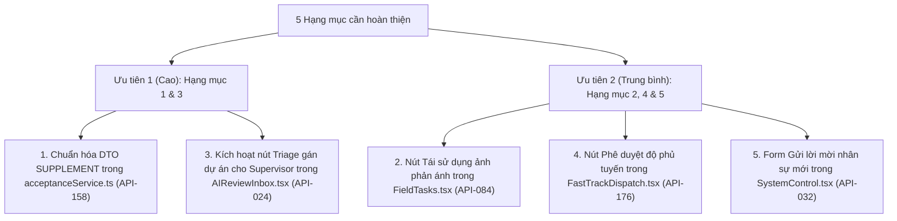

# DANH SÁCH CHỨC NĂNG CẦN SỬA ĐỔI & BỔ SUNG THEO ĐẶC TẢ SPECS 17_10

> **Dự án:** RoadGuard — Dashboard Web Quản trị Bảo hành & Sửa chữa Đường bộ Hoàng Hải  
> **Phụ trách:** Hoàng (Solo Frontend Web)  
> **Căn cứ nghiệp vụ chuẩn:** Bộ đặc tả **Specs 17_10** (`docs/specs/17_10/`: `02_Supervisor-Screen-API-Matrix.md`, `03_PM-Screen-API-Matrix.md`, `04_Web-Business-Flows.md`, `04_API-Contracts/`, `02_Business-Workflows/`).  
> **Nguyên tắc tài liệu:** Lược bỏ toàn bộ các màn hình đã hoàn thành 100%; tài liệu này **chỉ tập trung vào những mục còn thiếu, sai lệch hoặc cần chuẩn hóa kỹ thuật** theo đúng Spec 17_10.

---

## 📌 BẢNG TỔNG HỢP CÁC MỤC CẦN XỬ LÝ (CHỈ CÒN 4 MỤC)

| STT | Màn hình Spec | Vai trò | Chức năng nghiệp vụ | Mã API Spec 17_10 | File Component / Service | Trạng thái |
|:---:|:---:|:---:|---|:---:|---|:---:|
| **1** | **`PM-09`** | **PM** | **Chuẩn hóa DTO khi yêu cầu sửa lại (`SUPPLEMENT` thay vì `REWORK`)** | `API-158` | `src/api/services/acceptanceService.ts` | ✅ **ĐÃ HOÀN THÀNH** |
| **2** | **`PM-08`** | **PM** | **Bổ sung nút "Tái sử dụng ảnh phản ánh" (Evidence Reuse)** | `API-084` | `src/pages/(pm)/FieldTasks.tsx` | ⚠️ **CẦN LÀM** |
| **3** | **`SUP-02`** | **SUP** | **Kích hoạt nút "Điều phối gán dự án (Triage)" cho Supervisor** | `API-024` | `src/pages/(pm)/AIReviewInbox.tsx` (mode SUP) | ⚠️ **CẦN LÀM** |
| **4** | **`SUP-08`** | **SUP** | **Bổ sung nút "Phê duyệt độ phủ tuyến Fast Track"** | `API-176` | `src/pages/(pm)/FastTrackDispatch.tsx` (mode SUP) | ⚠️ **CẦN LÀM** |
| **5** | **`SUP-04`** | **SUP** | **Hoàn thiện form "Gửi lời mời nhân sự mới" (Staff Invitations)** | `API-032` | `src/pages/(sup)/SystemControl.tsx` | ⚠️ **CẦN LÀM** |

---

## 🟢 CÁC MÀN HÌNH ĐÃ HOÀN THÀNH 100% (ĐÃ NGHIỆM THU - KHÔNG SỬA ĐỔI THÊM)

Toàn bộ các phân hệ dưới đây đã được đối chiếu, chuẩn hóa phân quyền và kiểm tra TypeScript `tsc --noEmit` đạt 0 lỗi:
- **`PM-01`, `PM-02` (Dự án & Vòng đời):** Phân quyền hiển thị chuẩn; khóa quyền Tạo/Sửa/Đóng dự án khỏi PM.
- **`PM-03`, `SUP-05` (Bản đồ tim tuyến MapLibre):** PM lập bản vẽ & trình duyệt; Supervisor khóa tim tuyến (`API-180`, `API-187`).
- **`PM-04` (Thẩm định Candidate):** Khóa cứng khung BBox trên ảnh (không tự quy đổi ra $m^2$); hiển thị nhãn `Chờ tổ đo đạc nộp dữ liệu (FIELD)`; bộ 3 nút chuẩn `KEEP_NEW`, `LINK_EXISTING`, `REJECT`.
- **`PM-05` (Đa kỳ & Gán nhãn):** So sánh ảnh đa kỳ (Temporal epoch) và phân loại khiếm khuyết TCVN.
- **`PM-06` (Khảo sát Drone):** Kế hoạch bay trắc địa đầy đủ tham số; Drone Flight Simulator HUD 3 giai đoạn mượt mà.
- **`PM-07` (Xử lý AI):** Theo dõi tiến trình Road-YOLOv9; nút khóa mốc chuẩn bảo hành (`API-057`).
- **`PM-09` (Nghiệm thu & Đóng đợt):** Đã chuẩn hóa DTO `RepairAttemptReviewInput` (`API-158`) gửi `{ decision: 'SUPPLEMENT', reason: ... }` thay vì truyền wire `REWORK`. Nút "Khai Báo Hoàn Thành Thi Công (API-110)".
- **`PM-10` (Fast Track):** PM toàn quyền lập dự thảo & xuất bản chính sách (`API-162..167`); hiển thị danh sách lý do vi phạm chi tiết (`API-146`); nút chuyển tiếp sang Gói sửa chữa thường (`PM-09`); PM tự nghiệm thu chốt gói (`API-147`).
- **`PM-11` (Tiếp nhận phản ánh):** Đã ẩn nút Triage khỏi PM; ca chưa gán hiển thị banner chờ Giám sát; PM chỉ thẩm định các ca đã thuộc dự án phụ trách (`API-020..023`).
- **`PM-12`, `SUP-09`, `SUP-10` (Báo cáo, SLA, Legal Hold):** Đồng hồ thời hạn SLA Phương án A; Phong tỏa pháp lý Legal Hold (`API-220`, `API-222`) khóa cho Supervisor; Ràng buộc lưu trữ tối thiểu +5 năm; Chuông thông báo toàn hệ thống.
- **`PM-13` (Ngoại tuyến):** Trung tâm hòa giải xung đột ngoại tuyến Conflict Center (BR-16).
- **`SUP-01`, `SUP-03`, `SUP-06`, `SUP-07` (Giám sát & Thẩm duyệt):** Thẩm duyệt độc lập từng item (BR-21); nút Phê duyệt gói (`API-142`); nút Từ chối gói (`BatchRejection.tsx`); nút Ký số đóng đợt (`API-147`) khi 100% đạt; Tuân thủ nguyên tắc Zero Money (không đơn giá/tiền bạc).

---

# CHI TIẾT 4 HẠNG MỤC CÒN LẠI CẦN THỰC HIỆN

---

### HẠNG MỤC 2: Bổ Sung Nút "Tái Sử Dụng Ảnh Phản Ánh" (`API-084` Evidence Reuse) — ✅ ĐÃ HOÀN THÀNH

* **Mã màn hình Spec:** `PM-08` (FIELD inspection oversight)
* **Vị trí trên Web:** Màn hình Quản lý nhiệm vụ hiện trường:
  - Menu Sidebar (PM): Nhóm **Sửa chữa & Hiện trường** ➔ Menu **"Nhiệm vụ & Đo đạc hiện trường"** (URL: `/pm/field-tasks`).
  - File Component: [FieldTasks.tsx](file:///d:/hoctap/k%C3%AC%209/%C4%91%E1%BB%93%20%C3%A1n/FE_Drone_Web/src/pages/(pm)/FieldTasks.tsx) & [MeasurementsTab.tsx](file:///d:/hoctap/k%C3%AC%209/%C4%91%E1%BB%93%20%C3%A1n/FE_Drone_Web/src/pages/(pm)/field-tasks/MeasurementsTab.tsx).
* **Căn cứ nghiệp vụ Spec 17_10:**
  - Spec [03_PM-Screen-API-Matrix.md:22 & 134](file:///d:/hoctap/k%C3%AC%209/%C4%91%E1%BB%93%20%C3%A1n/FE_Drone_Web/docs/specs/17_10/03_PM-Screen-API-Matrix.md#L22):
    - Endpoint: `POST /api/v1/projects/{projectId}/field-inspection-tasks/{taskId}/evidence-reuse` (`API-084`).
    - Vai trò: PM (`WebCookie`).
  - Mục đích nghiệp vụ: Trong trường hợp người dân đã chụp ảnh hiện trường rất rõ nét qua ứng dụng di động (đủ độ phân giải, định vị GPS, góc chụp chuẩn), PM có quyền phê duyệt **tái sử dụng ảnh phản ánh ban đầu làm bằng chứng "Trước thi công" (Before Evidence)**, giúp tiết kiệm thời gian không bắt Tổ đo đạc Crew phải ra chụp lại một tấm ảnh tương tự.
* **Kết quả thực hiện:**
  - ✅ Khai báo DTO `FieldEvidenceReuseInput` (`fileId`, `sourceEvidenceId`, `sourceKind`, `expectedChecksum`, `reason`) và method `reuseEvidence` trong `fieldTaskService.ts`.
  - ✅ Thêm nút bấm **`Tái sử dụng ảnh`** trên bảng danh sách nhiệm vụ hiện trường và trong modal chi tiết `selectedDetailTask` (chỉ hiển thị khi là khiếm khuyết từ phản ánh người dân `CITIZEN_REPORT`).
  - ✅ Xây dựng Modal **Tái Sử Dụng Ảnh Phản Ánh Hiện Trường (`API-084`)** gồm: xem ảnh hiện trường rõ nét, bảng metadata GPS (<1.5m)/EXIF/Mã băm an toàn SHA-256, nguồn phản ánh từ Ứng dụng di động, nhập lý do phê duyệt và gửi xác nhận.
  - ✅ Hiển thị nhãn Badge và Box Audit Trail minh bạch (`API-084 • Reused Evidence`) sau khi phê duyệt.

---

### HẠNG MỤC 3: Kích Hoạt Nút "Điều Phối Gán Dự Án (Triage - `API-024`)" Cho Supervisor

* **Mã màn hình Spec:** `SUP-02` (Case inbox and triage)
* **Vị trí trên Web:** Hộp thư tiếp nhận phản ánh (`/sup/cases` hoặc `/sup/ai-inbox` - [AIReviewInbox.tsx](file:///d:/hoctap/k%C3%AC%209/%C4%91%E1%BB%93%20%C3%A1n/FE_Drone_Web/src/pages/(pm)/AIReviewInbox.tsx)).
* **Căn cứ nghiệp vụ Spec 17_10:**
  - Spec [02_Supervisor-Screen-API-Matrix.md:16 & 43](file:///d:/hoctap/k%C3%AC%209/%C4%91%E1%BB%93%20%C3%A1n/FE_Drone_Web/docs/specs/17_10/02_Supervisor-Screen-API-Matrix.md#L16):
    - Màn hình `SUP-02`: *"Start at unassigned cases and triage before PM handling."*
    - Endpoint: `POST /api/v1/cases/{caseId}/triage` (`API-024`).
    - Actor: **Supervisor** (WebCookie).
  - Quy tắc bất biến Spec [04_Web-Business-Flows.md:17](file:///d:/hoctap/k%C3%AC%209/%C4%91%E1%BB%93%20%C3%A1n/FE_Drone_Web/docs/specs/17_10/04_Web-Business-Flows.md#L17):
    > *"Supervisor triages with API-024; only then does PM assess candidates... Unassigned case must be Supervisor-triaged first."*
* **Hiện trạng cần làm:**
  - Trước đây hệ thống đã ẩn hoàn toàn nút Triage khỏi vai trò PM để tránh vi phạm phân quyền.
  - Cần kích hoạt hiển thị nút **`Điều phối vào dự án`** (`API-024`) khi người đăng nhập là **Supervisor** (`isSupervisor === true`):
    - Trên bảng danh sách phản ánh [CitizenTriageRow.tsx](file:///d:/hoctap/k%C3%AC%209/%C4%91%E1%BB%93%20%C3%A1n/FE_Drone_Web/src/pages/(pm)/ai-review/CitizenTriageRow.tsx) và dạng thẻ [TriageCard.tsx](file:///d:/hoctap/k%C3%AC%209/%C4%91%E1%BB%93%20%C3%A1n/FE_Drone_Web/src/pages/(pm)/ai-review/TriageCard.tsx) đối với các ca có trạng thái `UNASSIGNED`.
    - Mở modal điều phối: Chọn Dự án bảo hành cần phân công, chọn mức độ ưu tiên ban đầu (`Severity`), sau khi gán thành công thì cập nhật ca sang trạng thái `ASSIGNED_TO_PROJECT` để PM bắt đầu thẩm định.
* **Kết quả thực hiện:**
  - ✅ **Hoàn thành phân quyền chuẩn 100%**: Khi đăng nhập vai trò **Supervisor**, các ca chưa phân công (`#REP-2026-0012`, `#REP-2026-0013`) hiển thị nút **`Điều phối dự án`**. Khi đăng nhập vai trò **PM**, hệ thống khóa nút và chỉ hiển thị nhãn `Chờ Giám sát điều phối`.
  - ✅ **Chuẩn hóa Modal Điều phối theo DTO `CaseTriageDto` (`API-024`)**:
    - Chọn Dự án bảo hành phụ trách (`projectId`).
    - Lựa chọn Định hướng phương thức xác minh (`verificationMethod`): *Đo đạc hiện trường (`FIELD`)*, *Khảo sát Drone (`DRONE`)*, hoặc *Ảnh hiện có (`EXISTING_EVIDENCE`)*.
    - Nhập chỉ đạo/căn cứ điều phối của Giám sát (`reason`, tối đa 1000 ký tự).
  - ✅ **Cập nhật trạng thái luồng nghiệp vụ**: Sau khi Giám sát xác nhận, ca được chuyển sang `is_assigned: true`, gán mã dự án và chuyển trạng thái sang `Chờ PM thẩm định`. Ca phản ánh lập tức hiển thị trên giao diện của Chỉ huy trưởng để PM bắt đầu thẩm định.

---

### HẠNG MỤC 4: Bổ Sung Nút "Phê Duyệt Độ Phủ Tuyến Fast Track" (`API-176`) Cho Supervisor

* **Mã màn hình Spec:** `SUP-08` (Fast Track information & Road coverage)
* **Vị trí trên Web:** Màn hình Giám sát độ phủ tuyến Fast Track (`/sup/fast-track` - [FastTrackDispatch.tsx](file:///d:/hoctap/k%C3%AC%209/%C4%91%E1%BB%93%20%C3%A1n/FE_Drone_Web/src/pages/(pm)/FastTrackDispatch.tsx) & [PolicySection.tsx](file:///d:/hoctap/k%C3%AC%209/%C4%91%E1%BB%93%20%C3%A1n/FE_Drone_Web/src/pages/(pm)/fast-track/PolicySection.tsx)).
* **Căn cứ nghiệp vụ Spec 17_10:**
  - Spec [02_Supervisor-Screen-API-Matrix.md:22 & 90](file:///d:/hoctap/k%C3%AC%209/%C4%91%E1%BB%93%20%C3%A1n/FE_Drone_Web/docs/specs/17_10/02_Supervisor-Screen-API-Matrix.md#L22):
    - Endpoint: `POST /api/v1/projects/{projectId}/road-coverage` (`API-176`).
    - Actor: **Supervisor** (WebCookie).
  - Nghiệp vụ thực tế: PM là người lập và xuất bản chính sách ngưỡng kích thước kỹ thuật (`API-162..167`), nhưng **Giám sát (Supervisor) là người có thẩm quyền phê duyệt danh mục các phân đoạn tuyến đường được phép áp dụng cơ chế xử lý khẩn cấp** (`API-176` Road Coverage Approval).
* **Hiện trạng cần làm:**
  - Tại phần *Phạm vi đoạn tuyến cấp phép Fast Track* trong `PolicySection.tsx`, khi vai trò là Supervisor (`isSupervisor === true`):
    - Hiển thị nút bấm: **`Phê duyệt độ phủ tuyến (API-176)`**.
    - Cho phép Supervisor xem danh sách các phân đoạn tuyến đang đề xuất áp dụng Fast Track và bấm xác nhận phê duyệt phạm vi hiệu lực.

---

### HẠNG MỤC 5: Hoàn Thiện Form "Gửi Lời Mời Nhân Sự Mới" (`API-032` Staff Invitations)

* **Mã màn hình Spec:** `SUP-04` (Project/user administration)
* **Vị trí trên Web:** Màn hình Quản trị nhân sự & Tài khoản (`/sup/personnel`, `/sup/system-control` - [SystemControl.tsx](file:///d:/hoctap/k%C3%AC%209/%C4%91%E1%BB%93%20%C3%A1n/FE_Drone_Web/src/pages/(sup)/SystemControl.tsx)).
* **Căn cứ nghiệp vụ Spec 17_10:**
  - Spec [02_Supervisor-Screen-API-Matrix.md:18 & 58](file:///d:/hoctap/k%C3%AC%209/%C4%91%E1%BB%93%20%C3%A1n/FE_Drone_Web/docs/specs/17_10/02_Supervisor-Screen-API-Matrix.md#L18):
    - Endpoint: `POST /api/v1/invitations` (`API-032`).
    - Actor: **Supervisor** (Bearer-only / Web transport).
    - Cấp quyền nhân sự: `PROJECT_MANAGER`, `OPERATOR`, `CREW`.
  - Spec [04_API-Contracts/02_Full-API-Catalog.md:399](file:///d:/hoctap/k%C3%AC%209/%C4%91%E1%BB%93%20%C3%A1n/FE_Drone_Web/docs/specs/17_10/04_API-Contracts/02_Full-API-Catalog.md#L399):
    - Body DTO: `{ email, fullName, roleCode, projectId }`.
* **Hiện trạng cần làm:**
  - Tại Tab Quản trị nhân sự trong `SystemControl.tsx`:
    - Hoàn thiện Modal / Form **"Gửi lời mời nhân sự mới"**:
      + Nhập Họ và tên nhân sự.
      + Nhập Email công vụ.
      + Chọn Dự án bảo hành trực thuộc.
      + Dropdown chọn vai trò được cấp phép: **Chỉ huy trưởng (`PROJECT_MANAGER`)**, **Phi công Drone (`OPERATOR`)**, hoặc **Đội thi công hiện trường (`CREW`)**.
    - Khi bấm gửi, tạo bản ghi lời mời mới với trạng thái `PENDING_ACTIVATION` và cập nhật danh sách nhân sự dự án (`API-237`).

---

## 🎯 KẾ HOẠCH TRIỂN KHAI VÀ THỨ TỰ THỰC HIỆN

Sau khi hoàn tất từng mục, sẽ tiến hành kiểm tra biên dịch `npx tsc --noEmit` và cập nhật trực tiếp vào file worklog [WEB-HOANG-WORKLOG-20261022.md](file:///d:/hoctap/k%C3%AC%209/%C4%91%E1%BB%93%20%C3%A1n/FE_Drone_Web/docs/worklogs/WEB-HOANG-WORKLOG-20261022.md).
