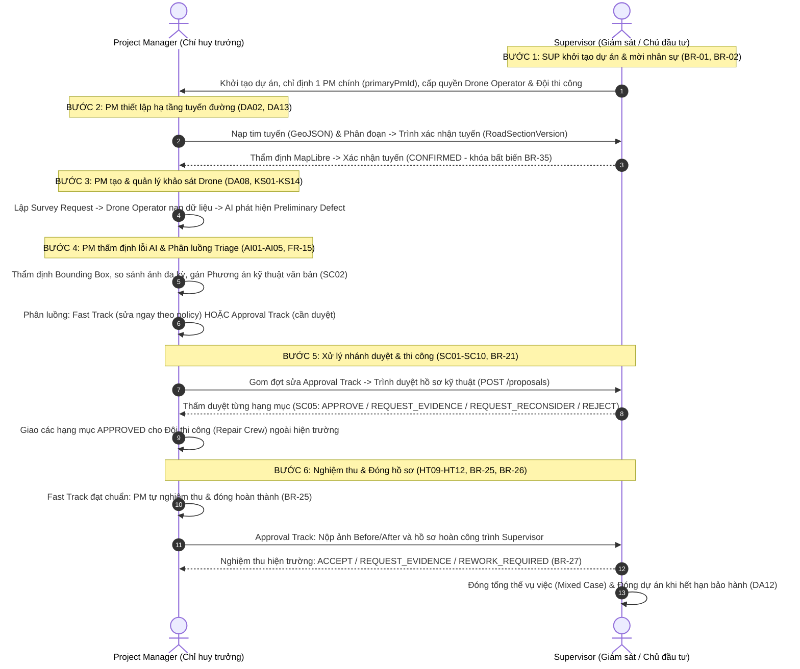

# KỊCH BẢN KIỂM THỬ TỪNG BƯỚC CHO ROLE PM VÀ SUPERVISOR (END-TO-END WALKTHROUGH)
> **Dự án:** RoadGuard — Hệ thống Quản lý Bảo hành & Sửa chữa Hạ tầng Giao thông (Nhà thầu Hoàng Hải)  
> **Căn cứ chuẩn:** `docs/specs/29_9` (`operation_catalog.md`, `01_FRD_SRS.md`, `02_Business_Rules.md`, `04_Use_Cases.md`, `api.types.ts`, `06_Report_Analytics_Requirements.md`)  
> **Quy tắc bất biến:** Quản lý khối lượng kỹ thuật hình học thuần túy ($m^2, m, cm, mm$), Zero Money (hoàn toàn không có bảng giá/BOQ tài chính). Không bịa đặt tiêu chuẩn hay ký số ngoài đặc tả.

---

## 🧭 TỔNG QUAN LUỒNG TÁC NGHIỆP LIÊN VAI TRÒ

---

# PHẦN 1: KỊCH BẢN KIỂM THỬ CHI TIẾT DÀNH CHO ROLE PM (PROJECT MANAGER)

Đăng nhập tài khoản PM: `pm@hoanghai.vn` / `RoadGuard@2026`  
(URL: `/login` $\rightarrow$ Redirect về `/pm/dashboard`)

---

### BƯỚC PM-01: Kiểm tra Dashboard Chỉ huy & Lối tắt (BC02)
- **Đường dẫn URL:** `/pm/dashboard`
- **Mục tiêu:** Nắm bắt tổng thể khối lượng khiếm khuyết cần xử lý, khảo sát đang chạy và các việc khẩn trong phạm vi dự án được phân công (BC02).
- **Thao tác kiểm tra trên màn hình:**
  1. [ ] Xem các thẻ KPI: Tổng số lỗi mới từ AI (`NEW`), số lỗi cần thẩm định, số đợt sửa đang trình duyệt.
  2. [ ] Bấm các nút lối tắt nhanh: "Tạo khảo sát bay", "Hộp thư AI", "Gom đợt sửa chữa".
  3. [ ] Kiểm tra danh sách "Việc cần xử lý ngay" (Pending Actions): hiển thị các công việc gán cho PM.
- **Tiêu chuẩn đạt (Expected):** Không có trường tiền tệ; số liệu nhảy mượt; click lối tắt chuyển đúng trang.

---

### BƯỚC PM-02: Thiết lập Tuyến đường, Tuyến nhánh & Phân đoạn (DA02, DA13, DA14, DA15, DA17)
- **Đường dẫn URL:** `/pm/projects/:id/alignment` (hoặc `/pm/alignment`)
- **Mục tiêu:** Nhập chuỗi tọa độ tim tuyến chính, khai báo mạng lưới tuyến nhánh nút giao / đường gom và phân chia phân đoạn kỹ thuật.
- **Thao tác kiểm tra trên màn hình:**
  1. [ ] **Tim tuyến chính:** Tải lên tệp mẫu GeoJSON hoặc dán chuỗi tọa độ GPS trên MapLibre. Cấu hình Lý trình gốc (`Km 1020+000`) và bề rộng mặt đường (8.0m hoặc 12.0m).
  2. [ ] **Tạo Tuyến nhánh (DA17):** Bấm `+ Tạo tuyến nhánh`. Nhập Tên nhánh (ví dụ: *Nhánh rẽ kết nối ĐT.725*), dán danh sách tọa độ GPS [Kinh độ, Vĩ độ] (hoặc bấm *"Nạp mẫu GPS"*). Hệ thống tự động nhận diện điểm rẽ từ trục chính (`BranchStationKm`: ví dụ `Km 1024+500`), tự tính chiều dài và bề rộng.
  3. [ ] **Phân chia Phân đoạn theo đối tượng:**
     - Chọn `[ Trục chính ]` $\rightarrow$ Nhập cự ly chia đoạn (500m, 1000m) $\rightarrow$ Bấm **"Áp dụng chia đoạn tự động"**.
     - Chọn `[ Tuyến nhánh ]` $\rightarrow$ Chia đoạn riêng cho tuyến nhánh. Kiểm tra các mốc lý trình phân đoạn (`Km 0+000`, `Km 0+500`) và dải polygon mặt đường phủ kín liên tục không bị đứt quãng.
  4. [ ] Bấm nút **"Trình duyệt tim tuyến"** (Gửi trọn gói cả Trục chính và Tuyến nhánh sang Supervisor thẩm duyệt).
- **Tiêu chuẩn đạt (Expected):** Bản đồ vẽ rõ tim trục chính và tuyến nhánh; phân đoạn phủ kín 100% không bị hở; gửi trình duyệt thành công.

---

### BƯỚC PM-03: Lập Yêu cầu Bay Khảo sát Drone (DA08, KS01, KS04)
- **Đường dẫn URL:** `/pm/surveys/create`
- **Mục tiêu:** Tạo phiếu giao nhiệm vụ bay quét cho Drone Operator, xác định rõ phạm vi Trục chính hoặc Tuyến nhánh (DA08, KS01).
- **Thao tác kiểm tra trên màn hình:**
  1. [ ] Chọn Dự án và chọn đối tượng tuyến bay:
     - Chọn `[Trục chính] QL1A` $\rightarrow$ kiểm tra lý trình tự động gán từ `Km 1020+000` đến `Km 1045+000`.
     - Chọn `[Tuyến nhánh] Nhánh rẽ Đèo Hải Vân` $\rightarrow$ kiểm tra bản đồ tự zoom đến nhánh rẽ, lý trình tự chuyển thành `Km 0+000` đến `Km 1+850` và vẽ dải hành lang bay riêng cho nhánh.
  2. [ ] Nhập thông số bay: độ cao an toàn (65m), độ phân giải GSD ($\le 1.5$ cm/px), độ phủ chồng ảnh (80%).
  3. [ ] Chọn Drone Operator được chỉ định bay từ danh sách nhân sự dự án (`primaryDroneOperatorId`).
  4. [ ] Bấm **"Tạo yêu cầu bay khảo sát"** (`createSurvey: POST /projects/{projectId}/surveys`).
- **Tiêu chuẩn đạt (Expected):** Chuyển hướng về `/pm/surveys`, nhiệm vụ mới hiển thị rõ tên tuyến/nhánh được chỉ định bay.

---

### BƯỚC PM-04: Quản lý Danh sách & Tiến độ Khảo sát (KS10, KS11, KS14)
- **Đường dẫn URL:** `/pm/surveys`
- **Mục tiêu:** Theo dõi tiến độ bay, trạng thái nạp dữ liệu và tiến trình AI Detect (KS10).
- **Thao tác kiểm tra trên màn hình:**
  1. [ ] Xem danh sách các đợt bay: Bộ lọc theo trạng thái (`SCHEDULED`, `PROCESSING`, `COMPLETED`).
  2. [ ] Mở chi tiết một đợt khảo sát: Xem thông số bay, ngày bay, tệp dữ liệu nạp lên.
  3. [ ] Kiểm tra trạng thái AI: Đã hoàn tất phân tích phát hiện hư hỏng mặt đường $\rightarrow$ Có nút bấm chuyển sang **"Xem lỗi phát hiện"**.
- **Tiêu chuẩn đạt (Expected):** Hiển thị rõ tiến trình từ bay $\rightarrow$ nạp dữ liệu $\rightarrow$ AI hoàn tất.

---

### BƯỚC PM-05: Tiếp nhận Hộp thư Lỗi AI & Phản ánh Người dân (AI01, AI04, PA03)
- **Đường dẫn URL:** `/pm/ai-inbox`
- **Mục tiêu:** Tiếp nhận và sàng lọc danh sách khiếm khuyết sơ bộ (Preliminary Defect) do AI phát hiện và phản ánh công dân gửi về.
- **Thao tác kiểm tra trên màn hình:**
  1. [ ] Xem danh sách bảng lỗi: Kiểm tra cột vị trí xem có hiển thị rõ ràng nhãn phân loại tuyến:
     - Hư hỏng trên trục chính: `[Trục chính] Km 1025+400 • Làn cơ giới`.
     - Hư hỏng trên đường nhánh: `[Nhánh Hải Vân] Km 0+350 • Làn rẽ phải`.
  2. [ ] Thử lọc theo phạm vi tuyến (Bộ lọc Tuyến chính / Tuyến nhánh) để kiểm tra danh sách lọc tương ứng.
  3. [ ] Tích chọn nhiều lỗi $\rightarrow$ Thao tác hàng loạt (Bulk Action): "Xác nhận hàng loạt" hoặc "Đánh dấu kiểm tra lại".
  4. [ ] Bấm vào một lỗi cụ thể để vào màn hình thẩm định chuyên sâu.
- **Tiêu chuẩn đạt (Expected):** Phân biệt chính xác hư hỏng nằm ở trục chính hay tuyến nhánh; tọa độ ghim trên bản đồ chuẩn xác.

---

### BƯỚC PM-06: Thẩm định Chi tiết Lỗi AI & Bounding Box (AI05, AI06)
- **Đường dẫn URL:** `/pm/defects/:id/verify-a`
- **Mục tiêu:** Xác minh hình ảnh, chỉnh sửa khung nhận diện bounding box, loại trừ nhận diện sai (False Positive).
- **Thao tác kiểm tra trên màn hình:**
  1. [ ] Xem ảnh cận cảnh Drone với khung Bounding Box của AI.
  2. [ ] Kéo chỉnh kích thước hộp bounding box hoặc vẽ lại nếu AI phát hiện lệch.
  3. [ ] Đổi loại khiếm khuyết (ví dụ từ Nứt dọc sang Nứt lưới/mai rùa) nếu AI nhận diện nhầm.
  4. [ ] Bấm **"Xác nhận lỗi (Confirm Defect)"** hoặc **"Bác bỏ lỗi AI (Reject False Positive)"**.
- **Tiêu chuẩn đạt (Expected):** Thao tác kéo thả mượt mà; bấm xác nhận chuyển trạng thái sang `CONFIRMED`.

---

### BƯỚC PM-07: So sánh Ảnh Đa kỳ Temporal Epoch (AI10, AI11)
- **Đường dẫn URL:** `/pm/defects/:id/verify-b`
- **Mục tiêu:** Đánh giá tốc độ phát triển suy thoái của vết nứt/ổ gà theo thời gian so với baseline và các kỳ khảo sát trước.
- **Thao tác kiểm tra trên màn hình:**
  1. [ ] Xem thanh trượt so sánh 2 ảnh: Ảnh kỳ bay trước (T-1) và Ảnh kỳ bay mới nhất (T).
  2. [ ] Kéo thanh trượt Split-screen (Side-by-side) để đối chiếu tốc độ mở rộng của vết nứt.
  3. [ ] Ghi chú đánh giá tốc độ hư hỏng (Tăng nhanh / Ổn định) làm căn cứ chọn phương án kỹ thuật.
- **Tiêu chuẩn đạt (Expected):** Hiển thị rõ ngày chụp 2 kỳ; thanh trượt so sánh hoạt động trực quan.

---

### BƯỚC PM-08: Gán Phương án Kỹ thuật & Phân luồng Triage (SC01, SC02, FR-15)
- **Đường dẫn URL:** `/pm/defects/:id` (hoặc modal trong màn hình thẩm định)
- **Mục tiêu:** Nhập phương án sửa chữa kỹ thuật dạng văn bản tổng quát (SC02: không lập dữ liệu tài chính, định mức hay vật liệu chi tiết) và phân luồng Fast Track / Approval Track.
- **Thao tác kiểm tra trên màn hình:**
  1. [ ] Nhập phương án xử lý kỹ thuật tổng quát dạng văn bản (SC02): ví dụ *"Trám vết nứt mặt đường"*, *"Cào bóc và bù phụ kết cấu mặt đường"* kèm kích thước hình học ($m^2, m, mm$) nếu có.
  2. [ ] Lựa chọn phân luồng xử lý (`TriageDecision` - FR-15, SC01):
     - **Fast Track (Sửa chữa nhanh/khẩn cấp):** Dành cho lỗi nhẹ đủ điều kiện theo FastTrackPolicy, PM tự quyết, tự giao nhiệm vụ đo-và-sửa và tự đóng hồ sơ (BR-25).
     - **Approval Track (Nhánh cần duyệt):** Hư hỏng kết cấu cần thẩm định, gom vào gói đề xuất trình Supervisor thẩm duyệt từng hạng mục (SC01, SC04, BR-21).
  3. [ ] Bấm **"Lưu phương án kỹ thuật & Phân luồng"**.
- **Tiêu chuẩn đạt (Expected):** Không có ô nhập giá tiền/đơn giá/vật tư chi tiết; phân luồng lưu đúng vào hồ sơ khiếm khuyết.

---

### BƯỚC PM-09: Quản lý & Thi công Nhánh Sửa chữa Nhanh Fast Track (TN01, TN05, BR-25)
- **Đường dẫn URL:** `/pm/fast-track` (hoặc tab Fast Track)
- **Mục tiêu:** PM tự chỉ đạo xử lý và nghiệm thu đóng các lỗi thông thường mà không cần chờ Chủ đầu tư (BR-25).
- **Thao tác kiểm tra trên màn hình:**
  1. [ ] Xem danh sách các hạng mục Fast Track đang chờ thi công.
  2. [ ] Chọn hạng mục $\rightarrow$ Phân công Đội thi công (Repair Crew) thực hiện nhiệm vụ đo-và-sửa.
  3. [ ] Khi đội thi công nộp ảnh hoàn thành $\rightarrow$ PM xem ảnh Before/After và bấm **"Đóng hoàn thành Fast Track"**.
- **Tiêu chuẩn đạt (Expected):** Hạng mục chuyển sang trạng thái `CLOSED`/`RESOLVED`; ghi nhận nhật ký đóng bởi PM; hệ thống phát thông báo giám sát đến Supervisor.

---

### BƯỚC PM-10: Gom Đợt Sửa chữa & Lập Hồ sơ Trình duyệt (SC01, SC03, SC04)
- **Đường dẫn URL:** `/pm/proposals` (hoặc `/pm/repair-batches/create`)
- **Mục tiêu:** Gom các lỗi thuộc nhánh Approval Track thành một đợt sửa chữa lớn để trình Giám sát.
- **Thao tác kiểm tra trên màn hình:**
  1. [ ] Bấm nút **"Tạo Đợt sửa chữa mới"**.
  2. [ ] Đặt tên đợt: ví dụ *"Đợt sửa chữa mặt đường Km1+200 - Km3+500 Quý 4"*.
  3. [ ] Chọn các khiếm khuyết thuộc nhánh Approval Track vào danh sách gom đợt: kiểm tra cột `Tuyến / Nhánh` để lọc đúng vị trí cần gom.
  4. [ ] Xem tổng hợp khối lượng kỹ thuật: Tổng diện tích cào bóc Trục chính ($\sum m^2$) và Tuyến nhánh ($\sum m^2$).
  5. [ ] Bấm nút CTA chính: **"Trình duyệt Đợt sửa chữa"** (`submitProposal: POST /proposals`).
- **Tiêu chuẩn đạt (Expected):** Đợt sửa chuyển sang trạng thái `PENDING_APPROVAL` (hoặc `SUBMITTED`); xuất hiện trong danh sách chờ duyệt; hoàn toàn không có bảng BOQ giá tiền.

---

### BƯỚC PM-11: Phân công Đội Thi công Ngoài Hiện trường (SC10, SC11)
- **Đường dẫn URL:** `/pm/repair-batches/assign` (hoặc nút Giao việc tại chi tiết đợt đã duyệt)
- **Mục tiêu:** Sau khi đợt sửa được Supervisor phê duyệt (`APPROVED`), PM giao việc cho đội thi công.
- **Thao tác kiểm tra trên màn hình:**
  1. [ ] Mở đợt sửa chữa có trạng thái `APPROVED` (hoặc danh sách item đã được duyệt).
  2. [ ] Chọn Đội thi công (Repair Crew) từ danh sách đội thuộc dự án.
  3. [ ] Đặt hạn hoàn thành (Deadline) và tải lên chỉ dẫn kỹ thuật/biện pháp an toàn.
  4. [ ] Bấm **"Giao việc cho Đội thi công"** (`assignCrew: POST /repairs/{repairId}/assign`).
- **Tiêu chuẩn đạt (Expected):** Trạng thái đợt sửa chuyển sang `ASSIGNED` $\rightarrow$ Đội thi công nhận nhiệm vụ trên Mobile.

---

### BƯỚC PM-12: Nhiệm vụ Đo đạc Hiện trường & Phân giải Xung đột Ngoại tuyến (TN01, TN06, BR-16)
- **Đường dẫn URL:** `/pm/field-tasks`
- **Mục tiêu:** Quản lý các phiếu yêu cầu đo đạc thước/laser bổ sung ngoài hiện trường khi ảnh Drone chưa đủ rõ, thẩm định số liệu nộp về; tiếp nhận và phân giải xung đột dữ liệu ngoại tuyến (Offline Sync Conflicts) theo BR-16.
- **Thao tác kiểm tra trên màn hình:**
  - **Phần A: Quản lý & Xác minh Nhiệm vụ Đo đạc (Tab 1):**
    1. [ ] Xem danh sách nhiệm vụ hiện trường (Field Tasks) theo các trạng thái (`Cần thực hiện`, `Đang đo đạc`, `Đã có số đo`, `Đã xác minh`).
    2. [ ] Bấm **"+ Tạo nhiệm vụ"**: Giao nhiệm vụ cho Repair Crew (chỉ định vị trí Km, làn đường, dụng cụ đo).
    3. [ ] Bấm xem chi tiết & ảnh đối chứng: Soi vạch thước, kiểm tra số mm đo được và EXIF GPS.
    4. [ ] Bấm **"Xác minh số liệu"**: Xác nhận số liệu hợp lệ để chuyển sang `VERIFIED` và cập nhật vào hồ sơ khiếm khuyết.
  - **Phần B: Phân giải Xung đột Ngoại tuyến Offline Sync (Tab 2 - BR-16):**
    1. [ ] Bấm chuyển sang Tab **"Xử lý xung đột ngoại tuyến"**.
    2. [ ] Xem danh sách các ca xung đột do kỹ sư hiện trường nộp lên khi có mạng trở lại.
    3. [ ] Lựa chọn quyết định giải quyết xung đột chuẩn xác theo từng loại nguyên nhân (BR-16):
       - **Đổi đội khi ngoại tuyến (`ASSIGNMENT_REASSIGNED`):** Chọn công nhận kết quả đội đo thực tế hoặc giữ nguyên đội được phân công lại.
       - **Lệch chính sách Fast Track (`POLICY_VERSION_MISMATCH`):** Đặc cách duyệt Fast Track hoặc chuyển sang Approval Track.
       - **Trùng lặp 2 thiết bị cùng nộp (`DUPLICATE_WORK_ATTEMPT`):** Chọn bản thiết bị chính xác hoặc hợp nhất thủ công.
       - **Cứu hộ thiết bị gặp sự cố (`DEVICE_RESCUE_PENDING`):** Bấm "Trình Giám sát duyệt cứu hộ".
       - **Hồ sơ đợt đã đóng băng APPROVED (`AGGREGATE_VERSION_CONFLICT`):** Tạo phụ lục đợt mới hoặc từ chối số liệu nộp muộn.
    4. [ ] Xác nhận giải quyết xung đột $\rightarrow$ Ca xung đột chuyển sang trạng thái phân giải tương ứng và ghi nhận mã băm SHA-256 vào Audit Log.
- **Tiêu chuẩn đạt (Expected):** Quản lý trạng thái phiếu đo đạc mượt mà; danh sách xung đột phân giải đúng thẩm quyền PM / Supervisor theo spec 29_9.

---

### BƯỚC PM-13: Hoàn tất & Trình Nghiệm thu Hạng mục (HT09, HT11, HT12, BR-25)
- **Đường dẫn URL:** `/pm/evidence-closeout` (hoặc `/pm/work-orders/:id/confirm`, `/pm/acceptance`)
- **Mục tiêu:** PM kiểm tra hồ sơ hoàn thành thi công do đội hiện trường gửi về (ảnh Before/After, số đo hình học, chứng từ hiện trường) và xử lý theo đúng phân luồng nghiệp vụ.
- **Thao tác kiểm tra trên màn hình:**
  1. [ ] Mở hạng mục thi công đã hoàn tất do đội hiện trường báo cáo.
  2. [ ] Kiểm tra tính toàn vẹn của cặp ảnh đối chứng: Ảnh hư hỏng ban đầu (Before) và Ảnh sau khi hoàn thiện (After) có tọa độ GPS/EXIF hợp lệ.
  3. [ ] Kiểm tra các tệp đính kèm: Biên bản hiện trường, kết quả kiểm tra chất lượng thi công.
  4. [ ] **Thực hiện xử lý theo đúng phân luồng nghiệp vụ:**
     - **Nhánh Duyệt thông thường (APPROVAL_TRACK - HT09, HT11):** Bấm **"Trình Giám sát nghiệm thu (Submit for Inspection)"** (`POST /repair-attempts/{attemptId}/review` với decision `ACCEPT`). Ca sửa chữa chuyển trạng thái sang `PENDING_INSPECTION`, chờ Supervisor nghiệm thu (`acceptApprovalAttempt: POST /repair-attempts/{attemptId}/acceptance`).
     - **Nhánh Cấp bách Fast Track (FAST_TRACK - BR-25, HT12):** Đối với các hư hỏng thuộc diện đặc cách khẩn cấp, PM tự kiểm tra bằng chứng đạt yêu cầu và bấm **"Đóng hoàn thành Fast Track (Close Fast Track)"**. Hạng mục chuyển thẳng sang trạng thái `RESOLVED` / `CLOSED`.
     - **Trường hợp thi công không đạt (HT10):** PM bấm **"Yêu cầu làm lại (Request Rework)"**, nhập lý do sai sót kỹ thuật để yêu cầu đội hiện trường khắc phục lại.
- **Tiêu chuẩn đạt (Expected):** Luồng duyệt `APPROVAL_TRACK` chuyển đúng trạng thái `PENDING_INSPECTION`; luồng `FAST_TRACK` đóng thẳng về `CLOSED`/`RESOLVED` theo đúng `BR-25`.

---

### BƯỚC PM-14: Báo cáo Phân tích & Chỉ số Rủi ro KPI (BC02, RPT-01, RPT-04, RPT-06)
- **Đường dẫn URL:** `/pm/reports` (hoặc `/pm/risk-analytics`)
- **Mục tiêu:** Theo dõi các chỉ số KPI vận hành, chất lượng bảo hành, tỷ lệ xử lý Fast Track và mô hình cảnh báo rủi ro suy thoái mặt đường trong phạm vi dự án của PM.
- **Thao tác kiểm tra trên màn hình:**
  1. [ ] Chọn dự án bảo hành và khoảng thời gian để lọc báo cáo.
  2. [ ] Kiểm tra biểu đồ chất lượng bảo hành công trình (`RPT-01`): Tỷ lệ nghiệm thu đạt ngay đợt đầu, tốc độ phát triển hư hỏng lún nứt.
  3. [ ] Kiểm tra báo cáo thống kê phân luồng xử lý (`RPT-04`): Tỷ lệ các ca xử lý Fast Track so với quy trình thẩm duyệt thông thường.
  4. [ ] Xem bản đồ nhiệt (Heatmap) và biểu đồ phân tích nguy cơ suy thoái mặt đường theo lý trình Km (`RPT-06`): Đánh giá các đoạn đường có chỉ số rủi ro cao để đưa vào kế hoạch bay khảo sát tiếp theo.
  5. [ ] Bấm nút **"Xuất báo cáo (Export)"** định dạng PDF phục vụ họp giao ban công trường.
- **Tiêu chuẩn đạt (Expected):** Dữ liệu phân tích hiển thị chính xác, biểu đồ trực quan, hỗ trợ kết xuất dữ liệu báo cáo đầy đủ theo phân quyền PM.

---

### BƯỚC PM-15: Thực nghiệm Đối soát Mô hình AI & Dữ liệu Thực địa (RS01 - RS06, RPT-09, FR-31, BR-44, MET-12)
- **Đường dẫn URL:** `/pm/research-validation` (hoặc `/pm/rpt-09`)
- **Mục tiêu:** Thực hiện quy trình đối soát khoa học độc lập (Research Validation Track) giữa số đo mô hình trích xuất từ Drone (Derived) với số đo thực địa đo bằng thước thẳng & thước đo sâu (Ground Truth) để đánh giá độ chính xác thuật toán.
- **Thao tác kiểm tra trên màn hình:**
  1. [ ] Kiểm tra thông tin phiên bản mô hình AI, tập dữ liệu thực nghiệm và phương pháp đo đối chứng (Thước thẳng và thước đo độ sâu thực địa theo `RS02`, `RS03`).
  2. [ ] Bấm **"Chạy Thẩm định Mới (Run Validation Job)"** (`FR-31`): Kích hoạt tác vụ nền bất đồng bộ (HTTP 202 Accepted) để tính toán ghép cặp mẫu đối soát (`RS04`).
  3. [ ] Kiểm tra bộ 4 thẻ chỉ số sai số kỹ thuật định lượng theo chuẩn `MET-12` (`RS05`):
     - Tỷ lệ mẫu hợp lệ (`used_count / sample_count`) và số lượng mẫu bị loại trừ (`excluded_count`).
     - Độ lệch hệ thống có dấu ($\text{Bias} = \sum e / N$ theo đơn vị $mm$).
     - Sai số tuyệt đối trung bình ($\text{MAE} = \sum |e| / N$ theo đơn vị $mm$).
     - Căn bậc hai sai số toàn phương ($\text{RMSE} = \sqrt{\sum e^2 / N}$ theo đơn vị $mm$).
  4. [ ] Kiểm tra Bảng danh sách các cặp mẫu đối soát (`Paired Ground Truth Samples` - `RS04`):
     - Bộ lọc phân loại mẫu: Tất cả / Hợp lệ (`INCLUDED`) / Bị loại (`EXCLUDED`) / Ngoại lai (`OUTLIER`).
     - Chi tiết từng mẫu (`sample_id` theo `RS01`): Loại hư hỏng, Lý trình Km, Số đo thực tế Ground Truth ($mm$), Số đo Drone AI Derived ($mm$), Sai số có dấu ($e = Derived - GroundTruth$).
  5. [ ] Kiểm tra Bảng Lịch sử các đợt chạy kiểm định (`Validation Runs` - `RS05`): Truy vết nguồn dữ liệu thực địa vs mock theo `BR-44`, phiên bản thuật toán, số lượng mẫu và các chỉ số sai số Bias / MAE / RMSE tương ứng.
  6. [ ] Bấm **"Xuất CSV Dữ Liệu Đối Soát"** (`RS06` / `RPT-09`): Tải về tệp chuẩn hóa phục vụ báo cáo khoa học và tinh chỉnh mô hình.
- **Tiêu chuẩn đạt (Expected):** Khởi tạo tác vụ kiểm định bất đồng bộ thành công, các chỉ số sai số hình học ($Bias$, $MAE$, $RMSE$) hiển thị chính xác theo đơn vị $mm$, phân biệt rõ ràng mẫu hợp lệ/bị loại theo `BR-44`.

---

### BƯỚC PM-16: Tra cứu Nhật ký Kiểm toán & Lịch sử Hoạt động (RPT-10, Durable Audit Trail)
- **Đường dẫn URL:** `/pm/audit-trail` (hoặc `/pm/rpt-10`)
- **Mục tiêu:** Kiểm tra dòng sự kiện bất biến (Durable Audit Trail) và truy vết toàn bộ thao tác nghiệp vụ trên hệ thống.
- **Thao tác kiểm tra trên màn hình:**
  1. [ ] Bộ lọc tìm kiếm: Lọc theo Khoảng thời gian, Vai trò tác nhân (Actor Role), Mã hồ sơ công trình hoặc Loại hành động (Khảo sát, Duyệt đợt, Giải quyết xung đột, Nghiệm thu).
  2. [ ] Xem danh sách các bản ghi sự kiện kiểm toán (`GET /audit-events`):
     - Thời gian ghi nhận (Timestamp).
     - Tác nhân thực hiện (Tên người dùng, vai trò PM / Sup / Drone Operator / Field Crew).
     - Mã thực thể liên quan (Survey ID, Batch ID, Incident ID, Conflict Case ID).
     - Chi tiết hành động và mã băm SHA-256 xác thực payload dữ liệu.
  3. [ ] Bấm xem chi tiết một sự kiện để đối chiếu tính toàn vẹn của chuỗi dữ liệu.
- **Tiêu chuẩn đạt (Expected):** Toàn bộ sự kiện hệ thống hiển thị đầy đủ, không cho phép chỉnh sửa hoặc xóa lịch sử, đảm bảo tuân thủ nguyên tắc kiểm toán độc lập.

---

### BƯỚC PM-17: Quản lý Vòng đời Dữ liệu & Đề xuất Hủy Hồ sơ Lưu trữ (BR-45, QT11, QT13)
- **Đường dẫn URL:** `/pm/retention` (hoặc `/pm/system-control`)
- **Mục tiêu:** Theo dõi thời hạn lưu trữ hồ sơ công trình (hết bảo hành + 5 năm) và lập đề xuất hủy dữ liệu khi đủ điều kiện theo quy định tại `BR-45` và `QT11`.
- **Thao tác kiểm tra trên màn hình:**
  1. [ ] Kiểm tra danh sách các gói hồ sơ công trình bảo hành kèm trạng thái lưu trữ và thời hạn pháp lý (Retention Policy).
  2. [ ] Kiểm tra điều kiện khóa pháp lý (Legal Hold): Các hồ sơ đang có tranh chấp hoặc thanh tra sẽ bị khóa cứng, không được phép đề xuất hủy.
  3. [ ] Đối với hồ sơ đã hết thời hạn bảo hành trên 5 năm và không có khóa pháp lý: Bấm **"Lập đề xuất hủy hồ sơ (Request Deletion)"** (`requestDeletion: POST /retention/deletion-requests`).
  4. [ ] Điền thông tin căn cứ pháp lý, đính kèm biên bản thanh lý hợp đồng bảo hành và bấm **"Gửi đề xuất sang Giám sát"**.
- **Tiêu chuẩn đạt (Expected):** Hệ thống tự động chặn mọi đề xuất hủy hồ sơ khi chưa đủ thời hạn 5 năm sau bảo hành hoặc đang có `Legal Hold`; đề xuất tạo thành công chuyển sang trạng thái chờ Giám sát phê duyệt (`PENDING_SUPERVISOR_APPROVAL`).

---

# PHẦN 2: KỊCH BẢN KIỂM THỬ CHI TIẾT DÀNH CHO ROLE SUPERVISOR (GIÁM SÁT / CHỦ ĐẦU TƯ)

Đăng nhập tài khoản Supervisor: `sup@hoanghai.vn` / `RoadGuard@2026`  
(URL: `/login` $\rightarrow$ Redirect về `/sup/dashboard`)

---

### BƯỚC SUP-01: Khởi tạo Dự án & Phân bổ Quyền Nhân sự (DA01, DA03, FR-04, BR-01, BR-02)
- **Đường dẫn URL:** `/sup/projects` $\rightarrow$ Bấm "Thêm mới dự án"
- **Mục tiêu:** Tạo mới hồ sơ quản lý bảo hành công trình và phân quyền nhân sự chủ chốt (chỉ Supervisor mới có quyền tạo dự án theo BR-01, FR-04, `createProject: POST /projects`).
- **Thao tác kiểm tra trên màn hình:**
  1. [ ] **Nhập thông tin dự án (`ProjectCreate`):** Tên dự án (`name`), Mã hợp đồng/dự án (`code`), Ngày nghiệm thu/bàn giao (`handoverDate`), Ngày hết hạn bảo hành (`warrantyEndDate`). Mảng tệp bàn giao (`handoverFileIds`) để trống hoặc chọn tệp nếu có.
  2. [ ] **Kiểm tra Validation logic (FR-04, api.types.ts):** Thử chọn ngày kết thúc bảo hành trước ngày bàn giao (`warrantyEndDate < handoverDate`) $\rightarrow$ Hệ thống bắt buộc hiển thị lỗi và chặn lưu (`warrantyEndDate >= handoverDate`).
  3. [ ] **Chỉ định PM chính (BR-01, DA03):** Bổ nhiệm đúng **1 PM chính** phụ trách dự án (`primaryPmId`). PM có thể quản lý nhiều dự án cùng lúc.
  4. [ ] Bấm **"Lưu & Khởi tạo dự án"** (`createProject: POST /projects` kèm Header `Idempotency-Key`).
  5. [ ] **Phân bổ quyền thành viên & Tổ đội (DA03, QT02):** Sau khi dự án khởi tạo thành công:
     - Phân bổ quyền thành viên cho Drone Operator (`setMembership: POST /projects/{projectId}/memberships`).
     - Khởi tạo tổ đội thi công cho dự án (`createCrew: POST /projects/{projectId}/crews`).
- **Tiêu chuẩn đạt (Expected):** Dự án mới hiển thị trong danh mục ở trạng thái `ACTIVE`; PM chính được phân quyền nhìn thấy dự án trong danh sách tác nghiệp; người ngoài dự án bị chặn quyền truy cập (BR-02).

---

### BƯỚC SUP-02: Thẩm định & Xác nhận Phiên bản Tuyến (DA13, FR-07, BR-35)
- **Đường dẫn URL:** `/sup/projects/:id/alignment` (hoặc `/sup/alignment`)
- **Mục tiêu:** Giám sát kiểm tra hình học tim tuyến, bề rộng và các tuyến nhánh do PM nạp lên trước khi khóa phiên bản vận hành bất biến.
- **Thao tác kiểm tra trên màn hình:**
  1. [ ] **Kiểm tra tim tuyến & bề rộng:** Xem tim tuyến dạng polyline (`centerline`), các khoảng biến thiên bề rộng mặt đường (`widthIntervals`), và hành lang khảo sát tổng thể (`surveyTotalWidthMeters`) trên bản đồ tương tác MapLibre.
  2. [ ] **Kiểm tra các tuyến nhánh (Branch):** Xem các tuyến nhánh rẽ, lý trình điểm rẽ, điểm nối và lý do kết nối (`connectionReason`).
  3. [ ] Bấm nút **"Xác nhận phiên bản tuyến (Confirm Route Version)"** (`confirmRoute: POST /route-versions/{routeVersionId}/confirm` kèm Header `Idempotency-Key, If-Match`).
- **Tiêu chuẩn đạt (Expected):** Toàn bộ phiên bản tuyến được khóa bất biến `RoadSectionVersion` ở trạng thái `CONFIRMED` (Read-only - FR-07); sau bước xác nhận này của Supervisor, PM mới bắt đầu được phép công bố phân đoạn (`SegmentSet`) và lập kế hoạch bay khảo sát (DA13, FR-08, BR-35).

---

### BƯỚC SUP-03: Thẩm duyệt Từng Hạng mục Đợt Sửa chữa (SC05, SC06, SC07, BR-21, BR-22)
- **Đường dẫn URL:** `/sup/proposals` $\rightarrow$ Bấm mở đợt sửa đang ở trạng thái `PENDING_APPROVAL` (hoặc `/sup/approvals/:id`)
- **Mục tiêu:** Thẩm duyệt từng hạng mục kỹ thuật trong đợt sửa do PM trình (tuân thủ SC02: Hoàn toàn không quản lý giá tiền, BOQ hay định mức tài chính).
- **Thao tác kiểm tra trên màn hình:**
  1. [ ] **Kiểm tra phương án kỹ thuật:** Xem danh sách hạng mục đề xuất: Vị trí Km, loại hư hỏng, mô tả giải pháp kỹ thuật dạng văn bản (xác nhận giao diện không chứa đơn giá, thành tiền hay dự toán tài chính theo SC02).
  2. [ ] **Thực hiện quyết định thẩm duyệt độc lập trên từng RepairItem (SC05, BR-21):**
     - **APPROVE (Phê duyệt):** Phê duyệt hạng mục đạt chuẩn kỹ thuật.
     - **REQUEST_EVIDENCE (Yêu cầu bổ sung bằng chứng):** Yêu cầu PM bổ sung thêm ảnh/số đo thực địa. *Bắt buộc nhập lý do giải trình.*
     - **REQUEST_RECONSIDER (Yêu cầu xem xét lại):** Đề nghị điều chỉnh lại phạm vi/phương án sửa. *Bắt buộc nhập lý do.*
     - **REJECT (Từ chối):** Từ chối phương án sửa đề xuất. *Bắt buộc nhập lý do.* (Theo BR-22: Giữ Defect chưa xử lý để PM lập đề xuất khác, không chuyển thành NO_DEFECT hay RESOLVED).
  3. [ ] Bấm nút ban hành: **"Ban hành Quyết định Thẩm duyệt"** (`decideRepairItem: POST /repair-items/{itemId}/decisions`).
- **Tiêu chuẩn đạt (Expected):**
  - Các hạng mục được `APPROVE` bị khóa Read-only và **được giải phóng để PM giao đội thi công ngay (SC10), không phải chờ đợi các hạng mục bị trả (BR-21)**.
  - Các hạng mục có yêu cầu sửa đổi/xem xét lại chuyển sang `REVISION_REQUIRED`, trả về cho PM lập phiên bản sửa đổi bổ sung (SC08, SC09).

---

### BƯỚC SUP-04: Thẩm định Bằng chứng & Nghiệm thu Kết quả Hiện trường (HT10, HT11, HT12, BR-27)
- **Đường dẫn URL:** `/sup/acceptance` (hoặc `/sup/acceptance/:batchId`, alias: `/sup/evidence-closeout`)
- **Mục tiêu:** Đối chứng ảnh thi công hoàn thành của nhánh duyệt `APPROVAL_TRACK` và ra quyết định nghiệm thu chất lượng (phân biệt thiếu bằng chứng với chất lượng chưa đạt theo BR-27).
- **Thao tác kiểm tra trên màn hình:**
  1. [ ] Mở hạng mục do PM đã kiểm tra và trình lên (chỉ áp dụng cho các hạng mục thuộc nhánh duyệt `APPROVAL_TRACK`; các mục Fast Track do PM tự nghiệm thu và đóng theo BR-25, Supervisor chỉ nhận báo cáo giám sát RPT-04).
  2. [ ] Kiểm tra cặp ảnh đối chứng Before/After, số đo và kết quả thi công thực tế tại hiện trường (HT10, BR-27).
  3. [ ] **Ra quyết định nghiệm thu theo chuẩn `ReviewAttempt` (`acceptApprovalAttempt: POST /repair-attempts/{attemptId}/acceptance`):**
     - **Lựa chọn 1: ACCEPT (Chấp thuận):** Kết quả thi công đạt yêu cầu chất lượng công trình $\rightarrow$ Hạng mục chuyển sang trạng thái `PASSED` (hoặc `ACCEPTED`).
     - **Lựa chọn 2: REQUEST_EVIDENCE (Yêu cầu bổ sung bằng chứng):** Yêu cầu bổ sung ảnh góc chụp rõ hơn/phiếu đo (chưa bắt cào bóc làm lại). *Bắt buộc nhập lý do.*
     - **Lựa chọn 3: REWORK_REQUIRED (Yêu cầu sửa lại):** Chất lượng thi công chưa đạt yêu cầu $\rightarrow$ Yêu cầu PM/Crew tổ chức thi công lại (HT10, HT13). *Bắt buộc nhập lý do.*
- **Tiêu chuẩn đạt (Expected):** Hạng mục chuyển sang trạng thái tương ứng; lưu đầy đủ nhật ký quyết định thẩm định của Supervisor (QT09).

---

### BƯỚC SUP-05: Đóng Tổng thể Vụ việc Hỗn hợp (Mixed Case Closeout) (HT12, BR-26, PA06, FR-23)
- **Đường dẫn URL:** `/sup/acceptance/:batchId` (nghiệm thu đợt) hoặc `/sup/cases/:caseId` (chi tiết vụ việc)
- **Thẩm quyền:** Duy nhất Giám sát trưởng (Supervisor / Chủ đầu tư).
- **Mục tiêu:** Đóng tổng thể hồ sơ vụ việc hỗn hợp khi 100% các nhánh xử lý con (Fast Track + Approval Track) đã hoàn tất nghiệm thu hợp lệ.
- **Thao tác kiểm tra trên màn hình:**
  1. [ ] Mở hồ sơ vụ việc hỗn hợp gồm đồng thời:
         - Các hạng mục nhánh Fast Track (do PM tự kiểm tra và đóng theo BR-25).
         - Các hạng mục nhánh Approval Track (do Supervisor thẩm định đối chứng ảnh Before/After theo BR-27).
  2. [ ] **Kiểm tra Gate điều kiện (BR-26, HT12):**
         - Nếu còn dù chỉ 1 hạng mục chưa đạt (đang ở trạng thái `REWORK_REQUIRED` phải thi công lại, hoặc `REQUEST_EVIDENCE` đang chờ bổ sung đo đạc) $\rightarrow$ Nút **"Đóng Tổng thể Vụ việc (Close Case)"** bị khóa mờ (`Disabled`).
         - Việc nhánh Fast Track đã xong không được làm đóng sớm toàn bộ vụ việc khi nhánh Approval Track chưa hoàn thành.
  3. [ ] **Thực hiện đóng tổng thể khi đủ điều kiện:**
         - Khi 100% hạng mục đều đạt chuẩn (`Fast Track = PASSED`, `Approval Track = ACCEPTED/PASSED`) $\rightarrow$ Nút đóng kích hoạt sáng.
         - Supervisor nhập ý kiến kết luận/lý do đóng và bấm **"Đóng Tổng thể Vụ việc (Close Case)"** (`closeMixedCase: POST /api/v1/cases/{caseId}/close`).
- **Tiêu chuẩn đạt (Expected):**
  - Trạng thái vụ việc chuyển sang `CLOSED` (Đóng băng hồ sơ, Read-only).
  - Tự động kích hoạt luồng công bố kết quả: PM chọn ảnh AFTER đạt chuẩn để công bố cho người dân/chủ phản ánh (`IncidentReport` $\rightarrow$ `REPAIRED` theo PA07, FR-25).
  - Ngăn chặn triệt để việc đóng sai sót khi chưa nghiệm thu hết các phần việc bắt buộc (BR-26).

---

### BƯỚC SUP-06: Giám sát Rủi ro, Xuất Hồ sơ Bằng chứng & Đóng Dự án (BC01, BC04, BC05, BC07, BC09, DA12, RPT-01, RPT-06, RPT-07)
- **Đường dẫn URL:** `/sup/risk-analytics` (hoặc `/sup/reports`), `/sup/projects`
- **Mục tiêu:** Giám sát chỉ số rủi ro suy thoái mặt đường, xuất gói hồ sơ bằng chứng kỹ thuật có mã băm toàn vẹn Checksum SHA-256 và đóng dự án khi hết hạn bảo hành.
- **Thao tác kiểm tra trên màn hình:**
  1. [ ] **Báo cáo Danh mục & Rủi ro Diễn biến (RPT-01, RPT-06, BC01, BC04, BC05):**
     - Xem tổng quan danh mục dự án bảo hành, số dự án theo trạng thái, dự án sắp đến hạn bảo hành (BC01).
     - Xem chỉ số hư hỏng theo mức độ nghiêm trọng/khẩn cấp, mức thay đổi so với khảo sát gốc baseline (BC04).
     - Sử dụng bộ lọc phân tích rủi ro và so sánh giữa các dự án khác nhau trong danh mục (BC05 - tính năng chỉ dành cho Supervisor).
  2. [ ] **Xuất Hồ sơ Bằng chứng Xác thực (RPT-07, BC07, BC09):**
     - Bấm nút **"Xuất Hồ sơ Bằng chứng"** (`createExport: POST /exports` kèm `ExportRequest`).
     - Tải về tệp PDF tổng hợp báo cáo kỹ thuật HOẶC Gói nén ZIP chứa toàn bộ ảnh gốc Before/After kèm mã Checksum SHA-256 xác thực toàn vẹn dữ liệu (BC09).
  3. [ ] **Đóng / Ngừng sử dụng Dự án khi hết bảo hành (DA12):**
     - Khi công trình hoàn thành toàn bộ thời gian bảo hành, Supervisor nhập lý do và bấm **"Đóng dự án"** (`closeProject: POST /projects/{projectId}/close`).
     - Dự án chuyển sang trạng thái `CLOSED`; toàn bộ hồ sơ được lưu trữ tối thiểu thời hạn bảo hành + 5 năm (QT13) và sẵn sàng tra cứu (BC10).
- **Tiêu chuẩn đạt (Expected):** Dự án chuyển sang `CLOSED`; tệp xuất có mã Checksum SHA-256 xác thực.

---

### BƯỚC SUP-07: Quản trị Hệ thống, Tài khoản & Kiểm toán (CN10, QT01, QT02, QT09, QT14)
- **Đường dẫn URL:** `/sup/settings` (hoặc `/sup/admin`, `/sup/audit`)
- **Mục tiêu:** Thực hiện quyền quản trị hệ thống, tài khoản nhân sự, tra cứu nhật ký kiểm toán và thiết lập giữ hồ sơ tranh chấp pháp lý.
- **Thao tác kiểm tra trên màn hình:**
  1. [ ] **Đặt lại mật khẩu tài khoản người dùng (CN10):**
     - Mở danh sách người dùng $\rightarrow$ Chọn tài khoản cần cấp lại mật khẩu.
     - Bấm **"Đặt lại mật khẩu"** (`adminResetPassword: POST /users/{userId}/password-reset`).
     - Hệ thống cấp mật khẩu tạm thời an toàn, ghi nhận cờ buộc đổi mật khẩu ở lần đăng nhập tiếp theo (`must_change_password: true`).
  2. [ ] **Khóa / Mở tài khoản nhân sự (QT01, QT02):**
     - Chuyển trạng thái tài khoản giữa `ACTIVE` và `SUSPENDED` (`updateAccount: PATCH /users/{userId}`).
     - Kiểm tra quy tắc an toàn: Tài khoản bị khóa sẽ bị thu hồi token ngay lập tức nhưng không làm mất lịch sử tác nghiệp đã lưu.
  3. [ ] **Tra cứu Nhật ký Kiểm toán (QT09):**
     - Mở trang tra cứu Audit Events (`listAuditEvents: GET /audit-events`).
     - Xem danh sách nhật ký chỉ đọc: Người thực hiện, thời điểm, hành động, dữ liệu trước/sau và nguyên nhân. Xác nhận không có chức năng sửa xóa nhật ký.
  4. [ ] **Thiết lập Giữ hồ sơ tranh chấp (Legal Hold) (QT14):**
     - Bật/tắt cờ Legal Hold cho dự án (`setLegalHold: PUT /projects/{projectId}/legal-hold`).
     - Xác nhận cơ chế bảo vệ: Khi dự án có cờ Legal Hold, hệ thống chặn toàn bộ yêu cầu xóa dữ liệu kể cả khi đã hết hạn lưu trữ (QT13, QT14).
- **Tiêu chuẩn đạt (Expected):** Mọi thao tác quản trị được lưu vết kiểm toán bất biến; quyền hạn được thi hành chính xác ở server-side.

---

# BẢNG TỔNG HỢP CHECKLIST KIỂM TRA NGHIỆM THU (24 BƯỚC CHI TIẾT)

| Mã bước | Tên bước kiểm tra | Role | Trạng thái hiển thị | Thao tác tương tác | Không dính giá tiền | Ghi chú kiểm thử theo Spec 29_9 |
|:---:|---|:---:|:---:|:---:|:---:|---|
| **PM-01** | Dashboard & Lối tắt | PM | [ ] Đạt / [ ] Chưa | [ ] Đạt / [ ] Chưa | [ ] Đạt | Kiểm tra 3 thẻ KPI & danh sách việc cần làm (BC02) |
| **PM-02** | Tuyến chính, Tuyến nhánh & Phân đoạn | PM | [ ] Đạt / [ ] Chưa | [ ] Đạt / [ ] Chưa | [ ] Đạt | Nhập tim tuyến, bề rộng và chia segment (DA02, DA13) |
| **PM-03** | Tạo yêu cầu bay (Chọn trục/nhánh) | PM | [ ] Đạt / [ ] Chưa | [ ] Đạt / [ ] Chưa | [ ] Đạt | Lập yêu cầu bay khảo sát (DA08, KS01) |
| **PM-04** | Theo dõi tiến độ khảo sát | PM | [ ] Đạt / [ ] Chưa | [ ] Đạt / [ ] Chưa | [ ] Đạt | Lọc trạng thái khảo sát bay (KS10) |
| **PM-05** | Hộp thư AI & Phản ánh (Lọc trục/nhánh) | PM | [ ] Đạt / [ ] Chưa | [ ] Đạt / [ ] Chưa | [ ] Đạt | Rà soát sơ bộ Preliminary Defect (AI01, AI04) |
| **PM-06** | Thẩm định Bounding Box | PM | [ ] Đạt / [ ] Chưa | [ ] Đạt / [ ] Chưa | [ ] Đạt | Hiệu chỉnh loại, khung bao, vị trí hư hỏng (AI05) |
| **PM-07** | So sánh ảnh đa kỳ | PM | [ ] Đạt / [ ] Chưa | [ ] Đạt / [ ] Chưa | [ ] Đạt | Đối chiếu ảnh với baseline và các kỳ trước (AI10, AI11) |
| **PM-08** | Gán phương án & Phân luồng | PM | [ ] Đạt / [ ] Chưa | [ ] Đạt / [ ] Chưa | [ ] Đạt | Phân loại Fast Track hoặc Approval Track (FR-15, SC01) |
| **PM-09** | Xử lý Fast Track | PM | [ ] Đạt / [ ] Chưa | [ ] Đạt / [ ] Chưa | [ ] Đạt | PM tự nghiệm thu và đóng lỗi nhẹ (BR-25) |
| **PM-10** | Gom đợt & Trình duyệt | PM | [ ] Đạt / [ ] Chưa | [ ] Đạt / [ ] Chưa | [ ] Đạt | Lập gói hồ sơ sửa chữa không chứa giá tiền (SC01-SC04) |
| **PM-11** | Giao việc đội thi công | PM | [ ] Đạt / [ ] Chưa | [ ] Đạt / [ ] Chưa | [ ] Đạt | Giao item APPROVED cho Crew thực hiện (SC10) |
| **PM-12** | Nhiệm vụ đo đạc bổ sung & Xung đột | PM | [ ] Đạt / [ ] Chưa | [ ] Đạt / [ ] Chưa | [ ] Đạt | Giao nhiệm vụ đo thực địa kiểm chứng & xử lý xung đột (TN01, BR-16) |
| **PM-13** | Trình hồ sơ nghiệm thu | PM | [ ] Đạt / [ ] Chưa | [ ] Đạt / [ ] Chưa | [ ] Đạt | Kiểm tra Before/After và trình Supervisor (HT09, HT11) |
| **PM-14** | Báo cáo Phân tích & Chỉ số KPI | PM | [ ] Đạt / [ ] Chưa | [ ] Đạt / [ ] Chưa | [ ] Đạt | Theo dõi KPI vận hành và nguy cơ suy thoái mặt đường (BC02, RPT-01) |
| **PM-15** | Đối soát Mô hình AI & Ground Truth | PM | [ ] Đạt / [ ] Chưa | [ ] Đạt / [ ] Chưa | [ ] Đạt | Tính toán Bias, MAE, RMSE theo mm và xuất CSV (RS01-RS06, BR-44) |
| **PM-16** | Tra cứu Nhật ký Kiểm toán | PM | [ ] Đạt / [ ] Chưa | [ ] Đạt / [ ] Chưa | [ ] Đạt | Truy vết dòng sự kiện Durable Audit Trail (GET /audit-events) |
| **PM-17** | Vòng đời Dữ liệu & Đề xuất Hủy | PM | [ ] Đạt / [ ] Chưa | [ ] Đạt / [ ] Chưa | [ ] Đạt | Đề xuất hủy hồ sơ hết hạn lưu trữ > 5 năm không có Legal Hold (BR-45) |
| **SUP-01** | Khởi tạo dự án & Phân bổ nhân sự | SUP | [ ] Đạt / [ ] Chưa | [ ] Đạt / [ ] Chưa | [ ] Đạt | Tạo dự án, chỉ định 1 PM chính, cấp quyền Crew (DA01, BR-01) |
| **SUP-02** | Thẩm định & Xác nhận tuyến | SUP | [ ] Đạt / [ ] Chưa | [ ] Đạt / [ ] Chưa | [ ] Đạt | Khóa bất biến RoadSectionVersion (DA13, FR-07, BR-35) |
| **SUP-03** | Thẩm duyệt 4 nhánh từng hạng mục | SUP | [ ] Đạt / [ ] Chưa | [ ] Đạt / [ ] Chưa | [ ] Đạt | Quyết định Approve/Evidence/Reconsider/Reject (SC05, BR-21) |
| **SUP-04** | Nghiệm thu Before/After | SUP | [ ] Đạt / [ ] Chưa | [ ] Đạt / [ ] Chưa | [ ] Đạt | Quyết định Accept/RequestEvidence/ReworkRequired (HT10, BR-27) |
| **SUP-05** | Đóng Mixed Case tổng thể | SUP | [ ] Đạt / [ ] Chưa | [ ] Đạt / [ ] Chưa | [ ] Đạt | Chặn đóng nếu còn hạng mục chưa đạt (HT12, BR-26) |
| **SUP-06** | Rủi ro, Xuất hồ sơ & Đóng dự án | SUP | [ ] Đạt / [ ] Chưa | [ ] Đạt / [ ] Chưa | [ ] Đạt | Phân tích rủi ro, xuất PDF/ZIP SHA-256, đóng dự án (BC01, DA12) |
| **SUP-07** | Quản trị tài khoản & Kiểm toán | SUP | [ ] Đạt / [ ] Chưa | [ ] Đạt / [ ] Chưa | [ ] Đạt | Đặt lại MK (CN10), khóa user (QT01), Audit (QT09), Legal Hold (QT14) |
