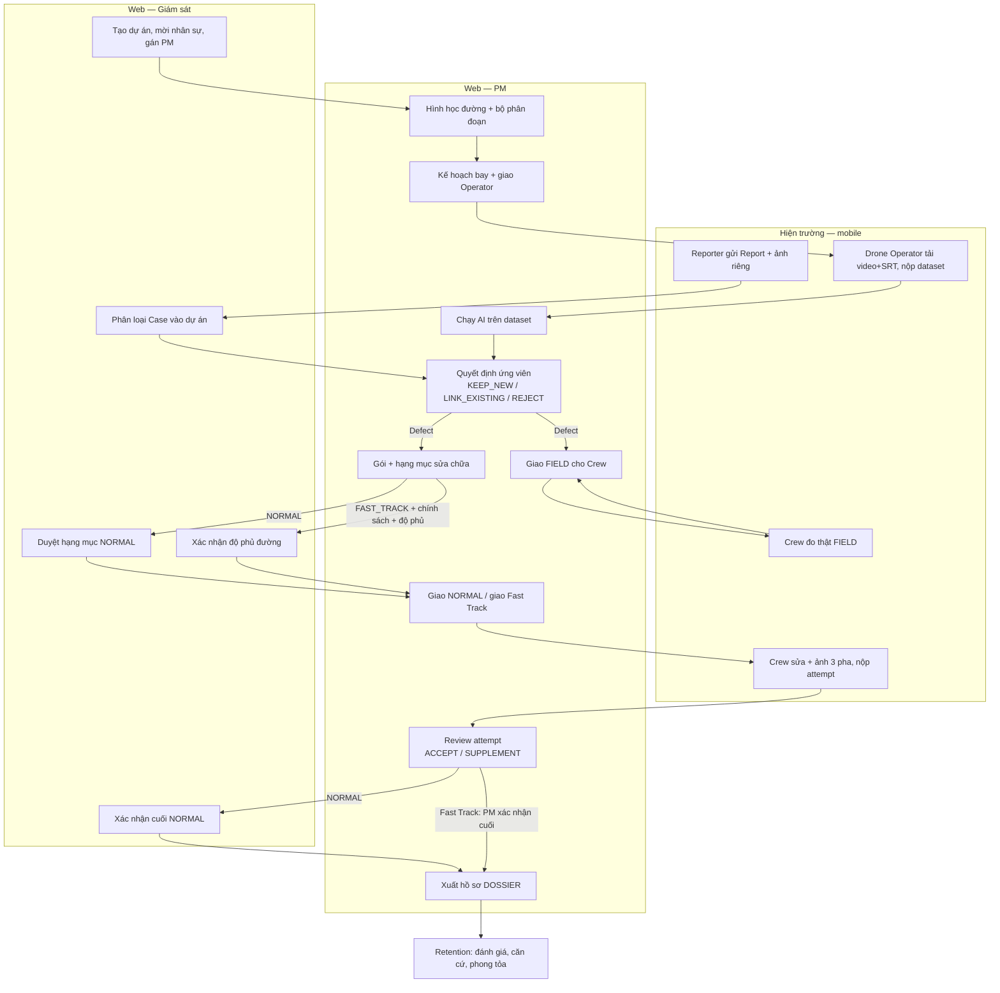

# 02 — Dataflow: dữ liệu đi qua hệ thống như thế nào

Quy ước đánh dấu: **[ĐÃ KIỂM]** = đã chạy thật bằng giao diện Web và đọc lại bằng GET (xem `NGHIEM-THU-THEO-LUONG.md`); **[CHƯA KIỂM]** = có trong tài liệu/BE nhưng chưa chạy; **[MOBILE]** = do ứng dụng di động thực hiện, Web chỉ đọc kết quả.
Mọi đường API bên dưới bắt đầu bằng `/api/v1`. Trong trình duyệt gọi qua proxy của Vite (`/api/v1/...` → `https://localhost:18443`).

## 0. Quy ước truyền tải (áp dụng cho MỌI lệnh ghi)
| Thành phần | Quy tắc |
|---|---|
| Phiên Web | `GET /auth/web/csrf` → `POST /auth/web/login` → `GET /auth/web/session`. Cookie `HttpOnly`; **không lưu token vào localStorage**. `POST /auth/web/renew` trả 401 khi chưa đăng nhập là **bình thường** |
| `X-CSRF-TOKEN` | Bắt buộc cho POST/PUT/PATCH/DELETE (client tự gắn trong `src/api/client.ts`) |
| `Idempotency-Key` | UUID cho mỗi **lệnh tạo/ghi**. Gửi lại **cùng key + cùng body** khi chưa rõ kết quả; khác body mà trùng key → 409 |
| `If-Match` | ETag có nháy kép (`"AAAAAAAAx2A="`) của tài nguyên có phiên bản. Lấy từ header `ETag` của GET trước đó. Thiếu → 428, cũ → 412/409 |
| Kết quả chưa rõ (mất mạng giữa chừng) | **Chỉ GET để đối chiếu**, không POST lệnh mới. FE giữ lại key/body/phiên bản trong `sessionStorage` (journal) |
| Lỗi | Dạng RFC 9457: `{status, code, detail, correlationId}`. UI phải hiện mã + `code`; ghi `correlationId` khi báo lỗi BE |

## 1. Đường chính (xuyên suốt từ báo cáo đến hồ sơ)



### Một "mẩu dữ liệu" đi qua hệ thống (ví dụ: một ổ gà)
| Bước | Thực thể sinh ra | Ai | Ghi chú |
|---|---|---|---|
| 1 | `Report` + ảnh VERIFIED (hoặc khung hình AI) | Reporter / AI | Ứng viên thô, **chưa** là khiếm khuyết |
| 2 | `IncidentCase` thuộc dự án | Giám sát phân loại | Chỉ cho Report; AI đi thẳng vào dự án qua dataset |
| 3 | `Candidate decision` → `Defect` (`OPEN`) | **PM** | Lưu bất biến nguồn + phiên bản + lý do |
| 4 | `FIELD task` → `Submission` → số đo thật | PM giao, Crew đo, PM review | UNKNOWN ≠ 0 |
| 5 | `Repair obligation` → `Repair package` → `Repair item` | PM (NORMAL cần Giám sát duyệt) | `mode` Normal hoặc FastTrack |
| 6 | `Task (NORMAL/FT)` + `Attempt` (ảnh 3 pha) | PM giao, Crew làm | Giao mới sinh task, đồng hồ 24h (FT) bắt đầu |
| 7 | `Review` → `Final confirmation` | PM, rồi Giám sát (Normal) hoặc PM (FT) | Defect → đã giải quyết |
| 8 | `Export (DOSSIER)` + `Retention evaluation` | PM / Giám sát | Hồ sơ + lưu trữ; hold chặn xóa |

## 2. Từng luồng chi tiết

### W01 — Tài khoản, lời mời, thành viên, tổ chức
- **Ai/Ở đâu:** Giám sát `/sup/personnel`; người nhận mời `/auth/setup-password?token=…`; hồ sơ `/pm/profile`, `/sup/profile`.
- **Chuỗi:**
  1. Giám sát: `POST /invitations` `{email, role, projectIds}` + `Idempotency-Key` → 201. BE gửi email (dev: **Mailpit** `http://localhost:18026`) có liên kết `…/auth/setup-password?token=<TOKEN>`.
  2. Người nhận (**chưa đăng nhập**): `POST /invitations/preview` `{invitationToken}` → `{role, projects[], expiresAt, inviterName}`. 404 `not_found` = sai/hết hạn/đã dùng/bị thu hồi → màn "Token đã vô hiệu hóa". *Preview không tiêu thụ lời mời.*
  3. `POST /invitations/accept` `{invitationToken, displayName, password}` + `Idempotency-Key` → 200 `{user:{id,role}}`. Lời mời **dùng một lần**. FE hiện `alert` rồi chuyển về `/login` (không tự đăng nhập).
  4. Đăng nhập. Vai Crew/Operator/Reporter **không dùng Web** (đăng nhập Web bị từ chối); PM/Giám sát vào được.
  5. Tổ chức: Giám sát `PUT /users/{id}/organization` (kèm lý do) → 200; Giám sát đọc `GET /users/{id}/organization`. **PM nhận 403** khi đọc của chính mình; PM chỉ thấy tổ chức đồng đội qua `member-contacts` (cần thuộc dự án).
- **Trạng thái:** lời mời `pending → accepted/expired`; tài khoản `ACTIVE/INACTIVE`; `must_change_password` → ép đổi mật khẩu.
- **Lỗi hay gặp:** link mời mở khi chưa đăng nhập mà trang báo "Máy chủ không trả…" → client chặn `/invitations/preview` (đã sửa, nằm trong danh sách yêu cầu ẩn danh ở `src/api/client.ts`).
- **[ĐÃ KIỂM]** gửi mời CREW và PM, preview, accept, PM đăng nhập Web, Giám sát lưu tổ chức.

### W02 — Dự án, hình học, vòng đời
- **Tạo dự án (Giám sát):** biên bản bàn giao là **bắt buộc**.
  `POST /projects/handover-upload-intents` → `POST /uploads/{id}/part-urls` → `PUT` lên URL ký sẵn (MinIO) → `POST /uploads/{id}/complete` → **poll đến `VERIFIED`** → `POST /projects` với `handoverFileIds:[fileId]` và `If-Match` = ETag của upload. Thiếu biên bản → 428 `handover_required`.
  Dự án có sẵn: `POST /uploads` (DOCUMENT) → `POST /projects/{p}/handover-documents`.
- **Hình học (PM, Giám sát xác nhận):** tuyến → phiên bản hình học → bộ phân đoạn → bố trí tấm. Dự thảo ≠ đã xác nhận; xuất bản cần phiên bản mới nhất. `GET /projects/{p}/geometry-package`, `GET /projects/{p}/road-sections/{rs}/versions/{v}/geometry`. **[CHƯA KIỂM chi tiết]**
- **Vòng đời:** `GET /projects/{p}/lifecycle` → `{constructionCompletion, operationalClosure, outstandingMandatoryObligationIds, transferableObligations, actions[], version, missingReasons}`. Lệnh ghi (đều `POST /projects/{p}/lifecycle/<lệnh>` + `Idempotency-Key` + `If-Match` = `version`):
  | Lệnh | Vai | Ý nghĩa |
  |---|---|---|
  | `construction-declarations` | PM | Khai báo hoàn thành thi công, kèm tệp minh chứng (chọn từ tệp dự án) |
  | `construction-confirmations` | Giám sát | Xác nhận khai báo (`sourceActionId`) → `constructionCompletion = CONFIRMED` |
  | `obligation-transfers` / `obligation-transfer-acceptances` | Giám sát (dự án gửi / dự án nhận) | Chuyển nghĩa vụ sang dự án khác, rồi tiếp nhận |
  | `defect-closures`, `operational-closures` | Giám sát | Đóng khiếm khuyết gốc / đóng vận hành dự án (BE còn có `POST …/lifecycle/renewed-handling-scope`) |
  | Ghi nhận tái phát | PM | Là một phần của `candidate-decisions` (`KEEP_NEW` + `recurrence`) |
- **Màn:** `/pm/projects/{id}`, `/sup/projects/{id}` (thẻ "Hoàn thành thi công", panel chuyển nghĩa vụ ở `/sup/proposals`).
- **Chú ý:** `actions[]` chứa các hành động; `history[]` hiện luôn rỗng (ghi cho BE). Xác nhận thi công **không hoàn tác**. Chuyển nghĩa vụ kéo cả gói sửa chữa sang dự án nhận nhưng BE để `projectId` cũ (lỗi BE #10).
- **[ĐÃ KIỂM]** khai báo → xác nhận → `CONFIRMED`; chuyển + tiếp nhận nghĩa vụ.

### W03 — Reporter và IncidentCase [MOBILE tạo, Web xử lý] [CHƯA KIỂM]
- Reporter (mobile): đăng ký email + OTP 6 số, tải ảnh riêng (multipart → VERIFIED), `POST /reports` (mô tả 1–1000 ký tự, vị trí GPS xác minh **hoặc** cờ "không chắc vị trí"; số 0 không phải "không biết vị trí"), bổ sung `POST /reports/{id}/supplements`.
- Giám sát: hàng đợi Case chưa gán → `POST /cases/{id}/triage` (chọn dự án/ưu tiên hoặc bác bỏ).
- PM: đọc `GET /cases/{id}/reports`; nối báo cáo trùng `POST /cases/{id}/report-links`, tách `report-splits`; kết luận `POST /cases/{id}/conclusions`; **công bố riêng** tới người nhận hợp lệ (không lộ ảnh người khác).
- Từ Report không có Survey/AI: nguồn vẫn là `REPORTER` (không bịa Survey).

### W04 — Thẩm định ứng viên → Defect
- **Ai/Màn:** PM `/pm/ai-inbox` (Hộp thẩm định), chi tiết `/pm/defects/{id}/verify`.
- **Chuỗi:**
  1. Danh sách ứng viên đến từ kết quả AI (`GET /projects/{p}/ai-mock-runs/{run}/result`) hoặc Report.
  2. Đọc ứng viên: `GET /projects/{p}/ai-candidates/{id}` — **hiện chỉ chấp nhận Bearer** (cookie Web nhận 401). FE chuyển sang đọc từ kết quả run và hiện cảnh báo "trạng thái thẩm định chưa đọc được".
  3. Quyết định: `POST /projects/{p}/candidate-decisions` `{decision: KEEP_NEW|LINK_EXISTING|REJECT, reason, …ghim phiên bản}` + `Idempotency-Key` → 201. LINK_EXISTING cần chọn khiếm khuyết đích.
  4. Đối chiếu: `GET /projects/{p}/candidate-decisions/{decisionId}` (loại, `defectId`, ETag).
- **Kết quả:** `KEEP_NEW` tạo `Defect` (`OPEN`); `LINK_EXISTING` gom vào Defect đích; `REJECT` không tạo gì. Quyết định bất biến, không sửa.
- **Chặn:** phiên bản Defect/target cũ, sai dự án, hình dạng quyết định không hỗ trợ → 4xx.
- **[ĐÃ KIỂM]** cả ba loại quyết định, đọc lại đúng.

### W05 — Khảo sát bằng drone và AI
- **Ai/Màn:** PM `/pm/surveys` (danh sách + "Xem chi tiết"), `/pm/surveys/create`, `/pm/surveys/{id}`; Operator [MOBILE].
- **Chuỗi:**
  1. PM lập kế hoạch: `POST /projects/{p}/road-sections/{rs}/survey-plans`, yêu cầu `survey-requests`; hoãn `POST /projects/{p}/survey-plans/{planId}/postpone`.
     **Trùng kế hoạch / 409:** BE mới trả `survey_active_plan_conflict` kèm `existingPlanId`/`existingPlanStatus` (khóa: dự án + tuyến + loại khảo sát, đang PLANNED/POSTPONED/IN_PROGRESS); FE hiện thông báo rõ và nút mở kế hoạch đó. Mã khác: `survey_source_scope_invalid`, `survey_plan_state_conflict`, `survey_task_plan_mismatch`, `duplicate_request` (cùng key khác nội dung). Sau 4xx dứt khoát form được giải phóng; "Hủy bỏ"/F5 đối chiếu bằng GET.
     **Đóng kế hoạch:** PM mở kế hoạch IN_PROGRESS, chọn bản nộp từng nhiệm vụ (gốc + bổ sung) trong thẻ "Xác nhận hoàn tất kế hoạch khảo sát"; `POST /survey-plans/{id}/complete {sources[],reason}` với `If-Match` = ETag kế hoạch. BE chặn bằng `survey_plan_completion_blocked` + `reasonCode` (ví dụ `plan_unhandled_task_branch`). Sau khi đóng, tạo được kế hoạch kỳ mới cùng tuyến/loại. **[ĐÃ KIỂM]**
     **Hiển thị:** danh sách và modal có nhãn KẾ HOẠCH / NHIỆM VỤ / Bổ sung, mã rút gọn `KH-…`/`NV-…`, lịch bay (kế hoạch) hoặc hạn (nhiệm vụ), Operator, phạm vi, và nút mở nhiệm vụ gốc–con. BE (develop_ABC) trả `surveyType`, FE hiện loại Cơ sở/Định kỳ/Đột xuất; UNKNOWN hiện "Chưa xác định".
  2. Giao Operator → nhiệm vụ `survey-tasks`: `GET/POST /projects/{p}/survey-tasks` (`status` `SUBMITTED` khi đã nộp); PM còn có `POST /survey-tasks/{id}/cancel|reassign|supplements`. Operator `accept|decline`, tải video+SRT, `POST /survey-tasks/{id}/datasets` [MOBILE]. Dataset phải **VERIFIED**; thiếu telemetry thì ghi `MISSING`.
  3. PM mở nhiệm vụ SUBMITTED → panel bộ dữ liệu (`SurveyDatasetPanel`): chọn bản nộp, phạm vi, **"Đọc phiên bản hình học và fixture"** (lấy `expectedGeometryVersion` từ BE), nhập mô hình/tiền xử lý/cấu hình/fixture.
  4. `POST /projects/{p}/ai-mock-runs` `{datasetId, scope, modelVersionId, preprocessingVersion, configVersion, fixtureVersion, stage, mode:MOCK}` → **202** `status QUEUED`.
  5. Poll `GET /projects/{p}/ai-mock-runs/{id}` → `SUCCEEDED` (`processingJobId`, `manifestHash`); kết quả `…/result`; danh sách job `GET /projects/{p}/processing-jobs`.
     **Theo dõi trên UI:** khung theo dõi dưới nút "Chạy AI mock" giữ lần chạy vừa tạo (đọc danh sách từ BE nên F5 vẫn thấy), tự đọc lại mỗi 3 giây đến khi kết thúc, hiện `errorCode` nếu FAILED, và phân biệt **runId** (`/ai-mock-runs/{id}`) với **processingJobId** (`/processing-jobs`). Khi SUCCEEDED, nút "Mở kết quả thẩm định" mở `/pm/surveys/{taskId}?run=…&dataset=…` chỉ với phát hiện của đúng lần chạy đó.
  6. **Hoàn tất nhiệm vụ (BE mới):** khi nhiệm vụ `SUBMITTED`, PM chọn bản nộp trong thẻ "Xác nhận hoàn tất nhiệm vụ khảo sát"; FE đọc `assessmentId` hiện hành từ `GET /datasets/{id}/coverage` (phương pháp `pm-evidence-review.v1`, mọi phân đoạn/dải PASS) rồi `POST /survey-tasks/{taskId}/complete` `{datasetId, assessmentId, reason}` với `If-Match` = ETag **nhiệm vụ** → 200, nhiệm vụ `COMPLETED`. Chỉ PM (Giám sát/Operator không được). *"Đã nộp", upload VERIFIED, AI SUCCEEDED đều không phải hoàn thành.* **[ĐÃ KIỂM]**
  7. Giao lại Operator (nhiệm vụ chưa nộp): danh sách loại Operator đang giữ nhiệm vụ; không còn Operator khác thì báo rõ và khóa xác nhận.
- **Giá trị dùng được trên môi trường seed:** model `72f84201-d033-4000-8000-000000000001`, tiền xử lý `fixture-preprocess.v1`, cấu hình `fixture-config.v1`, fixture `synthetic-road-v1` (lấy từ seed của BE). Các ô này nhập tay vì BE chưa có danh mục.
- **Lưu ý:** AI chỉ cho **ứng viên**; hộp khung và độ tin cậy không đổi thành kích thước thật.
- **[ĐÃ KIỂM]** tạo run → SUCCEEDED → có job + result.

### W06 — FIELD: đo thật ngoài hiện trường
- **Ai/Màn:** PM `/pm/field-tasks`; Crew [MOBILE].
- **Chuỗi:** PM `POST /projects/{p}/field-inspection-tasks` (`FieldTaskCreateInput`: `defectId`, `defectVersion`, `routeVersionId`, `segmentSetId`, `purpose` = `PRE_MEASUREMENT|POST_REPAIR|VERIFICATION`, `requiredMeasurementType` là **mã số 1–6** (1 DepressionDepth, 2 SlabFaultingHeight, 3 ShoulderErosionExtent, 4 Area, 5 DepressionLength, 6 DepressionWidth; không có API danh mục, FE khai báo cố định ở `src/api/services/fieldMeasurementTypes.ts`), `measurementScope` (chuỗi JSON, FE gửi `"{}"`), `instructions` (từ ô "Ghi chú chỉ dẫn"; không còn ô "Phương pháp & Thiết bị đo"), `assignedToUserId`, `dueAt`) → Crew accept/start/submit [MOBILE] (đo dài/rộng/sâu, ảnh có thước, **hash**) → PM `POST …/{taskId}/reviews` (ACCEPT / SUPPLEMENT…) theo bản mới nhất.
- **Lưu ý BE hiện tại:** tạo/giao với loại đo **5 hoặc 6 bị BE trả 500** (trigger SQL cũ chỉ cho 1–4, lỗi BE #11) dù hợp đồng nói 1–6.
- **Bất biến:** UNKNOWN ≠ 0; giữ nguyên người thực hiện ban đầu, thời điểm bắt đầu đầu tiên, đơn vị/phương pháp đo.
- **Điều kiện tạo:** Defect `OPEN`, nguồn và hình học hiện hành, Crew thuộc dự án. Nguồn Reporter giữ nguyên nguồn `REPORTER`.
- **[CHƯA KIỂM]** bước duyệt (cần Crew nộp). Việc giao FIELD kiểu NORMAL **[ĐÃ KIỂM]** gián tiếp ở W07.

### W07 — Sửa chữa NORMAL và nghiệm thu
- **Màn:** PM `/pm/proposals`, `/pm/proposals/{pkg}`, `/pm/repair-batches/assign`, `/pm/acceptance`, `/pm/evidence-closeout`; Giám sát `/sup/proposals`, `/sup/proposals/{pkg}`, `/sup/acceptance`.
- **Chuỗi và trạng thái hạng mục (`state`):**
  ```
  PM tạo gói + hạng mục (mode Normal)  ──►  AwaitingApproval
  Giám sát  POST …/items/{i}/approve   ──►  ReadyToAssign
  PM        POST …/items/{i}/assign    ──►  Assigned      (sinh FIELD task mode=NORMAL, status NewAssigned)
  Crew [MOBILE] execution-start/finish, attempts (ảnh Trước/Trong/Sau) ──► Submitted…
  PM        POST …/attempts/reviews   (ACCEPT | SUPPLEMENT)
  Giám sát  POST …/items/{i}/final-confirmation ──► hoàn tất
  ```
  `assign` gửi `{task: FieldTaskCreateInput, reason}` + `Idempotency-Key` + `If-Match` = ETag **hạng mục**. Màn giao việc cần chọn Crew, hạn chót, nguồn khiếm khuyết (`REPORTER` hay `SURVEY`) và chỉ dẫn an toàn.
- **Nguồn giao việc phải khớp BE:** `REPORTER` cần có liên kết KeepNew từ Report; `SURVEY` cần `surveyId` đúng chuỗi AI. Sai → 409 `source_not_ready`.
- **Xuất hồ sơ:** `POST /projects/{p}/exports` `{kind:'DOSSIER', format:'PDF', includeOriginalFiles:false, repairPackageIds|repairItemIds}` → **202** → poll `GET …/exports/{id}` đến `SUCCEEDED` → `…/manifest` → `…/content` (tải). **Chỉ PM** (Giám sát bị 403).
- **Giao việc từ danh sách gói:** hạng mục `ReadyToAssign` có nút "Giao việc" ở danh sách và modal, mở `/pm/repair-batches/assign` với hạng mục đã chọn sẵn. Modal chi tiết đọc `repairPlan` và `checklistVersion` từ `GET …/items/{i}`; nhãn tiến độ là "Quyết định phê duyệt", không phải tiến độ thi công. Form tạo gói chỉ có **một** ô "Phương án kỹ thuật sửa chữa" (`repairPlan`).
- **Chuyển nghĩa vụ:** xem W02.
- **[ĐÃ KIỂM]** Giám sát duyệt; PM giao (task NORMAL/REPORTER/PostRepair, hạng mục → `Assigned`); xuất hồ sơ gói; chuyển nghĩa vụ. **[MOBILE → CHƯA KIỂM]** thi công, review, xác nhận cuối, an toàn, sửa đổi, kế nhiệm, hủy, đóng khiếm khuyết.

### W08 — Fast Track (24 giờ)
- **Màn:** PM `/pm/fast-track` (chính sách + điều phối); Giám sát `/sup/fast-track` (chỉ xem, xác nhận độ phủ).
- **Chuỗi điều kiện (đều phải thỏa):**
  ```
  1. Tài liệu bàn giao (HANDOVER) hoặc căn cứ bảo hành đã có trong `road-coverage`
  2. Giám sát: POST …/road-coverage   (REAL_SOURCE | TEST_ONLY)    → độ phủ đã xác nhận
  3. PM: chính sách  POST …/repair-policies/drafts → PUT drafts/{id} → POST drafts/{id}/publish → REVISION
     (đọc: GET …/repair-policies, GET …/repair-policies/revisions/{id}; thu hồi: POST …/revisions/{id}/revoke)
  4. Gói + hạng mục mode FAST_TRACK
  5. PM: POST …/items/{i}/assign  {task, policyRevisionId, reason}  →  đồng hồ 24h bắt đầu, không reset
  6. Crew [MOBILE] làm trong 24h → PM review → PM xác nhận cuối (Giám sát chỉ nhận thông báo)
  ```
- **Nguồn giao việc (BE mới c0c99ca):** body `assign` gồm `task` (`FieldTaskCreateInput`) + `policyRevisionId` + `reason`. Nguồn **REPORTER**: `sourceKind:"REPORTER"`, `surveyId:null`, cần liên kết KeepNew của Report. Nguồn **SURVEY**: `sourceKind:"SURVEY"`, `surveyId` lấy từ `GET /datasets/{datasetId}` (trường `surveyId` thật; khác `id` dataset và `surveyTaskId`). `purpose:"POST_REPAIR"`, `requiredMeasurementType` là **số** (xem W06). Không cần nhiệm vụ FIELD giả. Response 201, ETag là phiên bản mới của hạng mục; `mode` trả `CONDITIONAL_FT`.
- **Assign thành công ≠ sẵn sàng thi công.** Crew còn phải accept/start FIELD, đánh giá và qua `…/items/{id}/eligibility` trước khi bắt đầu sửa; mapping độ phủ `TEST_ONLY` không cấp quyền thi công.
- **Sau chuyển nghĩa vụ A → B:** PM dự án nhận (B) tìm hạng mục qua `GET /projects/{B}/lifecycle` → `responsibilities[]` (`packageId`, `currentRepairItemId`) vì gói có thể không hiện trong danh sách gói của B; assign dưới URL B với ETag của `GET item` dưới B. Item giữ `projectId` gốc (A) làm provenance; Crew phải còn quyền ở dự án nguồn A; PM B hiện **không đọc được** defect/chính sách/Crew của A (lỗi BE #13) nên chưa tự giao được.
- **Không bypass guard**, không tạo nhiệm vụ giả. Chi tiết ở `docs/integration/fe-theo-be/E3-REPAIR-FASTTRACK-CHINHSUA-20261122.md`.
- **[ĐÃ KIỂM trên BE mới]** chính sách, độ phủ, hạng mục `ReadyToAssign`, giao Fast Track nguồn Reporter (201) và nguồn Survey (201). Chưa kiểm: giao ở dự án nhận sau chuyển (lỗi BE #13), thi công (mobile).

### W09 — Offline, thiết bị, bàn giao [MOBILE chủ yếu] [CHƯA KIỂM]
- Thiết bị đăng ký khóa công khai; Crew ký lô thao tác bằng ECDSA P-256; BE trả **biên nhận từng bản ghi** (`COMMITTED/REPLAYED/CONFLICT/STALE_SNAPSHOT`). HTTP 200 cả lô ≠ mọi bản ghi đã lưu.
- Web: `/pm/offline`, `/sup/offline` đọc danh sách thiết bị/lô/xung đột; Giám sát cấp quyền bàn giao có giới hạn; thu hồi thiết bị/grant. Chưa có dữ liệu thiết bị nên chưa chạy.

### W10 — Thông báo, xuất hồ sơ, lưu trữ, phong tỏa
- **Thông báo:** `GET /notifications`, `GET /notifications/{id}`, `POST /notifications/{id}/read`, `POST /notifications/read-batch`, ưu tiên (priority). *Đã đọc ≠ ACK.* **[CHƯA KIỂM — chưa có thông báo]**
- **Xuất hồ sơ:** như W07 (PM).
- **Lưu trữ (Giám sát, `/sup/retention`, `/sup/legal-hold`):**
  1. Mở dự án → đọc đánh giá gần nhất: `GET /projects/{p}/retention/evaluations` + `…/{id}` (mỗi tệp có `eligibility` và `reasonCodes`).
  2. **Chạy đánh giá mới:** `POST /projects/{p}/retention/evaluations` `{}` (hoặc `{fileIds}`) → **202** → poll `GET …/evaluations/{id}` đến `COMPLETE`.
  3. Căn cứ lưu trữ: `GET /projects/{p}/retention/files/{fileId}` (`inventoryComplete`, `applicableObligations`, `activeHoldCount`) → `PUT …/files/{fileId}/basis` (lý do bắt buộc). Hiện bị 409 `retention_inventory_incomplete` khi kiểm kê chưa đầy đủ.
  4. **Phong tỏa pháp lý:** `POST /retention/holds` (lý do, cơ quan, số văn bản) → 201; `GET /retention/holds/{id}`; gỡ `POST /retention/holds/{id}/release`. **Không có API liệt kê hold** → FE chỉ nhớ `holdId` trong `sessionStorage` của phiên; đóng trình duyệt là mất khả năng gỡ từ Web.
     Gỡ phong tỏa **bắt buộc có lý do** (`reason`); FE có ô "Lý do gỡ phong tỏa". **[ĐÃ KIỂM]** bật rồi gỡ, `activeHoldCount` về 0 (trong cùng phiên trình duyệt).
- **Giá trị eligibility gặp:** `WAITING_RETENTION_BASIS`, `BLOCKED_HOLD`. Có hold thì mọi tệp ra `BLOCKED_HOLD`.
- **[ĐÃ KIỂM]** chạy đánh giá (202 → COMPLETE), bật phong tỏa (201, `activeHoldCount=1`), xác nhận căn cứ (UI đúng, BE chặn 409).

## 3. Bảng trạng thái nhanh (giá trị đã quan sát)
| Đối tượng | Giá trị |
|---|---|
| Hạng mục sửa chữa `state` | `AwaitingApproval` (theo SRS, chưa tự quan sát) → `ReadyToAssign` → `Assigned` → …; `result` ban đầu `UNREPAIRED` |
| FIELD task | `mode` `NORMAL`/`MEASURE_ONLY`, `status` `NewAssigned`…, `purpose` `PostRepair`/`PreMeasurement`, `sourceKind` `REPORTER`/`SURVEY` |
| Survey task | `SUBMITTED` khi dataset đã nộp |
| AI run | `QUEUED` → `SUCCEEDED` (hoặc `FAILED`) |
| Export | `202` → `SUCCEEDED` (hoặc `FAILED`); `completeness` `PARTIAL` thì có `missingSections` |
| Retention evaluation | `COMPLETE`; eligibility `WAITING_RETENTION_BASIS`, `BLOCKED_HOLD` |
| Lifecycle | `constructionCompletion` `UNKNOWN` → `CONFIRMED`; `operationalClosure` `UNKNOWN` |
| Defect | `OPEN` … |
| Mã lỗi BE đã gặp | `source_not_ready`, `handover_required` (428), `retention_inventory_incomplete`, `access_forbidden`, `auth_session_revoked`, `not_found`, `duplicate_request`, `identity_email_conflict` |
